# ASWISS 실험: 누적 regret 라벨로 bucket 분할 (mini-stud)

2026-10-26 첫 실행. 이론은 [REGRET_SPACE_ABSTRACTION_KO.md](../REGRET_SPACE_ABSTRACTION_KO.md)의 식 (6) 기반 분할((B) 방식)이다.

## 무엇을 하는가

가장 거친 추상화에서 출발한다. time step마다 bucket 하나를 둔다. time step은 (좌석, street, 현재 street의 베팅 진행, 행동집합)이다. 카드와 이전 street 베팅은 구분하지 않는다. `small`에서는 bucket 40개가 된다.

학습은 다음 두 방식 중 하나다.

- external sampling MCCFR+: 매 반복 양쪽 traverser가 한 번씩 traversal하고, bucket별로 RM+를 적용하며, 평균은 선형 가중이다.
- 전체 순회 CFR+

epoch 길이는 두 배씩 늘린다. 각 epoch가 끝나면 다음 순서로 분할한다.

1. **라벨:** 원 정보집합마다 그 epoch의 누적 샘플 regret R̃_I를 보고 라벨을 붙인다.
   - external sampling: `R̃_I(a*) − z·sqrt(Σ r̃²) > 0`이면 argmax 행동 a*를 라벨로 쓰고, 아니면 "없음"이다.
   - 전체 순회: 도달 확률당 regret이 `tol`보다 크면 argmax 행동, 아니면 "없음"이다.
2. **분할:** 라벨이 둘 이상 섞인 bucket을 라벨별로 나눈다. 자식 bucket은 regret과 평균을 새로 시작한다. 병합은 하지 않는다.
3. **추적 범위:** 이번 실행은 모든 정보집합을 추적한다(p = 1). **그래서 학습 중 메모리는 아직 줄지 않는다.** 결과로 얻은 bucket 표가 작다는 것만 보인다.

## 실행

```bash
python agents/adaptive_buckets/aswiss/export.py small DATA/small
g++ -O3 -std=c++17 agents/adaptive_buckets/aswiss/aswiss.cpp -o aswiss
./aswiss --tree DATA/small --buckets DATA/small/bucket_timestep.bin --mode es --iters 2560000 \
  --epoch0 10000 --split cum --z 2 --seed 1 --out RUN
python agents/adaptive_buckets/aswiss/eval.py DATA/small RUN
python agents/adaptive_buckets/aswiss/kmeans.py DATA/small RUN/final_bucket_map.bin DATA/small/bucket_kmeans.bin 0
python agents/adaptive_buckets/aswiss/plot.py RUNS_DIR out.png
```

- **추상화 없음(perfect recall):** `--buckets`에 항등 사상을 준다.
- **고정 추상화:** `--split none`을 준다.

`eval.py`는 checkpoint마다 정책 세 가지의 exact exploitability(NashConv/2, ante)를 `tree_best_response.py`로 계산한다.

- bucket 평균: 실제로 배포할 수 있는 정책
- 진짜 sequence-form 평균: 원 정보집합별 누적이며, 이론이 다루는 정책
- 현재 전략

**구현 검증:** C++ 전체 순회 perfect-recall CFR+를 `tiny`에서 1,000반복 돌린 exploitability가 Python 구현과 같은 0.00205로 나왔다.

## 결과 (`small`, seed 1, external sampling 2,550,000반복)

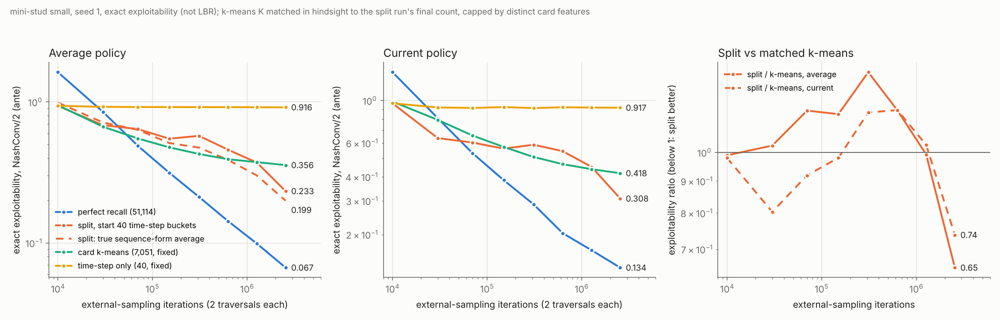

| 방식 | 마지막 epoch 동안 bucket 수 | 평균 정책 | 현재 정책 | 실행 시간 |
|---|---:|---:|---:|---:|
| perfect recall | 51,114 | 0.067 | 0.134 | 738초 |
| 분할 (time step 40개에서 시작, z=2) | 5,988 (종료 후 9,856) | 0.233 (진짜 평균 0.199) | 0.308 | 63초 |
| 카드 k-means 고정 | 7,051 | 0.356 | 0.418 | 96초 |
| time step만 고정 | 40 | 0.916 | 0.917 | 15초 |

- **정체와 감소:**
  - time step만 쓰는 고정 추상화는 0.92 근처에서 정체한다. 추상화 오차만 남은 상태다.
  - 분할 실행은 계속 감소한다.
- **k-means와의 비교:**
  - 마지막 checkpoint에서 분할/k-means 비율은 평균 정책 0.65, 현재 정책 0.74다.
  - 이때 분할 쪽 bucket(5,988개)이 k-means(7,051개)보다 적다.
  - 중간 구간(7만–60만 반복)에서는 분할이 k-means보다 나빴다. 분할된 자식이 regret과 평균을 새로 시작하기 때문으로 보인다. 원인은 검증하지 않았다.
- **아직 끝나지 않음:** 분할은 멈추지 않았다. 마지막 epoch에서도 2,313개를 분할했다. 더 길게 돌렸을 때 perfect recall보다 작은 크기에서 멈추는지는 아직 모른다.
- **노이즈 없는 기준(전체 순회 + 분할, tol 1e-3):** 4,000반복에서 bucket 5,273개, 평균 정책 0.18. 정확한 라벨로도 분할이 많이 일어나므로, 분할 대부분이 노이즈 때문은 아닌 것으로 보인다. 전체 순회 perfect-recall CFR+는 2,000반복에서 0.00083이었다.

## H 추적 (2026-10-26)

H는 같은 bucket에 묶인 정보집합들의 regret이 서로 상쇄되는 양이다. 정의는 `H = L − C`이다.

- `L = Σ_I max(0, max_a R_I(a))`: 원 정보집합마다 계산한 값의 합
- `C`: 같은 식을 bucket 합에 대해 계산한 값

추적 방식은 다음과 같다.

- `--exact-every 100`이면 100반복마다 진단용 전체 순회를 한 번 한다. 이때 원 정보집합의 정확한 regret을 계산해 100배로 누적하므로, epoch 합을 시간 표본으로 근사한 값이다.
- 이 진단값은 분할 판정에 쓰지 않는다. 진단을 켠 분할 실행의 최종 bucket 사상은 끄고 돌린 실행과 바이트 단위로 같다.

반복당 값이다. 각 행은 그 epoch 동안 쓰던 분할 기준이다.

| 누적 반복 | 분할: 정확 H | 분할: 샘플 H | time step 고정: 정확 H | k-means 고정: 정확 H |
|---:|---:|---:|---:|---:|
| 10,000 | 6.26 | 7.72 | 6.26 | 2.37 |
| 150,000 | 3.76 | 4.15 | 6.80 | 3.26 |
| 630,000 | 2.91 | 3.03 | 6.91 | 3.34 |
| 1,270,000 | 2.24 | 2.30 | 6.92 | 3.42 |
| 2,550,000 | 1.37 | 1.40 | 6.94 | 3.39 |

- **분할:** 분할이 진행될수록 H가 줄어든다(6.26 → 1.37).
- **고정 추상화:** time step 고정과 k-means 고정은 H가 줄지 않는다. 이 둘이 정체하는 원인이 추상화 오차라는 점과 맞는다.
- **샘플 H의 편향:** 알고리즘이 보는 샘플 H는 정확 H보다 크다(위쪽 편향). epoch가 길어질수록 차이가 줄어든다. 예를 들어 k-means 첫 epoch는 5.02 대 2.37이고, 마지막은 3.44 대 3.39다.
- **누적 상계:** `exploitability(선형 평균) ≤ Σ_I max(0, max_a Σ_t t·r_t(I,a)) / (2 Σ_t t)`로 계산한다. 2,550,000반복에서 분할 0.82, k-means 1.84, time step 고정 3.48이다. 실제로 잰 값(0.20 / 0.36 / 0.92)보다 느슨하지만 순서는 같다.

## 라벨 판정 역치 비교 (2026-10-26)

라벨 판정에 쓰는 역치를 세 가지로 바꿔 비교했다. 모든 역치는 정보집합마다, 그 epoch의 샘플 regret 합 R̃(a*)에 대해 적용한다. a*는 R̃가 가장 큰 행동이다.

- `normal`(z=2): `R̃ > 2·√(Σ r̃²)`. 정규분포 근사라서 엄밀한 보장은 없다.
- `hoeffding`: `R̃ > Δ_I·√(2 n ln(1/δ_k))`. Azuma–Hoeffding 부등식에서 나온 역치다.
- `bernstein`: `R̃ > √(2 n V ln(2/δ_k)) + 7·(2Δ_I)·n·ln(2/δ_k)/(3(n−1))`. 경험적 Bernstein 부등식에서 나온 역치다.

기호는 다음과 같다.

- n: 그 epoch의 방문 횟수
- V: 샘플 regret의 표본분산
- Δ_I: 정보집합 아래 보수의 최대−최소. 1–32 ante 범위다.
- δ_k = 0.05/(k+1)²: epoch k의 허용 오판정 확률. epoch에 걸쳐 합이 유한하므로, 노이즈로 인한 잘못된 라벨은 거의 확실히 유한 번만 생긴다.

Bernstein 역치는 원래 독립 표본용이다. 마팅게일 표본에 쓰려면 엄밀하게는 마팅게일용 버전이 필요하다.

2,550,000반복 기준이다. 정책 평가는 마지막 epoch 동안 쓰던 분할 위에서 한 것이고, H는 그 epoch의 정확 H(반복당)다.

| 역치 | 마지막 epoch bucket 수 (종료 후) | 정확 H | 평균 정책 | 현재 정책 |
|---|---:|---:|---:|---:|
| normal z=2 | 5,988 (9,856) | 1.37 | 0.233 | 0.308 |
| bernstein δ=0.05 | 164 (220) | 3.44 | 0.499 | 0.502 |
| hoeffding δ=0.05 | 114 (154) | 4.29 | 0.701 | 0.730 |
| 카드 k-means 고정 | 7,051 | 3.39 | 0.356 | 0.418 |
| time step 고정 | 40 | 6.94 | 0.916 | 0.917 |

- **보수적인 역치일수록 분할이 늦다.** Hoeffding과 Bernstein은 최악 범위 Δ_I를 쓰므로 분할이 훨씬 늦다. 그래도 둘 다 마지막 epoch까지 분할이 계속됐다.
- **bucket당 상쇄 감소 효율.** Bernstein은 bucket 164개로 k-means 7,051개와 비슷한 정확 H(3.44 대 3.39)에 도달했다. 다만 exploitability는 k-means가 더 낮았다.
- **seed는 하나뿐이다.** δ와 epoch 길이에 대한 민감도는 아직 보지 않았다.

## 집중 순회 방식 (focused.cpp, 2026-10-26)

정보집합별 regret 합을 모든 정보집합에 대해 저장하는 대신, 의심 bucket에서만 저장해 판정용 메모리를 줄이려는 시도다. 용어는 다음과 같다.

- **probe(탐침):** traverser가 어떤 정보집합 I의 노드 h를 지날 때 추가로 하는 계산이다. 각 행동 a마다 h·a에서 현재 전략대로 끝까지 무작위 진행(rollout)을 4번 하고, 그 평균으로 regret 벡터를 추정한다. 이 추정값은 판정에만 쓰고 regret 갱신에는 쓰지 않는다.
- **의심 표시:** 일반 bucket에서는 traverser 방문의 2%에서 probe를 하고, 결과를 bucket당 32칸짜리 저장소(reservoir)에 넣는다. epoch가 끝날 때 저장소 안에 서로 다른 라벨이 각각 2개 이상 있으면 그 bucket을 "의심"으로 표시한다. 이와 별도로 5% 확률의 무작위 감사로도 표시한다.
- **판정:** 의심 bucket은 다음 epoch 동안 멤버를 방문할 때마다 probe를 하고, 정보집합별 합을 누적한다. epoch가 끝나면 라벨 역치(정규근사, Hoeffding, Bernstein)로 분할한다.
- **판정용 메모리:** 판정을 위해 합을 누적한 정보집합 수다. 표에는 epoch별 최댓값을 적었다.
- **뒤 street 우선:** 저장소에서 나온 의심 표시를 가장 뒤 street에만 남긴다. 감사로 나온 표시는 항상 남긴다.
- **물려받기:** 분할된 자식이 부모의 regret과 평균을 복사해 시작한다.

2,550,000반복, seed 1, bucket 평균 정책의 exact exploitability:

| 방식 | 역치 | 최종 bucket 수 | 판정용 메모리 최대 | 정확 H | 평균 정책 |
|---|---|---:|---:|---:|---:|
| 전체 누적 | 정규 z=2 | 9,856 | 방문한 전부(≈51,114) | 1.37 | **0.233** |
| 전체 누적 | Bernstein | 220 | 방문한 전부 | 3.44 | 0.499 |
| 전체 누적 | Hoeffding | 154 | 방문한 전부 | 4.29 | 0.701 |
| 집중, 뒤 street 우선 | 정규 | 674 | 24,358 | 3.04 | 0.665 |
| 집중, 뒤 street 우선 | Bernstein | 93 | 21,406 | 5.62 | 0.863 |
| 집중, 뒤 street 우선 | Hoeffding | 81 | 22,482 | 5.63 | 0.818 |
| 집중, 뒤 street 우선, 물려받기 | 정규 | 690 | 24,658 | 4.22 | 0.675 |
| 집중, 뒤 street 우선, 물려받기 | Bernstein | 80 | 20,936 | 4.18 | 0.713 |
| 집중, 뒤 street 우선, 물려받기 | Hoeffding | 79 | 21,726 | 5.58 | 0.835 |
| 집중, 우선순위 없음, 물려받기 | 정규 | 1,359 | 28,997 | 3.91 | 0.440 |
| 집중, 우선순위 없음, 물려받기 | Bernstein | 124 | 19,851 | 5.11 | 0.803 |
| 카드 k-means 고정 | - | 7,051 | 0 | 3.39 | 0.356 |

- **성능:** 집중 방식은 전체 누적 방식보다 분할이 훨씬 적고, exploitability도 높다. 곡선이 중간에 다시 올라가는 구간도 있다.
- **원인 1 — 뒤 street 우선:** 5구 정보집합 2,154개가 bucket 37개에 머물렀다. 전체 누적 방식은 5구에서 1,104개까지 쪼갰다. 이 규칙을 끄자 정규 역치에서 0.674가 0.440이 되었다.
- **원인 2 — 판정 기회가 적다:** bucket마다 "표시 → 다음 epoch 판정"을 거치므로, 판정 기회가 전체 누적의 절반 이하다.
- **원인 3 — 판정 구간이 짧다:** Hoeffding과 Bernstein은 한 epoch의 누적만으로는 역치를 거의 넘지 못한다.
- **물려받기:** 결과가 거의 달라지지 않았다. 자식 초기화는 주원인이 아니다.
- **메모리 절감은 작다:** 판정용 메모리는 전체의 40–57% 수준이다. 7구 time step bucket 하나가 정보집합 수천 개를 담고 있어, 의심 bucket 몇 개만 판정해도 누적 대상이 많아진다.

## 수렴 조건부 분할 (gated.cpp, 2026-10-26)

분할 판정을 epoch 경계마다 하지 않는다. 마지막 분할 이후 추상화 게임이 수렴했을 때만 판정한다.

- **수렴 판정:** 1,000반복마다 `샘플 C / 구간 길이 ≤ ε`인지 확인한다. 구간은 마지막 분할 시점부터 센다. 구간이 1만 반복 이상일 때만 확인한다.
- **샘플 C:** 구간 동안 bucket별로 쌓은 샘플 regret 합을 R̃_B라 할 때 `Σ_B max(0, max_a R̃_B(a))`이다.
- **판정 후:** 판정을 통과하면 정보집합별 누적 regret 라벨로 분할한다. 분할이 하나도 없으면 구간을 계속 이어 간다.

판정 시점의 샘플 C와 정확 C(진단용 전체 순회로 계산)는 매우 가깝다. 예를 들어 0.100 대 0.096, 0.199 대 0.193, 0.050 대 0.050이다. **bucket 단위 C는 샘플로도 정확히 추정된다.**

2,550,000반복, seed 1. bucket 수는 그 시점에 쓰던 분할 기준이다.

| 방식 | bucket 수 | 분할이 일어난 판정 수 | 평균 정책 | 현재 정책 |
|---|---:|---:|---:|---:|
| 수렴 조건부, 정규, ε=0.05 | 135 | 1 (861,000반복) | 0.468 | 0.474 |
| 수렴 조건부, 정규, ε=0.1 | 339 | 2 | 0.571 | 0.583 |
| 수렴 조건부, 정규, ε=0.2 | 1,546 | 4 | 0.394 | 0.477 |
| 수렴 조건부, Bernstein, ε=0.1 | 241 | 11 (통과 160회) | 0.468 | 0.515 |
| 조건 없음, 정규 z=2 | 5,988 | epoch마다 | **0.233** | 0.308 |
| 조건 없음, Bernstein | 164 | epoch마다 | 0.499 | 0.502 |
| 카드 k-means 고정 | 7,051 | - | 0.356 | 0.418 |
| time step 고정 | 40 | - | 0.916 | 0.917 |

- **분할이 드물다:** 수렴 조건을 걸면 분할이 훨씬 드물고 늦다. bucket이 많을수록 같은 ε에 도달하는 데 오래 걸리기 때문이다. ε=0.2일 때 판정 사이 구간이 6.3만 → 11.4만 → 22.4만 → 91.5만 반복으로 길어졌다.
- **반복 수 기준:** 같은 반복 수에서는 조건 없는 정규 방식이 가장 좋다.
- **bucket 수 기준:** 같은 bucket 수에서는 수렴 조건부가 효율적이다.
  - 정규 ε=0.05는 bucket 135개로 0.468이다. 조건 없는 Bernstein(164개, 0.499)보다 좋다.
  - Bernstein 수렴 조건부(241개, 0.468)도 조건 없는 Bernstein보다 좋다.
- **H가 다시 커진다:** 분할 직후에는 정확 H가 떨어진다. 그러나 다음 판정까지 수렴하는 동안 다시 커진다(예: ε=0.1에서 분할 직후 1.99, 다음 판정 전 4.41). 분할 직후 같은 쪽에 묶인 멤버들이 이후 학습에서 다시 갈라지는 것으로 보인다.
- **ε=0.1의 비단조성:** ε=0.1이 0.05보다 나쁘게 나온 것은 seed 하나의 변동일 가능성이 있다.

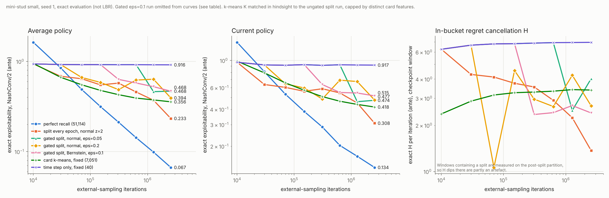

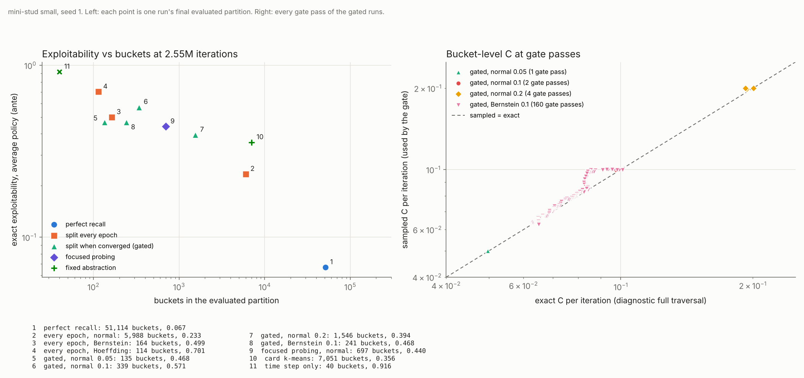

그림은 `python plot_gated.py RUNS_DIR results_gated_small_seed1`로 다시 그린다.

## 학습량 16배: 40,960,000반복 (2026-10-26, 완료된 실험)

**조건**
- 위 실행들을 40.96M반복까지 다시 돌렸다. ε=0.4(수렴 조건부, 정규)를 새로 추가했다.
- 집중 순회 방식은 다시 돌리지 않았다. 2.55M 값(697 bucket, 0.440)만 그림 아래에 적었다.
- seed가 같고 학습이 결정적이라, 처음 2.55M반복은 이전 실행과 비트 단위로 같다.
- 모든 값은 평균 정책의 정확한 exploitability(NashConv/2, ante)이다. 마지막 1만 반복짜리 짧은 구간은 제외했다.

| 방식 | 2.55M (bucket) | 40.95M (bucket) | 40.95M 현재 정책 | 40.95M / 완전 기억 | 40.95M / k-means |
|---|---:|---:|---:|---:|---:|
| 완전 기억 (51,114) | 0.067 | **0.0154** | 0.058 | 1 | 0.044 |
| 조건 없음, 정규 z=2 | 0.233 (5,988) | **0.0207** (22,227) | 0.066 | 1.35 | 0.059 |
| 수렴 조건부, 정규 ε=0.4 | 0.276 (7,175) | **0.0216** (31,943) | 0.067 | 1.41 | 0.062 |
| 수렴 조건부, 정규 ε=0.2 | 0.394 (1,546) | 0.0453 (25,617) | 0.078 | 2.95 | 0.130 |
| 수렴 조건부, 정규 ε=0.1 | 0.571 (339) | 0.192 (8,880) | 0.233 | 12.5 | 0.551 |
| 수렴 조건부, 정규 ε=0.05 | 0.468 (135) | 0.378 (2,439) | 0.419 | 24.6 | 1.086 |
| 수렴 조건부, Bernstein ε=0.1 | 0.468 (241) | 0.467 (329) | 0.466 | 30.4 | 1.343 |
| 조건 없음, Bernstein | 0.499 (164) | 0.537 (1,169) | 0.579 | 34.9 | 1.544 |
| 조건 없음, Hoeffding | 0.701 (114) | 0.652 (442) | 0.643 | 42.3 | 1.875 |
| 카드 k-means 고정 | 0.356 (7,051) | 0.348 (7,051) | 0.375 | 22.6 | 1 |
| time step 고정 | 0.916 (40) | 0.915 (40) | 0.925 | 59.4 | 2.63 |

조건 없는 방식은 분할 직전 epoch에 쓰인 분할을 bucket 수로 적었다. 같은 반복 수에서 잰 완전 기억 대비 비율(평균 정책)은 다음과 같다.

| | 2.55M | 5.11M | 10.23M | 20.47M | 40.95M |
|---|---:|---:|---:|---:|---:|
| 조건 없음, 정규 z=2 | 3.49 | 2.99 | 2.28 | 1.68 | 1.35 |
| 수렴 조건부, ε=0.4 | 4.13 | 3.03 | 2.53 | 1.59 | 1.41 |
| 수렴 조건부, ε=0.2 | 5.90 | 6.83 | 6.52 | 5.71 | 2.95 |
| 카드 k-means | 5.34 | 7.65 | 10.91 | 15.50 | 22.64 |

**관찰** (seed 하나, 측정된 지점만; 기울기로 교차점을 외삽하지 않았다)
- **완전 기억에 접근:** 조건 없는 정규 z=2와 ε=0.4는 완전 기억과의 비율이 측정한 모든 지점에서 줄었다(3.5 → 1.35, 4.1 → 1.41). k-means는 0.35 근처에서 멈췄고, 완전 기억과의 비율은 커지기만 했다(5.3 → 22.6).
- **ε의 효과:** ε가 클수록(덜 수렴한 상태에서 분할할수록) 반복 수 대비 빠르다. ε=0.4는 조건 없는 방식과 곡선이 거의 겹친다.
- **H의 차이:** 정확 H는 수렴 조건부 쪽이 훨씬 작다. 40.95M 구간에서 ε=0.4는 0.0006, ε=0.2는 0.0023, 조건 없는 방식은 0.030, k-means는 3.46이었다. 그런데 exploitability는 조건 없는 방식이 약간 더 낮다. 남은 차이는 bucket 안 상쇄(H)보다 학습 부족 쪽으로 보인다. 분할된 자식은 표를 처음부터 다시 시작하기 때문이다(가설, 확인하지 않음).
- **이전 결론 수정:** 2.55M에서 본 "같은 bucket 수에서는 수렴 조건부가 효율적"이라는 결론은 긴 학습에서 유지되지 않았다. 40.95M에서 조건 없는 정규 z=2는 22,227개로 0.0207이다. ε=0.4는 31,943개로 0.0216이고, ε=0.2는 25,617개로 0.0453이다. 조건 없는 방식이 bucket 수와 exploitability 둘 다에서 앞선다.
- **ε=0.4 판정 간격:** 판정 사이 구간이 207만 반복에서 정점을 찍은 뒤 줄었다(마지막 약 92만). 판정당 분할 수도 3,314개에서 28개로 줄었다. bucket 수는 31,943개에서 거의 멈췄다. 완전 기억(51,114개)보다 37% 적다.
- **엄격한 검정은 정체:** Bernstein과 Hoeffding은 수렴 조건부든 아니든 정체됐다(0.47–0.65). 원인은 다음과 같다.
  - 역치가 정보집합의 보상 폭 Δ_I(최대 32 ante)에 비례한다. 그래서 라벨이 거의 붙지 않는다.
  - 수렴 조건부 Bernstein은 판정을 34,495번 통과했지만 분할은 98번뿐이었고, 대부분 bucket 1개씩이었다. 분할이 있을 때만 구간이 리셋되어 구간이 약 50만–60만 반복으로 짧게 유지됐다.
  - 조건 없는 Bernstein은 단조롭지도 않다(0.50 → 0.58 → 0.62 → 0.54).
- **샘플 C의 편향:** 판정 시점 샘플 C와 정확 C의 비율(정규 검정, 분할이 있었던 판정)은 bucket 1,000개 미만에서 0.98–1.09, 1,000–20,000개에서 0.96–1.03이었다. ε=0.4에서 bucket이 2만 개를 넘자 최대 1.18까지 올라갔다(샘플 C가 과대). 이유는 E[max(0, X)] ≥ max(0, E[X])이기 때문이다. 각 bucket의 샘플 regret 합에 잡음이 끼면 양의 부분이 부풀고, bucket이 많을수록 이것이 더 많이 합산된다. 과대 추정이므로 판정은 보수적으로(늦게) 통과한다. 수렴하지 않았는데 통과하는 방향의 오류는 아니다.
- **분할과 checkpoint의 겹침:** 분할이 평가 checkpoint와 정확히 겹친 경우는 없었다. 겹쳤다면 그 checkpoint의 평균 정책이 막 초기화된 자식 표에서 나왔을 것이다.

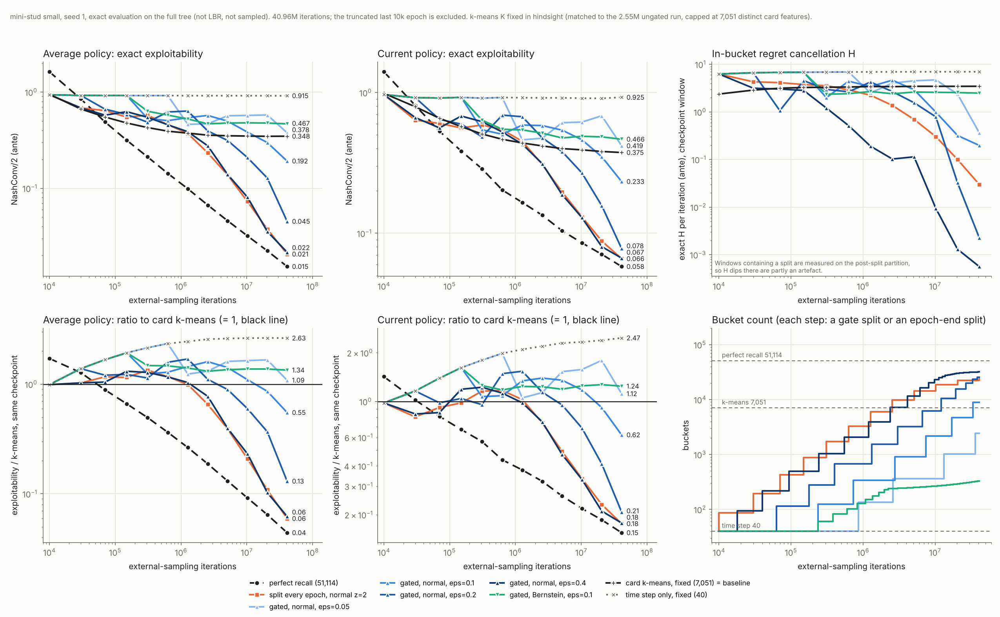

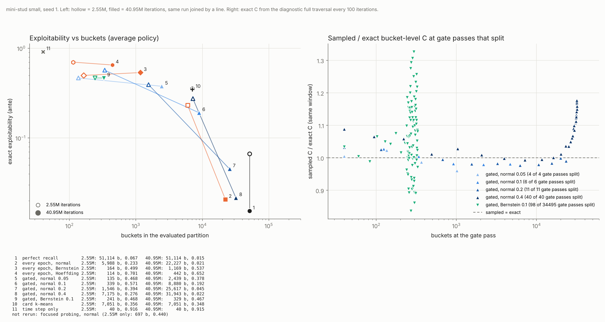

- **그림:** `python plot_long.py RUNS_DIR results_long_small_seed1 OLD_RUNS_DIR`로 다시 그린다.
- **실행 시간:** 수렴 조건부 실행 한 개에 약 63분 걸렸다. 대부분은 100반복마다 하는 진단용 전체 순회이다.
- **속도 개선:** 학습 루프는 이번에 손봤다. 샘플링에 닿은 bucket만 갱신하게 바꾸어 완전 기억 기준 45배 빨라졌다. 출력은 비트 단위로 같다.

## 고정 전략 판정과 bucket 이력 열쇠 (2026-10-28, 완료된 실험)

수렴 증명 문서 [§9](../ASWISS_CONVERGENCE_KO.md)의 두 판정 방법(A, B)과, 정보집합 대신 bucket 이력 열쇠를 라벨 단위로 쓰는 방법을 같은 조건에서 비교했다.

**조건**
- mini-stud small, seed 1, external sampling MCCFR+, epoch는 1만 반복에서 두 배씩, 분할된 자식은 표를 0에서 다시 시작, 4,096만 반복이다.
- 기준선(완전 기억, 카드 k-means, time step 고정)은 같은 트리, seed, 일정, 평가기로 돌린 기존 41M 실행이다.
- 평가는 bucket 평균 정책의 정확한 exploitability(NashConv/2, ante)다. 마지막 1만 반복짜리 epoch는 뺐다.
- 모든 비교군은 시작 분할이 게임 구조(time step 40개)뿐이다. 카드 특징이나 베팅 요약 같은 휴리스틱을 쓰지 않는다.
- **bucket 이력 열쇠:** (time step) + (그 player가 이전 결정들에서 속했던 bucket과 그때 둔 행동) + (마지막 결정 이후 새로 관측한 카드와 상대 행동)이다. 과거는 그것이 들어갔던 bucket으로만 기억한다. 같은 열쇠의 정보집합은 regret을 합쳐 라벨을 받고, 서로 다른 bucket으로 갈라지지 않는다.

| 비교군 | 라벨 단위 | 라벨 기준 |
|---|---|---|
| 기존 | 정보집합 | 구간 누적 샘플 regret, argmax + 정규 z=2 |
| 기존 + 여유 라벨 | 정보집합 | 같은 누적값, 여유 라벨 집합(§9 Lemma 9, z=1) |
| 방법 A | 정보집합 | 반복마다 1% 확률로 그 반복의 전략을 전체 트리에서 정확히 재생해 1/p 가중으로 합한 regret, 여유 라벨 집합(z=1) |
| 방법 B | 정보집합 | epoch 끝 bucket 평균 전략의 정확한 순간 regret(전체 트리 순회 한 번) |
| 기존 + B | 정보집합 | 두 기준의 공통 세분화(둘 중 하나라도 나누면 나눔) |
| 열쇠 + 기존 | bucket 이력 열쇠 | 기존 규칙을 열쇠별 합에 적용 |
| 열쇠 + B | bucket 이력 열쇠 | 방법 B를 열쇠별 합에 적용 |

- 여유 라벨의 z=1은 판정 폭(2η = 2σ)을 기존 규칙의 역치(2σ)와 맞춘 값이다. 64만 반복 시험에서 z=2는 bucket 186개로 지나치게 보수적이었다.
- 기존 규칙을 새 코드로 돌린 결과는 이전 41M 실행과 로그와 정책 파일 모두 바이트 단위로 같다.
- 정보집합마다 bucket을 하나씩 두면 이력 열쇠가 정보집합과 정확히 일대일임을 확인했다(51,114개).

**결과** (평균 정책 exploitability, 괄호는 평가한 분할의 bucket 수)

| 비교군 | 2.55M | 40.95M | 40.95M 현재 정책 | 40.95M 정확 H/반복 | 실행 시간 |
|---|---:|---:|---:|---:|---:|
| 기존 | 0.233 (5,988) | 0.0207 (22,227) | 0.0660 | 0.030 | 68분 |
| 기존 + 여유 라벨 | 0.532 (929) | 0.200 (5,284) | 0.255 | 1.39 | 69분 |
| 방법 A | 0.181 (3,767) | 0.0265 (12,813) | 0.0742 | 0.084 | 131분 |
| **방법 B** | **0.119** (5,223) | **0.0197** (12,683) | 0.0652 | 0.058 | 66분 |
| **기존 + B** | **0.086** (17,102) | **0.0154** (26,990) | **0.0578** | 0.002 | 67분 |
| 열쇠 + 기존 | 0.278 (10,045) | 0.0249 (29,916) | 0.0690 | 0.183 | 74분 |
| 열쇠 + B | 0.324 (4,081) | 0.0896 (12,895) | 0.137 | 1.20 | 72분 |
| 완전 기억 | 0.067 (51,114) | 0.0154 (51,114) | 0.0581 | 0 | 4분 (진단 없음) |
| 카드 k-means 고정 | 0.356 (7,051) | 0.348 (7,051) | 0.375 | 3.46 | – |
| time step 고정 | 0.916 (40) | 0.915 (40) | 0.925 | 6.94 | – |

- 실행 시간은 모두 100반복마다 하는 진단용 정확 순회(정확 H) 포함이다. 방법 A는 재생 순회가 더해져 두 배다.
- 이력 열쇠 수: 열쇠 + 기존은 1,176개에서 48,783개, 열쇠 + B는 42,690개까지 늘었다(정보집합 51,114개).

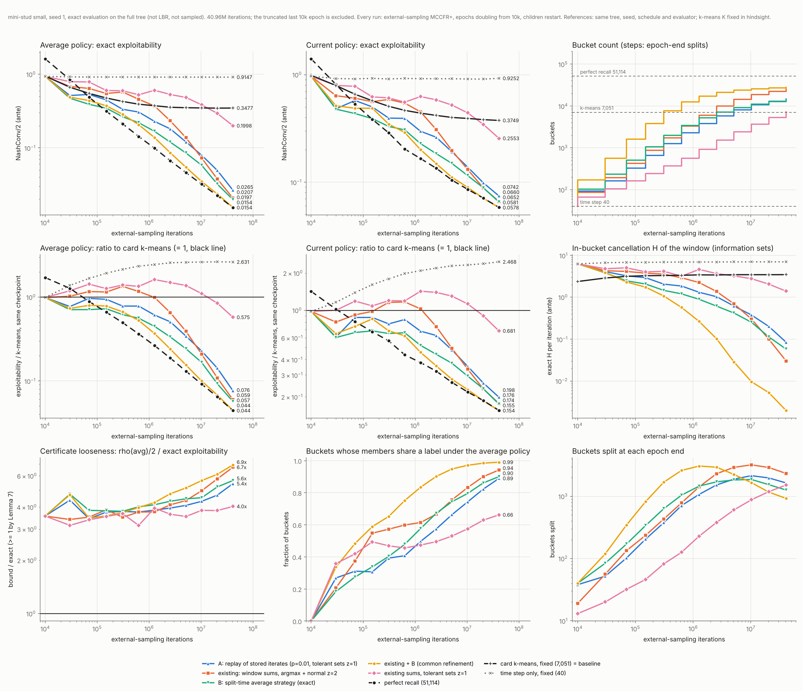

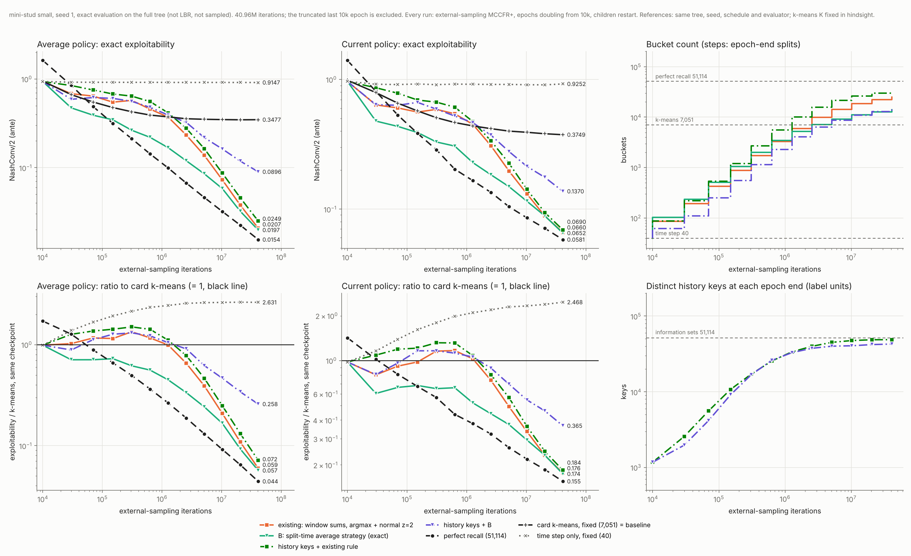

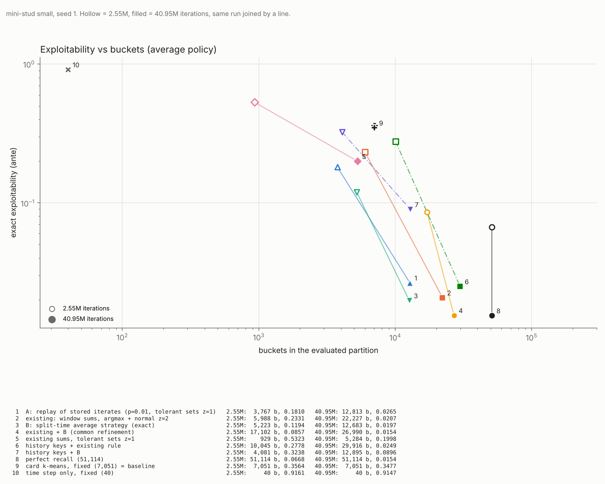

**관찰** (seed 하나, 측정한 지점만; 교차점을 외삽하지 않았다)
1. **방법 B가 단일 규칙 중 가장 좋다.**
   - 3만 반복 이후 모든 checkpoint에서 기존 규칙보다 낮다. bucket은 40.95M에서 기존의 57%다(12,683 대 22,227).
   - 2.55M에서는 0.119로 기존(0.233)의 절반이다.
   - bucket 수가 거의 같은 방법 A(12,813개, 0.0265)보다도 낮다.
2. **기존 + B는 완전 기억과 같은 값에 bucket 53%로 도달했다.**
   - 40.95M에서 0.0154로 완전 기억(0.0154)과 같고, 현재 정책도 0.0578 대 0.0581이다.
   - 정확 H는 0.002로 가장 작다.
   - 이전 실험의 가장 좋은 분할 실행(수렴 조건부 ε=0.4: 31,943개, 0.0216)보다 bucket이 적고 낮다.
3. **방법 B의 이론과 실제가 다르다.**
   - 인증값 ρ(평균 전략)/2는 40.95M에서 0.111로 실제(0.0197)의 5.6배다. 마지막 epoch에도 bucket의 10%가 라벨이 갈려 1,263개가 나뉘었다.
   - 즉 정리 B3의 오라클 조건(경로 밖까지 순간 regret이 작음)은 성립하지 않았다. 명제 B4(b)대로 CFR 평균은 경로 밖 regret을 남긴다.
   - 그런데도 그 라벨로 나눈 분할은 좋았다. 정리 B3은 충분조건일 뿐이고, 관찰된 성능을 설명하지 못한다.
4. **혼동 요인이 남아 있다.**
   - B의 라벨은 정확값(노이즈 0)이고 기존 규칙은 표본 추정치다.
   - A는 정확 재생이지만 시간 표집 노이즈와 여유 집합을 쓴다. 그래서 B의 이점이 "평균 전략" 때문인지 "정확한 값" 때문인지는 이 실험으로 완전히 나뉘지 않는다.
   - 다만 A도 2.55M까지는 기존 규칙보다 bucket이 적으면서 낮았다(0.181/3,767 대 0.233/5,988).
5. **여유 라벨 집합은 탐지력이 크게 떨어졌다.**
   - 표본 누적값에 z=1로 써도 bucket 5,284개, 0.200에 머물렀다. 거짓 분할을 막는 대가다.
   - 노이즈가 작은 정확 재생(A)에서는 같은 장치로도 잘 작동했다. 결정적인 것은 추정 오차 η의 크기다.
6. **bucket 이력 열쇠는 이 게임에서 이득이 없었다.**
   - 열쇠 + 기존(0.0249, 29,916개)은 정보집합 단위(0.0207, 22,227개)보다 조금 나쁘고 bucket이 더 많다. 열쇠는 끝에 정보집합의 95%까지 늘어 압축이 거의 남지 않았다.
   - 열쇠 + B(0.0896)는 정보집합 단위 B(0.0197)보다 4.5배 나쁘다. 정보집합 기준 정확 H가 1.20으로 크다. 같은 열쇠에 묶인 정보집합끼리 regret이 상쇄되어 남는 것으로, §9에 적은 미해결 문제가 실제로 나타났다.
   - **해석:** mini-stud는 정보집합을 모두 열거할 수 있고, 4천만 반복이면 정보집합마다 표본이 충분하다. 그래서 열쇠로 표본을 모으는 이득은 없고 열쇠 안 상쇄의 손해만 보였다. 열쇠의 이득이 기대되는 곳은 정보집합이 반복 방문되지 않는 큰 게임이다. 이 실험은 그 이득을 보여 주지 못했다.

**비교 조건과 남은 차이**
- 평가기, 트리, 학습 seed, epoch 일정은 모든 비교군과 기준선이 같다. LBR이나 근사치가 아니라 정확한 exploitability다.
- 라벨 규칙마다 노이즈 원천이 다르다. 기존과 기존 + 여유 라벨은 ES 표본, A는 시간 표집, B는 없음이다.
- k-means 기준선의 K는 이전 2.55M 실행에 사후로 맞춘 값이다(위 "비교 조건과 남은 차이" 절과 같음).
- seed가 하나뿐이고, 정확 라벨(A, B)은 전체 트리 순회가 필요해 작은 게임에서만 그대로 쓸 수 있다. 큰 게임에서는 B를 별도 표본 평가 순회로 추정해야 하고, 그때의 노이즈 효과는 확인하지 않았다.

**재현**

```bash
python agents/adaptive_buckets/aswiss/export.py small DATA/small
python agents/adaptive_buckets/aswiss/export_history.py small DATA/small   # 이력 열쇠 입력
g++ -O3 -std=c++17 agents/adaptive_buckets/aswiss/aswiss.cpp -o aswiss
./aswiss --tree DATA/small --mode es --iters 40960000 --epoch0 10000 --seed 1 --buckets DATA/small/bucket_timestep.bin \
  --split cum --exact-every 100 --label avg --out RUN
# --label window --z 2 | window_tol --z 1 | replay --z 1 --replay-p 0.01 | window+avg --z 2; 이력 열쇠는 --unit history 추가
python agents/adaptive_buckets/aswiss/eval.py DATA/small RUN
python agents/adaptive_buckets/aswiss/plot_fixed.py RUNS_DIR REF_DIR results_fixed_small_seed1
```

원자료: `results_data/fixed_small_seed1.tar.gz`(일곱 비교군과 세 기준선의 `log.csv`, `exploitability.csv`). 풀면 `runs_fx/`와 `runs41m/`이 나오고, `python plot_fixed.py runs_fx runs41m <출력 접두어>`로 위 그림을 다시 그린다.

## 장기 실행: 방법 B와 기존 + B (`run_long.py`, 163.84M 완료)

41M 비교에서 좋았던 두 규칙(방법 B, 기존 + B)을 기존 규칙, 기준선과 함께 더 길게 돌리는 스크립트다. Windows와 Linux에서 같은 명령으로 돈다.

```bash
# 저장소 루트에서. 필요: Python 3 + numpy + matplotlib, g++ (Windows는 MinGW-w64)
python agents/adaptive_buckets/aswiss/run_long.py            # 시작 (끝난 비교군은 건너뜀)
python agents/adaptive_buckets/aswiss/run_long.py --status   # 진행 상황
# 옵션: --iters 163840000 --workers 4 --arms avg window_avg window pr kmeans timestep --exact-every 1000 --gxx <g++ 경로>
```

- **하는 일:** 트리를 한 번 내보내고(`export.py`), 학습기를 한 번 빌드한다(Windows는 완전 정적). 그다음 비교군마다 학습하고 모든 checkpoint를 정확히 평가(`eval.py`)한 뒤 그림을 그린다(`plot_fixed.py`).
- **출력:** `agents/adaptive_buckets/aswiss/data/long/`. `runs/`(B, 기존 + B, 기존), `refs/`(완전 기억, k-means, time step), `results_curves.png`, `results_frontier.png`이 생긴다.
- **기본 학습량:** 163,840,000반복이다. epoch가 두 배씩 늘어서 81.91M 다음 epoch 경계가 163.83M이다.
  - `--iters 100000000`도 되지만, 그러면 마지막 epoch가 81.91M–100M으로 잘린다.
- **k-means 기준선:** 41M 비교와 같은 7,051개 분할(`results_data/bucket_kmeans_matched_es_z2.bin`)을 쓴다.
- **확인한 것:** 새로 내보낸 트리가 실험에 쓴 트리와 바이트 단위로 같았다. 비교군들도 41M 실행의 앞 checkpoint들과 같은 값을 냈다(같은 seed).
- **중단:** 학습기에 checkpoint가 없다. 도중에 멈춘 비교군은 다음 실행 때 처음부터 다시 돌고, 끝난 비교군은 건너뛴다.
- **시간 (이 환경, 2026-10-28 실측):** 비교군 하나가 163.84M에 25–30분이었다(정확 H 진단 1,000반복마다와 평가 포함). 4개 병렬로 6개 비교군에 약 1시간이 걸렸다.

**결과 (163.84M, seed 1, 완료)** — 평균 정책의 정확한 exploitability, 괄호는 평가한 분할의 bucket 수다. 40.95M까지의 값은 앞 절의 41M 실행과 같다(같은 seed, 결정적 학습).

| 비교군 | 40.95M | 81.91M | 163.83M | 163.83M / 완전 기억 | 163.83M 현재 정책 |
|---|---:|---:|---:|---:|---:|
| 기존 규칙 | 0.0207 (22,227) | 0.0123 (24,941) | 0.0080 (26,844) | 1.10 | 0.0410 |
| **방법 B** | 0.0197 (12,683) | 0.0124 (13,970) | **0.0075 (14,910)** | **1.03** | 0.0417 |
| **기존 + B** | 0.0154 (26,990) | 0.0104 (27,987) | **0.0071 (28,747)** | **0.97** | 0.0397 |
| 완전 기억 | 0.0154 (51,114) | 0.0105 (51,114) | 0.0073 (51,114) | 1 | 0.0391 |
| 카드 k-means 고정 | 0.348 (7,051) | 0.348 (7,051) | 0.348 (7,051) | 47.7 | 0.371 |
| time step 고정 | 0.915 (40) | 0.914 (40) | 0.914 (40) | 125 | 0.911 |

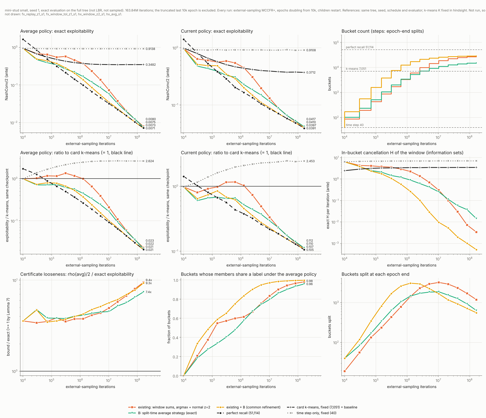

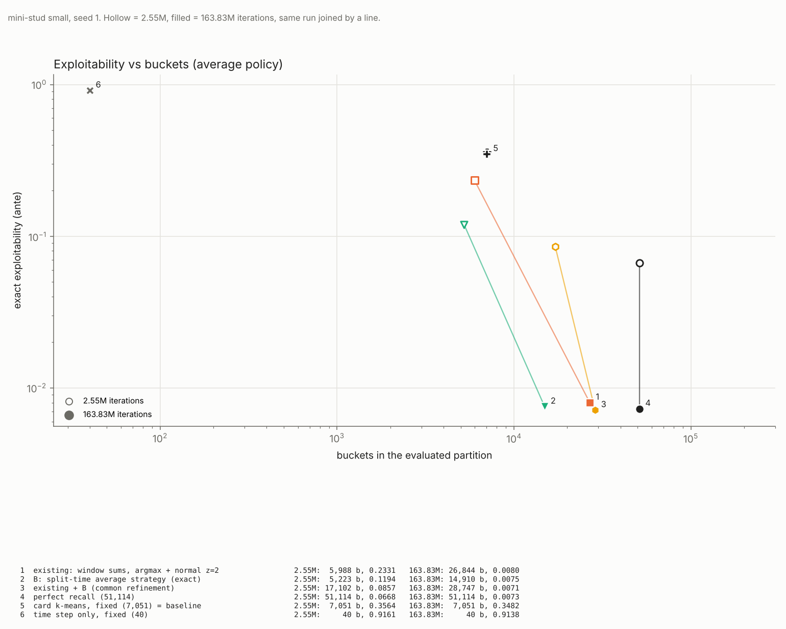

**관찰** (seed 하나, 측정한 지점만)
- **방법 B는 bucket 29%로 완전 기억과 거의 같아졌다.** 163.83M에서 0.0075 대 0.0073이다(1.03배). bucket은 14,910개로 완전 기억(51,114개)의 29%, 기존 규칙(26,844개)의 56%다.
- **기존 + B는 완전 기억보다 조금 낮았다.** 0.0071 대 0.0073이고 bucket은 56%다. seed 하나의 차이이므로 "같다"로 읽는 것이 맞다.
- **기존 규칙도 완전 기억과의 비율이 계속 줄었다.** 1.35(40.95M) → 1.17(81.91M) → 1.10(163.83M)이다. 고정 추상화(k-means 0.348, time step 0.914)는 그대로였다.
- **분할은 아직 끝나지 않았다.** 마지막 epoch에도 기존 1,186개, B 632개, 기존 + B 556개 bucket이 나뉘었다. 라벨이 일치하는 bucket 비율은 0.96–0.996이다.
- **B는 bucket 안 상쇄(정확 H)가 더 남는데도 exploitability가 낮다.** 163.83M 구간 H는 B 0.014, 기존 0.0034, 기존 + B 0.0005다. H가 작은 것만으로는 낮은 exploitability가 설명되지 않는다.
- **원자료:** `results_data/long164_small_seed1.tar.gz`. 풀어서 `python plot_fixed.py runs refs <출력 접두어> --last 163830000`으로 다시 그린다.

## 역방향 분할과 ε 판정 문턱 (2026-10-30, 완료된 실험)

**목적**
1. "열쇠 + B"(지금 ASWISS라고 부르는 것)가 정보집합 단위 B보다 4.5배 나빴던 원인이 열쇠 안 상쇄 $H_K$인지 확인한다. 그리고 역방향 분할(`../ASWISS_HISTORY_PROOF_KO.md` §8)로 고쳐지는지 본다.
2. "추상화 게임의 모든 bucket 후회 합이 ε 이하일 때만 분할한다"는 규칙이 성능을 개선하는지 확인한다. 개선이 없으면 ε/√t 문턱도 시험한다.

**조건**
- mini-stud small, external sampling MCCFR+, 4,096만 반복이다.
- 시작 분할은 time step 40개다. 라벨은 방법 B(판정 시점 bucket 평균 전략의 정확한 후회)다.
- seed는 1이다. 주요 7개 비교군과 k-means 기준선은 seed 2, 3도 돌렸다.
- 평가는 평균 정책과 현재 정책 각각의 정확한 exploitability(NashConv/2, ante)다.
- 진단용 정확 순회(`--exact-every`)는 껐다. 학습 경로는 같고 시간만 줄어든다(비교군 하나에 4–8분).
  - "열쇠 + B, 매 epoch"는 이전 41M 실행과 모든 epoch의 bucket 수, 분할 수, exploitability가 같았다(40.95M에 0.0896).
- 매 epoch 판정 비교군의 bucket 수는 **평가한 분할**의 것이다. 즉 40.95M checkpoint를 만든 분할(20.47M 판정 뒤)이다.
- k-means 기준선은 이전과 같은 7,051개 분할이다. seed 1은 기존 실행이고, seed 2, 3은 이번에 같은 분할로 다시 돌렸다.

**역방향 분할의 구현** (`aswiss.cpp`의 `judge_avg`, `--backward 1`)
- **진단:** 판정 때 열쇠마다 멤버 정보집합 각각의 라벨 집합을 본다. 열쇠로 합치기 전의 정확한 B 후회로 계산한다.
- **합쳐진 지점 찾기:** 공통 라벨이 없는 열쇠에서, 첫 멤버와 대표 라벨(집합의 가장 작은 원소)이 다른 멤버를 고른다. 두 정보집합의 자기 이력을 거꾸로 따라가며 열쇠가 처음 달라지는 가장 가까운 앞 결정을 찾는다. 두 열쇠가 같으므로 그 앞의 bucket은 모두 같다. 그 결정이 정보가 합쳐진 지점이다(보조정리 H3).
- **나누기:**
  - 합쳐진 지점의 두 열쇠에 각자의 대표 라벨을 표시한다.
  - 표시된 bucket을 열쇠의 표시 묶음별로 나눈다. 표시 없는 열쇠들은 한 묶음이다.
  - 라벨 묶음으로 갈리지 않는 쌍에는 열쇠 이름을 붙인 표시를 더해서, 판정한 모든 쌍이 다른 자식으로 가게 한다.
- **자식의 표:** 역방향으로만 나뉜 자식은 부모의 후회 표와 평균 표를 복사한다. 그 결정에서는 라벨이 같아 전략도 같고, 뒤 열쇠의 기억만 달라지기 때문이다. 정방향으로 나뉜 자식은 기존처럼 표를 새로 시작한다.
- **검증 1:** 증명 초안 §7의 H/L 카드 반례를 같은 형식으로 만들어 돌렸다(전체 순회 CFR+).
  - 역방향 분할이 없으면 exploitability가 0.5(NashConv 1)에 멈추고, 열쇠 안 상쇄도 0.5로 남는다.
  - 역방향 분할을 넣으면 첫 판정에서 첫 결정 bucket이 카드로 나뉘고, 다음 판정에서 둘째 결정 bucket이 정방향으로 나뉜다. 4만 반복에 0.0014가 됐다.
- **검증 2:** 기존 설정 4가지(`--label avg`/`window` × 정보집합/열쇠)는 이전 코드와 log, bucket 표, 정책 파일이 바이트 단위로 같다.

**판정 문턱의 구현** (`--gate-eps`, `--gate-decay`)
- 1만 반복마다 bucket 평균 정책의 $\rho_{\mathcal P}/2=\sum_B\psi(r(B))/2$를 정확히 계산한다. 이 값이 문턱 이하일 때만 판정(정방향 + 역방향)한다.
- 문턱은 고정 ε(0.2, 0.1, 0.05)이거나 ε√(10⁴/t)(t는 누적 반복, ε = 1, 2)다. 뒤의 것은 첫 검사(1만 반복)에서 ε가 되도록 맞춘 ε/√t다.
- 분할하는 판정마다 그 판정이 본 평균 정책과 현재 정책을 저장해 정확 exploitability를 잰다. 그림의 점이 이것이다("분할 직전").
- 매 epoch 판정은 원래 checkpoint가 분할 직전의 정책이다.

**결과 (seed 1, 40.95M)** — 평균 정책 / 현재 정책 exploitability, 평가한 분할의 bucket 수, 40.95M까지 분할한 판정 수와 마지막 분할 시점

| 단위 | 판정 시점 | 평균 | 현재 | bucket | 분할한 판정 | 마지막 분할 |
|---|---|---:|---:|---:|---:|---:|
| 정보집합 | 매 epoch 끝 | 0.0197 | 0.0652 | 12,683 | 12 | 매 epoch |
| 열쇠 | 매 epoch 끝 | 0.0896 | 0.1370 | 12,895 | 12 | 매 epoch |
| **열쇠 + 역방향** | 매 epoch 끝 | **0.0271** | **0.0739** | 15,745 | 12 | 매 epoch |
| 정보집합 | ε=0.2 | 0.0212 | 0.0613 | 19,011 | 681 | 40.93M |
| 열쇠 | ε=0.2 | 0.0559 | 0.1037 | 21,022 | 590 | 40.95M |
| **열쇠 + 역방향** | ε=0.2 | **0.0227** | **0.0671** | 22,634 | 626 | 40.91M |
| 정보집합 | ε=0.1 | 0.1805 | 0.2052 | 8,041 | 8 | 40.69M |
| 열쇠 | ε=0.1 | 0.2060 | 0.2462 | 6,972 | 8 | 23.01M |
| 열쇠 + 역방향 | ε=0.1 | 0.1528 | 0.2104 | 6,840 | 7 | 23.86M |
| 정보집합 | ε=0.05 | 0.2379 | 0.3060 | 2,198 | 5 | 14.97M |
| 열쇠 | ε=0.05 | 0.3869 | 0.4413 | 2,329 | 6 | 32.32M |
| 열쇠 + 역방향 | ε=0.05 | 0.3281 | 0.3795 | 2,583 | 5 | 27.40M |
| 정보집합 | 1·√(10⁴/t) | 0.3086 | 0.3614 | 1,027 | 4 | 0.07M |
| 열쇠 | 1·√(10⁴/t) | 0.4020 | 0.4808 | 1,978 | 6 | 1.33M |
| 열쇠 + 역방향 | 1·√(10⁴/t) | 0.4212 | 0.4497 | 1,548 | 4 | 0.13M |
| 정보집합 | 2·√(10⁴/t) | 0.1649 | 0.2135 | 4,849 | 7 | 0.22M |
| 열쇠 | 2·√(10⁴/t) | 0.2215 | 0.2599 | 6,691 | 9 | 1.23M |
| 열쇠 + 역방향 | 2·√(10⁴/t) | 0.1823 | 0.2278 | 6,064 | 7 | 0.42M |
| 카드 k-means 고정 (기준선) | – | 0.3477 | 0.3809 | 7,051 | – | – |

**세 seed (40.95M, 평균 정책)** — 괄호는 현재 정책의 세 seed 평균

| 비교군 | seed 1 | seed 2 | seed 3 | 평균 (현재) | bucket (seed 1/2/3) |
|---|---:|---:|---:|---:|---:|
| 정보집합, 매 epoch | 0.0197 | 0.0244 | 0.0193 | 0.0211 (0.0674) | 12,683 / 12,839 / 12,888 |
| 열쇠, 매 epoch | 0.0896 | 0.0921 | 0.0969 | 0.0929 (0.1521) | 12,895 / 13,132 / 13,158 |
| 열쇠 + 역방향, 매 epoch | 0.0271 | 0.0269 | 0.0290 | 0.0277 (0.0749) | 15,745 / 16,304 / 15,811 |
| 정보집합, ε=0.2 | 0.0212 | 0.0177 | 0.0194 | 0.0195 (0.0620) | 19,011 / 18,666 / 18,631 |
| 열쇠, ε=0.2 | 0.0559 | 0.0560 | 0.0653 | 0.0591 (0.1096) | 21,022 / 21,135 / 21,064 |
| 열쇠 + 역방향, ε=0.2 | 0.0227 | 0.0229 | 0.0226 | 0.0227 (0.0681) | 22,634 / 22,528 / 22,682 |
| 열쇠 + 역방향, ε=0.1 | 0.1528 | 0.1463 | 0.1452 | 0.1481 (0.2013) | 6,840 / 6,862 / 6,873 |
| 카드 k-means 고정 | 0.3477 | 0.3474 | 0.3477 | 0.3476 (0.3813) | 7,051 |

같은 seed끼리의 비(평균 정책, 괄호는 현재 정책), seed 1 / 2 / 3:
- 열쇠 + 역방향 ÷ 열쇠 (매 epoch): 0.303 / 0.292 / 0.299 (0.540 / 0.526 / 0.431)
- 열쇠 + 역방향 ÷ 정보집합 (매 epoch): 1.38 / 1.10 / 1.50 (1.13 / 1.00 / 1.22)
- ε=0.2 ÷ 매 epoch: 정보집합 1.08 / 0.73 / 1.01, 열쇠 0.62 / 0.61 / 0.67, 열쇠 + 역방향 0.84 / 0.85 / 0.78
- 열쇠 + 역방향 ε=0.1 ÷ k-means (bucket 6.8–6.9천 대 7,051): 0.439 / 0.421 / 0.418 (0.561 / 0.516 / 0.508)

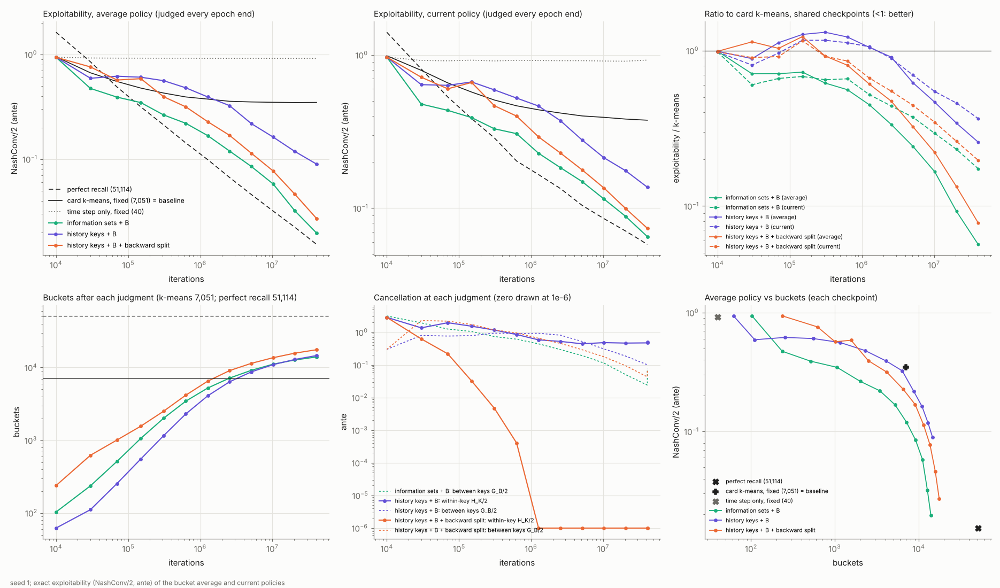

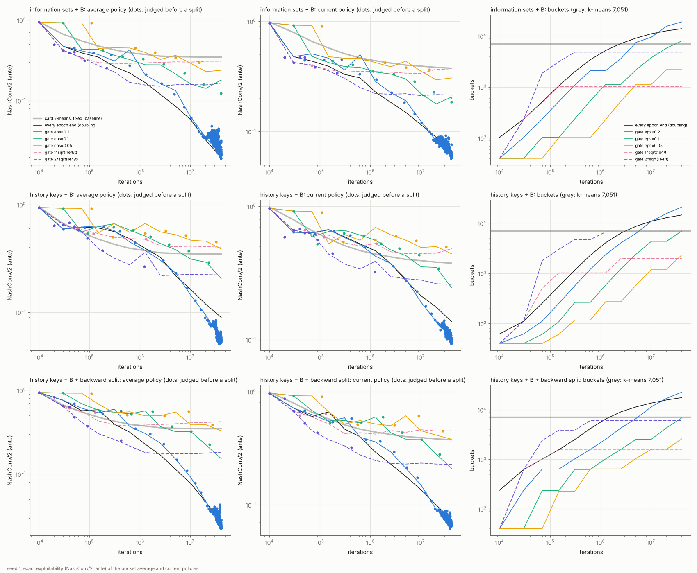

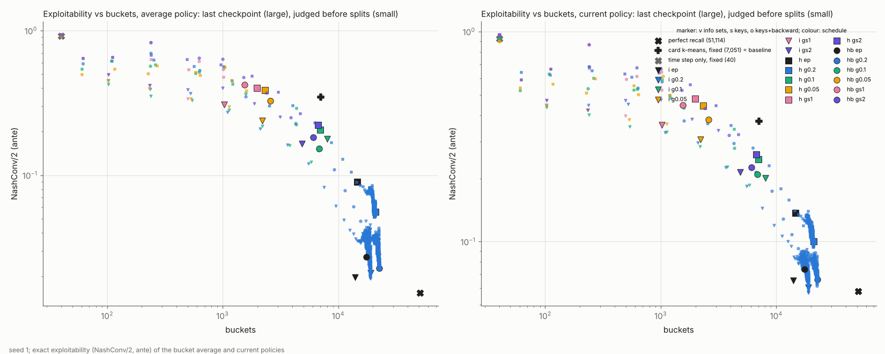

**관찰** (측정한 지점만; 교차점이나 추세를 외삽하지 않았다)
1. **역방향 분할로 열쇠 안 상쇄가 사라지고, 열쇠 단위의 손실 대부분이 회복됐다.**
   - 열쇠 안 상쇄 $H_K/2$는 판정마다 2.87 → 0.63 → 0.22 → 0.032 → 0.0047 → 0.0004 → 7·10⁻⁸ → 0이었다(seed 1). 세 seed 모두 0.63–2.55M 이후 정확히 0이다. 역방향 분할이 없으면 끝까지 0.47–0.53으로 남는다.
   - 역방향으로 나뉜 bucket 수는 판정마다 10, 95, 87, 58, 16, 2, 1, 0이다(seed 1). 실행 전체로는 263–274개다(매 epoch, 세 seed).
   - exploitability는 열쇠만 쓸 때의 0.29–0.30배다(세 seed). 현재 정책은 0.43–0.54배다.
2. **그래도 정보집합 단위보다는 1.1–1.5배 나쁘고 bucket이 23–27% 많다.** (매 epoch, 세 seed)
   - 원인은 확인하지 않았다. 후보는 첫 판정부터 bucket이 빨리 늘어 초반 학습량이 나뉘는 것이다(1만 반복 때 238개 대 103개).
3. **대가: 이 게임에서는 열쇠의 압축이 사라졌다.** 상쇄가 0이 된 뒤 열쇠는 정보집합의 99.4–99.8%를 구별한다(역방향 없이 83–85%). 상쇄를 없애려면 bucket 이력이 사실상 정보집합 전체를 기억해야 했다는 뜻이다.
   - bucket(전략 표) 수는 정보집합의 약 31%다.
   - 열쇠 표(라우팅)의 크기는 정보집합 수와 거의 같다.
   - 큰 게임에서도 그런지는 이 실험으로 알 수 없다.
4. **ε=0.2에서 처음으로 정리 H5의 종료 상태가 실제로 나왔다.**
   - 열쇠 + 역방향 ε=0.2는 29.1–30.5M에 처음으로 "문턱 통과 + 모든 bucket 일치($G_B=0$) + 열쇠 안 상쇄 0"인 판정에 이르렀다(세 seed). 이론 버전은 여기서 멈춘다.
   - 그때 인증값 $\rho/2$는 0.193–0.199다. 1만 반복 전 판정 정책의 실제 exploitability는 0.034–0.038로 인증값보다 5배쯤 작다.
   - 역방향이 없는 열쇠 ε=0.2도 같은 시기에 $G_B=0$에 이르렀다. 하지만 열쇠 안 상쇄 0.40이 남아 인증값이 0.59–0.60이고, 실제 값도 0.075–0.079로 두 배다.
   - 그 뒤에도 학습을 계속하면 평균 전략이 바뀌어 라벨이 다시 갈리고 분할이 이어졌다. 그 뒤 판정 중 분할이 없는 것은 44–47%다(정보집합 단위 58–60%).
5. **고정 ε 문턱은 같은 반복 수에서는 성능 개선이 일정하지 않았다.**
   - ε = 0.05, 0.1이면 문턱을 거의 통과하지 못한다. 4천만 반복 동안 분할이 5–8번이었고, bucket 2천–8천 개에서 0.15–0.39에 머물렀다.
   - ε = 0.2면 1,600만 반복 이후 검사의 32–64%가 통과해(전체로는 20–39%) 판정이 천 번 안팎 일어나고, bucket이 40% 이상 많아진다. 열쇠 단위는 매 epoch보다 낮아졌다(0.61–0.67배, 역방향 포함 0.78–0.85배). 정보집합 단위는 일정하지 않았다(0.73–1.08배).
   - 이 개선에는 판정 횟수와 bucket 수의 차이가 섞여 있다. "충분히 푼 뒤 판정"의 효과로 따로 떼어 보지 못했다.
   - **전체 합 문턱의 한계:** $\rho_{\mathcal P}$는 모든 bucket의 합이다. bucket이 2만 개일 때 몇 개를 나눠 자식이 표를 새로 시작해도 합은 거의 그대로다. 그래서 갓 나뉜 자식이 학습되기 전에 다음 판정이 온다. 전체 합은 "새 자식이 풀렸는지"를 보지 못한다.
6. **ε/√t 문턱은 추상화를 일찍 얼렸다.**
   - 마지막 분할이 7만–133만 반복이었고, bucket 1천–7천 개에서 멈춰 0.16–0.42였다.
   - 이유: 고정된 추상화에서도 $\rho_{\mathcal P}(\bar\sigma)$가 대략 1/√t로 준다(time step 40개 고정: 1만 → 255만 반복에 0.171 → 0.0093, 기울기 약 −0.53). 문턱과 같은 속도다. 그래서 $\rho_{\mathcal P}$/문턱 비가 거의 일정해지고(열쇠 + 역방향 2·√: 1.6, 1.7, 1.87), 한 번 문턱 위로 올라가면 다시 통과하지 못한다.
   - 줄어드는 문턱을 쓰려면 학습기의 수렴 속도보다 느리게 줄어야 한다. 예를 들면 분할 횟수 k에 대해 ε/√k(`--gate-decay sqrt_rounds`, 돌리지 않음)다.
7. **같은 크기에서는 모든 판정 방식이 k-means보다 훨씬 낮다.**
   - bucket 6–8천 개, 4,096만 반복 기준이다: k-means 0.348(7,051), 열쇠 + 역방향 ε=0.1 0.145–0.153, 정보집합 ε=0.1 0.181, 열쇠 + 역방향 2·√ 0.182, 열쇠 ε=0.1 0.206.
   - 세 번째 그림처럼, 판정 방식은 주로 frontier 위 어디서 멈추는지(bucket 수)를 정한다. 같은 bucket 수에서의 값은 방식끼리 대체로 1.6배 안이다.

**재현**

```bash
python agents/adaptive_buckets/aswiss/export.py small DATA/small
python agents/adaptive_buckets/aswiss/export_history.py small DATA/small
g++ -O3 -std=c++17 agents/adaptive_buckets/aswiss/aswiss.cpp -o aswiss
# 단위: --unit infoset | --unit history | --unit history --backward 1
# 판정 시점: (없음 = 매 epoch 끝) | --gate-eps 0.2 | --gate-eps 1 --gate-decay sqrt_iters
./aswiss --tree DATA/small --buckets DATA/small/bucket_timestep.bin --mode es --iters 40960000 --epoch0 10000 \
  --split cum --seed 1 --label avg --unit history --backward 1 --gate-eps 0.2 --out RUN
python agents/adaptive_buckets/aswiss/eval.py DATA/small RUN              # checkpoint별 정확 exploitability
python agents/adaptive_buckets/aswiss/eval_judgments.py DATA/small RUN --delete   # 분할 직전 판정 정책
python agents/adaptive_buckets/aswiss/plot_backward.py RUNS_DIR REF_DIR results_backward_small_seed1
```

- 실행 폴더 이름은 `단위_판정시점_s시드`다. 단위는 `i`, `h`, `hb`, 판정 시점은 `ep`, `g0.2`, `gs1`처럼 쓴다.
- `REF_DIR`은 `results_data/fixed_small_seed1.tar.gz`를 풀어 나오는 `runs41m/`이다.
- 원자료: `results_data/backward_small.tar.gz`(34개 실행의 `log.csv`, `judgments.csv`, `gate.csv`, `exploitability.csv`, `judgments_expl.csv`). 풀면 `runs_bw/`가 나오고, 위 명령으로 그림이 바이트 단위로 같게 다시 그려진다.
- ε=0.2 비교군은 분할 직전 정책 파일이 판정마다 3.2MB씩 생긴다(실행 하나에 600–700번). `--delete`로 평가 후 지운다.

## 비교 조건과 남은 차이

- **평가:** 모든 방식은 같은 정확한 BR 평가기, 같은 seed, 같은 반복 수로 평가했다. LBR이나 Local BR-gap이 아니다.
- **seed:** 하나뿐이다. 신뢰구간은 없다.
- **k-means 기준선의 조건:**
  - bucket 수를 분할 실행의 최종 time step별 개수(10,129개)에 **사후적으로** 맞췄다.
  - 카드 특징(자기 rank 개수, 자기 공개 rank, 상대 공개 rank, 이전 street 베팅)의 서로 다른 행 수가 상한이라 7,051개에서 멈췄다.
  - 학습 데이터는 쓰지 않았다.
- **40.96M 재실행의 k-means:** 같은 7,051개 분할을 그대로 썼다. K는 2.55M 조건 없는 실행에 맞춘 값이다. 40.95M의 분할 방식들(2,439–31,943개)과 bucket 수를 다시 맞추지 않았다.
- **분할의 정보원 차이:** ASWISS 분할은 그 실행 자신의 샘플 regret으로 정한다. k-means는 카드 특징만 쓴다. 평가 조건(트리, 평가기, checkpoint, 시작 seed)을 맞춰도 이 차이는 남는다. 샘플 경로는 전략이 달라지는 순간부터 실행마다 갈라진다.
- **마지막 epoch 제외:** 마지막 1만 반복짜리 짧은 epoch는 모든 곡선에서 뺐다. 분할 직후 자식의 평균이 거의 비어 있어서 bucket 평균 값이 왜곡된다.
- **메모리 절감 아님:** 추적을 p = 1로 했으므로 학습 메모리 절감을 보인 결과가 아니다. 일부만 추적(p < 1)하는 버전은 아직 만들지 않았다.
