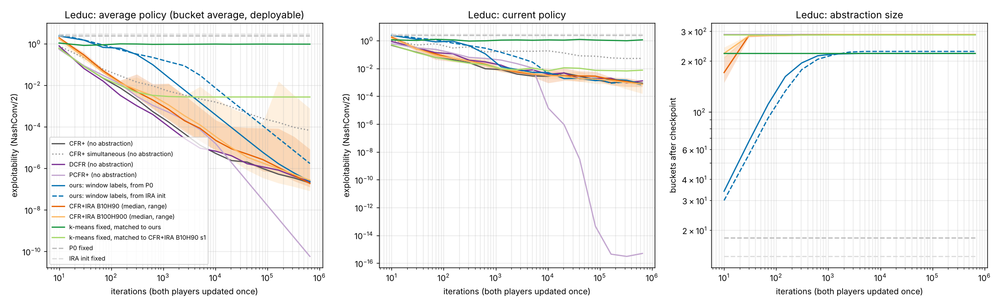
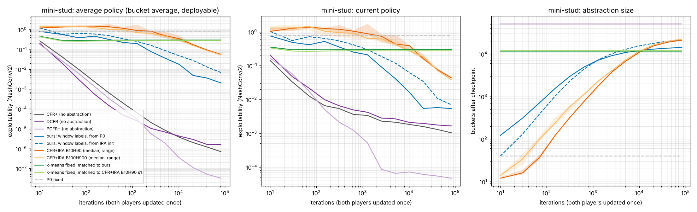
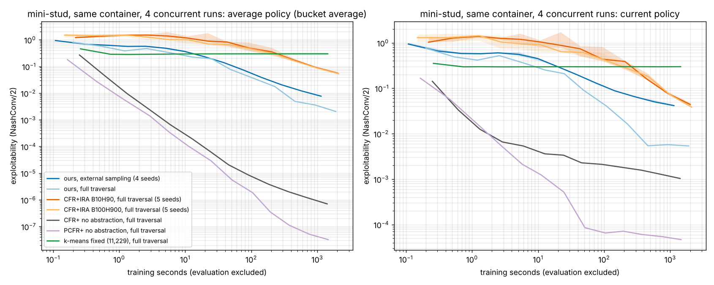

# SOTA 비교 1단계: CFR+IRA, DCFR, PCFR+와의 정확한 비교 (2026-11-04)

본문 방법(정리 1: 정보집합 단위 구간 누적 후회 라벨, `../../ASWISS_CONVERGENCE_KO.md`)을 적용 가능한 기존 방법과 같은 학습기, 같은 예산, 같은 평가기로 비교한다. 이 단계는 전체 트리 순회와 정확한 exploitability를 쓸 수 있는 작은 게임(Kuhn, Leduc, mini-stud)이다.

## 비교 대상과 이유

| 비교군 | 무엇 | 왜 |
|---|---|---|
| **CFR+IRA** (Čermák, Lisý, Bošanský, arXiv 1803.05392) | 풀이 중 추상화를 정제하면서 원 게임 균형 보장이 있는 유일한 기존 방법 | 본문 방법의 직접 경쟁 |
| CFR+, DCFR, PCFR+ (추상화 없음) | 표 기반 풀이기의 표준과 SOTA (DCFR: 포커에서 가장 빠른 쪽, PCFR+: 그 밖의 게임에서 가장 빠른 쪽) | 추상화 없이 원 게임을 바로 풀 때의 기준 |
| k-means 고정 | 카드 특징 k-means(`../kmeans.py`), P₀ 묶음별 bucket 수를 비교 대상의 최종 분할에 맞춤 | AGENTS.md의 기준선 |
| P₀ 고정, IRA 초기 추상화 고정 | 출발점 그대로 | 추상화 오차의 크기 |

## 구현 (`refine.cpp`)

- **학습기:** 모든 비교군이 같은 전체 순회 학습기를 쓴다. 기본은 교대 갱신이다(한 반복 = 플레이어 0 갱신 → 플레이어 1 갱신, 각각 전체 순회). 평균은 선형 가중(CFR+), t²(DCFR, PCFR+), 지연 0이다.
- **본문 방법(`--refine label`):** `../aswiss.cpp --mode full --split cum --label window`와 같은 규칙이다. epoch(10, 30, 70, … 반복) 끝마다 각 정보집합의 구간 누적 정확 후회에서 argmax를 라벨로 잡는다. 반사실 도달확률 합으로 나눈 값이 `tol`(1e-3) 이하면 "없음"이다. 라벨이 갈린 bucket을 라벨별로 나눈다.
- **CFR+IRA(`--refine ira`):** 원문 Algorithm 6–10을 따른다.
  - 휴리스틱 갱신: 매 반쪽 반복(한 플레이어 갱신)마다 행동하는 플레이어의 정보집합 k_h개를 뽑는다. 그 반쪽 반복 하나의 후회로 γ = {a : r(a) ≥ max r − 1/(5√t)}를 만들고, γ가 같은 것끼리 묶는다. 묶음이 둘 이상이면 가장 큰 묶음이 뽑히지 않은 멤버를 데리고, 모든 묶음이 새 bucket이 된다.
  - 후회 상한 갱신: 2^j 길이 구간마다 k_b개를 뽑아 구간 누적 후회를 추적한다. max_a R(a)/(t − T_j) > Δ_I√|A(I)|/(100√t)이면 그 정보집합을 떼어 낸다(5.1절의 설정).
  - 초기 추상화: 4.1.1절대로 (플레이어, 자기 행동열 길이, 행동 수)마다 bucket 하나다.
  - 설정: 원문에 보고된 B10H90과 B100H900이다.
  - 원문과 다른 점:
    - 원문 의사코드는 묶음이 하나뿐일 때도 bucket을 다시 만들어 표를 초기화하는 것처럼 읽힌다. 학습이 불가능해지므로 의도가 아니라고 보고, 묶음이 둘 이상일 때만 나눈다.
    - 평균 지연은 원문의 100 대신 0이다. 모든 비교군을 같게 하려는 것이다.
    - 원문은 정확한 최선 응답으로 ε 도달 시 멈추지만, 여기서는 고정 예산을 돌린다.
- **DCFR(1.5, 0, 2), PCFR+:** 원 논문의 기본값이다.
- **검증:**
  - 동시 갱신 모드의 추상화 없는 CFR+와 본문 방법이 `../aswiss.cpp --mode full`과 Leduc 65만 5,350반복의 모든 checkpoint 정책 파일에서 바이트 단위로 같다(24개, 48개). 본문 방법의 최종 bucket은 222개로 같다.
  - Kuhn에서 전체 실행 스크립트를 확인했다.

## 실행

```bash
bash agents/adaptive_buckets/aswiss/compare/run_compare.sh leduc OUT/leduc            # 65만 5,350반복, CFR+IRA seed 10개
bash agents/adaptive_buckets/aswiss/compare/run_compare.sh small OUT/small 81910 5    # mini-stud, CFR+IRA seed 5개
```

트리 내보내기, 빌드, 모든 비교군 학습, k-means 맞춤, 정확한 평가(`../eval.py`), 그림과 표(`plot_compare.py`)까지 한다.

## 결과 1: Leduc (정보집합 288개, 65만 5,350반복)



평균 정책은 배포 가능한 bucket 평균이다(추상화 없는 비교군은 sequence-form 평균과 같다). CFR+IRA는 seed 10개의 중앙값 [최소, 최대]이다.

| 비교군 | bucket (최종) | 1,270 | 20,470 | 81,910 | 655,350 | 현재 정책 655,350 |
|---|---:|---:|---:|---:|---:|---:|
| CFR+ (추상화 없음) | 288 | 1.69e-4 | 2.37e-6 | 9.75e-7 | 1.99e-7 | 8.5e-4 |
| DCFR (추상화 없음) | 288 | 1.03e-4 | 4.01e-6 | 1.17e-6 | 2.27e-7 | 1.3e-3 |
| PCFR+ (추상화 없음) | 288 | 5.0e-4 | 1.89e-6 | 2.95e-8 | **5.8e-11** | 5e-16 |
| **본문 방법 (P₀에서)** | **222** | 2.34e-2 | 9.19e-5 | 5.87e-6 | 2.35e-7 | 7.4e-4 |
| 본문 방법 (IRA 초기 추상화에서) | 228 | 0.135 | 1.77e-3 | 1.10e-4 | 1.71e-6 | 6.5e-4 |
| CFR+IRA B10H90 | 287 [286, 288] | 6.8e-4 | 8.7e-6 | 2.6e-6 | 1.87e-7 [1.2e-7, 8.4e-6] | 7.4e-4 |
| CFR+IRA B100H900 | 287 [286, 288] | 1.1e-3 | 9.9e-6 | 1.8e-6 | 2.68e-7 [8.1e-8, 7.6e-4] | 7.3e-4 |
| k-means 고정 (본문 방법에 맞춤) | 222 | 0.935 | 0.939 | 0.955 | 0.947 | 1.13 |
| k-means 고정 (CFR+IRA에 맞춤) | 287 | 2.9e-3 | 2.7e-3 | 2.7e-3 | 2.7e-3 | 7.4e-3 |
| P₀ 고정 | 18 | 2.35 | 2.35 | 2.35 | 2.35 | 2.35 |

- **CFR+IRA는 Leduc를 거의 다 푼다.** 처음 30반복 안에 휴리스틱 갱신이 288개 중 284–288개로 나눠, 이후로는 사실상 추상화 없는 CFR+다. 그래서 초반에는 본문 방법보다 훨씬 낮고, 끝에서는 CFR+와 같다.
- **본문 방법은 bucket 222개(77%)로 같은 정확도에 도달한다.** 655,350반복에서 2.35e-7이다. 추상화 없는 CFR+(1.99e-7)와 CFR+IRA 중앙값(1.87e-7)과 같은 수준이다. 초반이 느린 것은 18개에서 시작해 두 배 구간 끝에서만 나누기 때문이다.
- **같은 bucket 수의 k-means는 멈춘다.** 222개는 0.95, 287개(하나만 합친 것과 비슷)도 2.7e-3에서 더 내려가지 않는다.
- **PCFR+가 압도적으로 빠르다.** 추상화 없는 PCFR+는 5.8e-11이다. 이 크기의 게임에서는 추상화 없이 좋은 풀이기를 쓰는 것이 가장 낫다. 추상화의 이득은 원 게임을 다룰 수 없는 크기에서만 의미가 있다.
- 교대 갱신이 동시 갱신보다 300배 이상 낫다(추상화 없는 CFR+ 1.99e-7 대 6.73e-5). 정리 1은 동시 갱신을 가정한다.

## 결과 2: mini-stud small (정보집합 51,114개)

81,910반복, CFR+IRA는 seed 5개의 중앙값 [최소, 최대]이다. 표 전체는 [results_small.md](results_small.md)에 있다.



| 비교군 | bucket 20,470 | bucket 81,910 | 평균 정책 20,470 | 평균 정책 81,910 | sequence-form 평균 81,910 | 현재 정책 81,910 |
|---|---:|---:|---:|---:|---:|---:|
| CFR+ (추상화 없음) | 51,114 | 51,114 | 2.02e-6 | 7.04e-7 | 7.04e-7 | 1.03e-3 |
| DCFR (추상화 없음) | 51,114 | 51,114 | 2.91e-6 | 1.58e-6 | 1.58e-6 | 1.65e-3 |
| PCFR+ (추상화 없음) | 51,114 | 51,114 | 1.12e-7 | **3.23e-8** | 3.23e-8 | 4.66e-5 |
| **본문 방법 (P₀에서)** | 13,006 | **14,145** | 4.88e-3 | **2.05e-3** | 6.04e-4 | 5.37e-3 |
| 본문 방법 (IRA 초기 추상화에서) | 17,895 | 21,215 | 2.77e-2 | 6.85e-3 | 2.76e-3 | 6.97e-3 |
| CFR+IRA B10H90 | 15,527 [15,456, 15,689] | 21,066 [21,000, 21,330] | 0.173 | 5.64e-2 [5.32e-2, 5.79e-2] | 4.81e-2 | 4.40e-2 |
| CFR+IRA B100H900 | 16,481 [16,212, 16,646] | 22,218 [21,950, 22,591] | 0.157 | 5.33e-2 [4.83e-2, 6.20e-2] | 4.21e-2 | 3.84e-2 |
| k-means 고정 (본문 방법에 맞춤) | 11,229 | 11,229 | 0.296 | 0.297 | 0.297 | 0.298 |
| k-means 고정 (CFR+IRA에 맞춤) | 12,074 | 12,074 | 0.275 | 0.275 | 0.275 | 0.276 |
| P₀ 고정 | 40 | 40 | 0.764 | 0.764 | 0.764 | 0.764 |

- **본문 방법이 CFR+IRA보다 26–28배 낮고 bucket은 1/3 적다.** 81,910반복에서 평균 정책이 2.05e-3(14,145개) 대 5.33e-2–5.64e-2(21,066–22,218개)다. 20,470반복에서는 32–35배 차이다(4.88e-3 대 0.157–0.173). 현재 정책도 5.37e-3 대 3.84e-2–4.40e-2다.
- **CFR+IRA는 아직 나누는 중이다.** bucket이 15.5k → 21k로 계속 늘고 exploitability도 계속 내려간다. 본문 방법의 bucket은 13.0k → 14.1k로 늘어나는 속도가 줄었다. 곡선이 어디서 만나는지는 이 예산 밖이라 말할 수 없다(기울기로 외삽하지 않는다).
- **출발점이 중요하다.** 같은 본문 방법이라도 CFR+IRA의 초기 추상화(자기 행동열 길이와 행동 수만으로 묶음, 14개)에서 시작하면 bucket 21,215개에 6.85e-3이다. P₀(time step 40개: 좌석, street, 베팅 진행, 행동집합)에서 시작한 쪽이 bucket도 적고 3.3배 낮다. CFR+IRA와 같은 출발점끼리 비교해도 본문 방법이 약 8배 낮다(6.85e-3 대 5.33e-2–5.64e-2).
- **k-means는 bucket 수를 맞출 수 없다.** 카드 특징이 같은 정보집합은 나눌 수 없어서 11,229개와 12,074개가 최대였다. 둘 다 0.28–0.30에서 멈춘다. 본문 방법(14,145개)은 같은 반복에서 145배 낮다.
- **추상화 없는 풀이기가 가장 낫다.** mini-stud는 전체 순회로 원 게임을 바로 풀 수 있는 크기라서 PCFR+ 3.2e-8, CFR+ 7.0e-7이다. 추상화가 쓸모 있는 것은 정보집합 표를 다 들 수 없거나 전체 순회를 할 수 없는 게임에서다. 그래서 다음 절의 샘플링 비교가 실제 쓰임에 더 가깝다.
- 메모리: 학습 중 본문 방법은 모든 정보집합의 구간 후회를 들고 있다(51,114 × 행동 수). CFR+IRA는 감시하는 k_b + k_h개(100 또는 1,000)만 든다. 배포 정책 크기(bucket 수)는 본문 방법이 작다.

## 결과 3: 같은 시간에서 샘플링한 본문 방법 대 전체 순회 CFR+IRA (mini-stud)

CFR+IRA는 매 반복 전체 트리를 순회해야 한다. 본문 방법은 외부 샘플링으로도 돌 수 있다(정리 1의 설정). 그래서 같은 학습 시간에서 비교했다.

- **본문 방법, 외부 샘플링:** `../aswiss.cpp --mode es --split cum --z 2`, 진단 순회 없음, seed 4개, 1억 6,383만 반복(epoch 1만에서 두 배씩).
- 나머지는 결과 2의 전체 순회 실행이다.
- 모두 이 컨테이너(4코어)에서 동시에 4개씩 돌렸다. 초는 학습 시간이고 평가는 뺐다. 다른 기계나 다른 부하와는 비교할 수 없다.



| 비교군 | 학습 시간 | 반복 | bucket | 평균 정책 | 현재 정책 |
|---|---:|---:|---:|---:|---:|
| 본문 방법, 외부 샘플링 (seed 4개 중앙값 [최소, 최대]) | 577 s | 8,191만 | 26,888 | 1.20e-2 [1.19e-2, 1.23e-2] | 5.02e-2 |
| 〃 | 1,139 s | 1억 6,383만 | 28,130 | 7.67e-3 [7.45e-3, 8.00e-3] | 4.15e-2 |
| 본문 방법, 전체 순회 | 459 s | 20,470 | 13,006 | 4.88e-3 | 5.42e-3 |
| 〃 | 915 s | 40,950 | 13,710 | 3.60e-3 | 5.74e-3 |
| 〃 | 1,904 s | 81,910 | 14,145 | 2.05e-3 | 5.37e-3 |
| CFR+IRA B10H90, 전체 순회 (seed 1) | 443 s / 922 s / 2,010 s | 20,470 / 40,950 / 81,910 | 15,689 / 18,960 / 21,066 | 0.165 / 9.39e-2 / 5.32e-2 | 0.153 / 7.42e-2 / 4.42e-2 |
| CFR+IRA B100H900, 전체 순회 (seed 1) | 465 s / 984 s / 2,104 s | 20,470 / 40,950 / 81,910 | 16,481 / 20,024 / 22,218 | 0.155 / 9.43e-2 / 5.33e-2 | 0.149 / 7.25e-2 / 3.79e-2 |
| CFR+ 추상화 없음, 전체 순회 | 692 s | 40,950 | 51,114 | 1.21e-6 | 1.29e-3 |

- **같은 시간이면 샘플링한 본문 방법도 CFR+IRA보다 낮다.** 약 1,000초에서 7.67e-3(1,139 s) 대 9.4e-2(922–984 s)로 12배, 약 500초에서 1.20e-2(577 s) 대 0.155–0.165(443–465 s)로 13배다. CFR+IRA가 2,000초를 써도 5.3e-2로, 샘플링 쪽의 절반 시간 값보다 높다.
- **mini-stud에서는 본문 방법도 전체 순회가 샘플링보다 낫다.** 915초의 전체 순회(3.60e-3, bucket 13,710)가 1,139초의 샘플링(7.67e-3, bucket 28,130)보다 낮고 bucket도 절반이다.
  - 샘플링 잡음 때문에 z=2 검정이 가짜 라벨을 내서 더 많이 나눈다(정리 1은 수렴만 보장하고 bucket 수는 보장하지 않는다).
  - 그리고 이 크기에서는 전체 순회가 감당할 만하다. 샘플링이 필요한 것은 전체 순회를 할 수 없는 게임(7-stud)이다.
- **이 크기에서는 추상화 없는 전체 순회가 모두를 압도한다.** CFR+는 692초에 1.21e-6이다(PCFR+는 결과 2 참고).
- **남은 차이 (AGENTS.md):** 학습기가 다르다(외부 샘플링: 교대 순회, 상대 노드 단순 선형 평균; 전체 순회: 교대 갱신, 선형 평균). 그래서 이것은 방법 전체의 비교다. 평가기는 모두 같은 정확한 최선 응답이다. seed 수가 다르다(샘플링 4, CFR+IRA 5, 나머지 1). 표의 CFR+IRA 시간은 seed 1이고, 범위는 그림에 있다.

## 관련 연구 확인: 표본 기반 CFR+IRA가 이미 있는가 (2026-11-06)

**질문:** CFR+IRA의 CFR+를 MCCFR로 바꾸기만 하면 되는 일이라 연구가 멈췄거나, 실무에서는 이미 쓰는데 논문만 없는 것은 아닌가.

**원문의 입장 (`arXiv 1803.05392v2`, Artificial Intelligence 2020):**
- 6.1절 향후 과제에서 이렇게 말한다. "a notable limitation of the presented methods is the need to traverse the complete game tree of the unabstracted game in each iteration. Therefore, it would be interesting to investigate a combination of CFR+IRA with sampling techniques"
- 원문 Algorithm 8의 "SampleInformationSets"는 트리 표본이 아니다. 원 정보집합의 regret을 따로 저장할 정보집합을 메모리 한도(k_h, k_b) 안에서 고르는 것이고, 순회는 여전히 전체다.
- 종료 조건(Algorithm 6, 6행)도 원 게임 최선 응수 두 번, 즉 전체 순회다.

**그대로 바꿔 끼우면 안 되는 이유:**
1. 분할 규칙이 정확한 값을 전제로 한다.
   - 휴리스틱 갱신은 같은 추상 집합의 정보집합끼리 한 반복 regret을 허용오차 1/(5√t)로 비교한다.
   - regret 경계 갱신은 정보집합별 누적 regret을 Δ√|A|/(100√t)와 비교한다.
   - 표본 regret의 잡음은 한 번에 보수 범위 크기라, 이 허용오차로는 거의 모든 집합이 갈라진다. 허용오차를 키우면 반대로 거의 안 갈라진다.
   - 그래서 유의성 판정(z 검정)과, 잡음을 담은 수렴 정리(H_B와 조건 (T))가 따로 필요하다.
2. 큰 게임에서는 원 정보집합이 다시 오지 않는다. 7-stud 학습 중 원 정보집합은 거의 한 번씩만 나온다(`../stud7/README_KO.md`). 그래서 정보집합 단위 규칙은 판정할 표본이 없다. 원자·bucket 이력 같은 라벨 단위가 필요하다.
3. 원 정보집합 통계를 들고 있으면 메모리 절약이라는 목적이 무너진다.

**문헌 검색 (2026-11-06):**
- 표본 기반으로 정보 추상화를 학습 중 정제하면서 원 게임 수렴을 보이는 연구는 찾지 못했다.
- 이 세션에서는 arxiv.org 본문을 열 수 없었다. 아래 설명은 검색 결과의 초록과 요약에 근거한다.

| 연구 | 하는 일 | 본문 방법과의 차이 |
|---|---|---|
| EVPA (Li & Huang, ICLR 2025; 저장소 `agents/evpa`) | 실시간 하위 게임 풀이에서 기댓값 기반 온라인 정보 추상화 + minimax 가지치기 | 하위 게임 탐색용이고, 학습 중 regret 라벨로 쪼개지 않는다 |
| WEVA (Li & Huang, arXiv 2605.10900, 2026-05) | 전체 게임 CFR을 짧게 돌린 뒤 패별 기댓값 특징을 k-means++로 묶는다 | 한 번 만드는 추상화이고, 전체 게임 순회가 필요하다 |
| KrwEmd (arXiv 2511.12089), Beyond Outcome-Based Imperfect-Recall (arXiv 2510.15094) | 불완전 기억 추상화의 특징·거리 개선 | 학습 전에 만드는 정적 추상화 |
| Abstraction Agent (Li & Huang, Findings of EMNLP 2026) | LLM이 특징을 만들고 k-means로 묶는다 | 정적 |
| Brown & Sandholm, IJCAI 2015 (Simultaneous Abstraction and Equilibrium Finding) | 풀이 중 행동 추상화에 행동을 더한다 | 정보 추상화가 아니라 행동 추상화다 |

**실무:**
- 공개된 최상위 시스템이 쓰는 방식은 다음과 같다.
  - Libratus·Pluribus: 미리 만든 고정 추상화 + MCCFR 청사진 + 실시간 탐색
  - DeepStack·ReBeL·Student of Games: 학습 + 탐색
- 표본 기반 regret으로 정보 추상화를 정제한다는 공개 기록은 찾지 못했다. 비공개 사용 여부는 확인할 수 없다.

**남은 확인:**
1. 학술지판의 Google Scholar "인용한 논문" 목록을 직접 훑는다.
2. 원문 분할 규칙을 그대로 MCCFR에 넣은 "표본 CFR+IRA" 비교 실험을 mini-stud에서 해 본다. 같은 표본 수에서 과분할 또는 미분할이 나오는지 보면, "그냥 바꿔 끼우면 된다"를 직접 반박하거나 확인할 수 있다.

## 정리와 다음 단계

- **직접 경쟁(CFR+IRA)과의 비교:**
  - Leduc에서는 둘 다 원 게임 정확도에 도달한다. CFR+IRA는 사실상 추상화를 다 풀고, 본문 방법은 77%의 bucket을 쓴다.
  - mini-stud에서는 같은 반복 수에서 본문 방법이 26–28배 낮고 bucket은 1/3 적다. 같은 시간에서는 샘플링한 본문 방법도 12–13배 낮다.
- **추상화 없는 SOTA 풀이기와의 비교:** 두 게임 모두 원 게임을 바로 풀 수 있는 크기라서 PCFR+·CFR+가 압도한다. 추상화 방법들의 쓰임은 정보집합 표나 전체 순회가 불가능한 게임에 있다.
- **이 비교가 말하지 않는 것:**
  - 7-stud 규모에서의 상대 성능. CFR+IRA는 거기서 돌 수 없다.
  - mini-stud는 seed 1개 트리 하나, 예산 하나다.
  - CFR+IRA의 원 설정(평균 지연 100, ε 도달 시 정지)과 다른 점은 위 "구현"에 적었다.
- **다음:** 7-stud 비교군 선정(신경망 일반화 계열, 실시간 탐색)은 대화에서 논의 중이다.

---

# SOTA 비교 2단계: 같은 학습 시간에서 MMD, ESCHER, k-means, MCCFR (2026-11-07)

ASWISS를 **순수 MCCFR** 위에서 돌린다. 외부 샘플링에, RM+ 하한이 없는 regret matching과 균등 평균을 쓰며 MCCFR+가 아니다(`--plain 1`). 카드 군집 같은 사전 정보는 쓰지 않는다. 라벨은 정보집합마다 구간 표본 후회로 매기고, 출발점은 P₀(시점마다 bucket 하나)다.

모든 방법에 같은 학습 시간을 준다. 모든 체크포인트에서 정확한 exploitability(NashConv/2)와 그때까지 처리한 표본 수(root 수)를 잰다.

## 비교 조건

| 항목 | 조건 |
|---|---|
| 하드웨어 | 같은 기계(이 컨테이너, 4코어). 런마다 코어 하나, 동시에 도는 런은 4개 이하 |
| 예산 | 학습 시계 `train_seconds` = 경과 시간 − 체크포인트 저장·진단 시간. Kuhn 300초, Leduc과 mini-stud 1,800초. 예산을 넘긴 뒤 진행 중이던 반복/갱신까지 마치고 멈춘다(ESCHER Leduc 1,851초) |
| 구현 | 모두 같은 C++(`-O3`, 단일 스레드). 신경망은 `../stud7/sota/nn.hpp`(BLAS·GPU 없음) |
| 평가 | 같은 정확한 평가기(`../eval.py`)와 같은 트리. 실전 정책(평균 정책, MMD는 마지막 반복)과 현재 정책을 따로 잰다 |
| seed | 1개(seed 1). seed 사이 구간은 아직 없다 |

- **ASWISS:** P₀에서 출발. 정보집합마다 구간 표본 후회 R로 라벨을 매긴다. R(a*) > z·√Q(a*)(z = 2)일 때만 라벨이 붙는다.
- **MCCFR:** 같은 순수 MCCFR, 추상화 없음.
- **k-means:** 카드 특징 k-means(`../kmeans.py`). 시점 묶음마다 bucket 수를 ASWISS의 최종 분할에 맞추고, 같은 순수 MCCFR로 푼다.
  - 특징: 자기 카드·공개 카드의 rank 개수, 이전 street 베팅.
  - 남는 차이: 묶음 안의 서로 다른 특징 행 수가 상한이다. 그래서 mini-stud에서는 11,693개밖에 못 만들었다(ASWISS 21,722개). 또 ASWISS는 런마다 표본 후회로 정보집합을 나누고, k-means는 표본과 무관한 고정 특징으로 나눈다.
  - Kuhn에서는 ASWISS가 정보집합 12개를 모두 나누므로 k-means도 MCCFR과 같은 런이 된다.
- **MMD:** 논문 심층 설정. α_t = η_t = 0.05·√(1e7/t), clip 0.3, γ 0.99, 30 epoch × minibatch 128, lr 5e-5, 128×128.
- **ESCHER:** 논문 Table 4 예산. 가치 1,000판 + 후회 1,000판, 배치 2048, 500/500/10,000 스텝, 256×128, 저수지 1e5, 가치 탐험 0.01, 가치망 매 반복 재초기화, argmax fallback.
  - 평균 정책망 학습(체크포인트마다 10,000 스텝)은 학습 시계에서 뺐다. 원 논문도 평가할 때만 이 학습을 한다.
  - 표의 "실제 시간"에는 이 학습 시간이 들어 있다.
- **ReBeL:** 이 트리용 구현이 없어 돌리지 않았다. 우리 구현은 7-card stud 전용이다.

## 실행

```bash
bash agents/adaptive_buckets/aswiss/compare/run_walltime.sh kuhn  OUT/kuhn  300  1 4
bash agents/adaptive_buckets/aswiss/compare/run_walltime.sh leduc OUT/leduc 1800 1 4
bash agents/adaptive_buckets/aswiss/compare/run_walltime.sh small OUT/small 1800 1 4
python agents/adaptive_buckets/aswiss/compare/plot_walltime_compare.py OUT/small small walltime_small \
    --speedup mmd=2.5 escher=2.3 --floor "ASWISS final partition=FLOOR/aswiss/exploitability.csv" ...
```

- 컨테이너가 08:42에 재시작됐다. 이때 끊긴 Leduc ESCHER·k-means와 mini-stud 런 5개는 같은 설정의 `results_data/walltime/job_after_restart.sh`로 코어 4개 큐에서 다시 돌렸다.
- 그림: `walltime_{kuhn,leduc,small}.png`. 표: 같은 이름의 `.md`. 원자료: `results_data/walltime/`.

## 결과: 학습 시간 끝의 exploitability (NashConv/2, 실전 정책)

| 게임 (정보집합 수) | ASWISS | MCCFR (추상화 없음) | k-means | MMD | ESCHER |
|---|---:|---:|---:|---:|---:|
| Kuhn 300초 (12) | 1.4e-5 (12 bucket) | 2.2e-5 | 3.0e-5 (= MCCFR 런) | 0.047 | 0.154 |
| Leduc 1,800초 (288) | 2.6e-4 (206 bucket) | 1.9e-4 | 0.77 (206 bucket) | 0.42 | 2.09 |
| mini-stud 1,800초 (51,114) | 0.047 (21,722 bucket) | 1.1e-3 | 0.31 (11,693 bucket) | 0.62 | 2.24 |

| 게임 | 처리한 표본 (같은 시간) | ESCHER 실제 시간 |
|---|---|---:|
| Kuhn | 표 기반 3.5e9 순회 · MMD 2.1e5판 · ESCHER 1.8e4판(6반복) | 1,796초 |
| Leduc | 표 기반 5.5e9–6.3e9 순회 · MMD 6.5e5판 · ESCHER 8.1e4판(27반복) | 4,679초 |
| mini-stud | 표 기반 1.4e9–1.5e9 순회 · MMD 5.9e5판 · ESCHER 6.9e4판(23반복) | 4,956초 |

같은 반복 수(같은 체크포인트)에서의 비율은 다음과 같다. 1보다 작으면 ASWISS가 낮다. 외삽은 하지 않았다.

| 게임 | 순회 2e6 | 3.3e7 | 5.2e8 | 1e9 |
|---|---|---|---|---|
| Leduc ASWISS/k-means | 0.052 | 0.015 | 0.0012 | 0.00079 |
| Leduc ASWISS/MCCFR | 2.6 | 3.7 | 1.2 | 1.05 |
| mini-stud ASWISS/k-means | 1.7 | 0.60 | 0.14 | 0.079 |
| mini-stud ASWISS/MCCFR | 6.4 | 14.6 | 20.1 | 17.6 |

**mini-stud 분할의 바닥.** 각 최종 분할을 고정하고 전체 순회 CFR+를 5,110반복 돌렸다(`results_data/walltime/small_s1/floor_*`).

| 분할 | exploitability |
|---|---|
| ASWISS 최종 분할(21,722) | 4.7e-3–5.0e-3에서 평평해짐 |
| k-means 분할(11,693) | 0.28–0.29 |
| 추상화 없음 | 3.8e-4, 계속 내려감 |

ASWISS 분할은 학습 중에도 계속 세분되므로, 이 바닥은 1,800초 시점 분할의 값일 뿐이다.

## 해석

1. **고정 추상화(k-means) 대비:**
   - Leduc과 mini-stud 모두 k-means는 추상화 오차의 바닥(0.77, 0.29)에 막힌다. ASWISS는 그 아래로 계속 내려간다.
   - 학습 시간 끝의 비율: Leduc 3e-4, mini-stud 0.16.
   - 단, mini-stud의 짧은 예산(순회 2e6 부근, 2초)에서는 ASWISS가 k-means보다 1.7배 높다. 교차는 측정 체크포인트 사이에서 일어났다.
2. **추상화 없는 순수 MCCFR 대비:**
   - Leduc에서는 1,800초 끝에 1.37배 높다. 차이가 줄어드는 중이다(같은 체크포인트에서 3.7 → 1.05–1.34).
   - mini-stud에서는 끝에 41배 높고, 같은 체크포인트에서도 15–20배로 비율이 줄지 않는다. 원인은 두 가지가 겹친 것이다.
     - ASWISS 최종 분할의 바닥(5e-3)이 MCCFR의 1,800초 값(1.1e-3)보다 이미 높다. 표본 z 검정을 아직 통과하지 못해 합쳐져 있는 정보집합이 남아 있다.
     - ASWISS 런 자체(0.024–0.047)가 그 바닥보다 5–10배 위다. 분할된 자식은 후회와 평균 합을 0에서 다시 시작하는데, bucket이 끝까지 늘고 있어(1,288초 → 1,800초에 399개) 최근에 다시 시작한 bucket이 많다.
   - 마지막 점(1,800초)이 1,288초보다 나쁜 것(0.047 > 0.024)도 같은 이유다. 예산이 마지막 epoch를 정상 길이의 40%에서 끊었고, 1,288초에 641개로 나뉜 자식이 아직 덜 수렴했다.
   - 결론: 원 게임 표를 메모리에 그대로 둘 수 있는 크기에서는 순수 MCCFR이 더 낫다. ASWISS가 아끼는 것은 메모리(mini-stud에서 표의 42%)이고, 그 대가로 exploitability가 높다.
3. **신경망 방법(MMD, ESCHER) 대비:**
   - 같은 CPU 시간에서는 세 게임 모두 표 기반 방법이 2–5자릿수 낮다.
   - 하드웨어를 뺀 표본 축(그림의 (d)) 결과:
     - Kuhn과 Leduc에서는 같은 판 수에서도 표 기반이 낮다.
     - mini-stud에서는 6e5판 부근에서 MMD(0.62)와 ASWISS(약 0.7)가 비슷하다.
     - 표본 단위가 다르다는 점에 주의해야 한다. 외부 샘플링 순회 하나는 자기 차례의 모든 행동을 펼치고, MMD 한 판은 궤적 하나다.
   - ESCHER는 1,800초 동안 23–27반복밖에 못 했고 균등 정책 근처(2.1–2.2)에 머문다. 시간의 대부분이 신경망 학습이다.

## 공정성: GPU를 상정한 알고리즘을 CPU로 돌린 것에 대해

- **측정한 것:**
  - 신경망 기준선은 시간의 거의 전부를 신경망 학습에 쓴다. ESCHER Leduc 한 반복은 69초이고, 그중 1,500스텝 × 36ms = 54초가 학습이다.
  - 같은 코어에서 우리 `nn.hpp` 한 스텝은 numpy + OpenBLAS(1스레드)보다 2.1–3.6배 느리다(`calib/`).
  - 그림의 점선은 MMD와 ESCHER의 시간을 이 배수로 나눈 것이다. 결론은 바뀌지 않는다.
- **측정하지 않은 것:** GPU 배속. 우리 게임과 망 크기(128×128, 256×128)에서 GPU가 몇 배인지 재지 않았으므로 숫자로 주장하지 않는다.
- **결론의 범위:**
  - MMD: Leduc에서 3.3e5판 → 6.5e5판 동안 0.420 → 0.419로, 표본 축에서도 평평하다. 이 구간에서는 속도보다 방법·설정이 한계다.
  - ESCHER: 반복 수 자체가 모자라다. 이 결과로 GPU에서의 ESCHER 성능을 판단할 수 없다.
- **논문에 쓸 때 제안하는 진술:**
  1. "같은 기계, 코어 하나, 같은 학습 시간, 같은 언어·컴파일러의 구현"을 공정 조건으로 정확히 정의한다.
  2. 신경망 기준선은 GPU용으로 설계되었고, 우리 CPU 구현은 BLAS를 쓰지 않아 측정상 2.1–3.6배 느리다는 점을 밝힌다.
  3. 하드웨어와 무관한 표본 축 결과를 함께 낸다.
  4. GPU 민감도 실험(가능하면 공식 ESCHER 코드)을 별도로 보고하거나, 하지 못했다면 한계로 적는다.

## 한계

- **seed:** 1개다. 구간이 없다.
- **동시 실행:** 재시작 후 Leduc k-means는 mini-stud ESCHER(큰 가치망)와 함께 돌았다. 그래서 같은 1,800초에 MCCFR보다 순회가 약 10% 적다(5.5e9 대 6.1e9). Leduc ESCHER도 재시작 전보다 반복당 약 20% 느렸다(69초 대 57초).
- **지표:** LBR이 아니라 정확한 exploitability다. 7-stud의 LBR 결과와 섞어 읽으면 안 된다.

---

# 원안의 배정 규칙과 그 비용: 표 대 전이 (2026-11-08)

**왜 했나**
- 2단계의 작은 게임 비교에서 ASWISS는 atlas 없이 정보집합마다 라벨을 매겼다. 하지만 정보집합의 bucket을 배열에 저장해 두고 한 번에 찾았다. 그래서 원안의 "전이" 비용이 시간에 전혀 들어가지 않았다.
- 원안은 이렇다. 분할마다 그 시점의 순간 전략으로 정보집합의 업데이트 방향을 계산하고, 그 분할 기준을 만족하는 자식 bucket으로 옮긴다. 이것을 계보를 따라 반복한다.
- 표가 없을 때(7-stud) 이 방식이 실제로 얼마나 느린지 재는 것이 목적이다.

**구현 (`../aswiss.cpp --route original`)**
- **분할 판정:** 기존과 같다. 그 epoch에 방문된 정보집합의 z 검정 라벨("없음" 포함)이 둘 이상이면 분할하고, 자식은 그 라벨들이다.
- **배정 (원안):** 모든 정보집합(방문 여부 무관)을 분할 시점 전략(epoch 끝의 현재 전략)에서의 정확한 업데이트 방향으로 자식에 보낸다.
  - 자식 라벨 중 반사실 도달확률당 후회가 가장 큰 것을 고르고, "없음"은 tol(1e-3)로 친다.
- **`--route-impl table`:** 분할 때 트리를 한 번 정확히 순회해 모든 정보집합의 방향을 계산하고 저장한다. 정보집합을 다 셀 수 있는 작은 게임에서만 가능하다.
- **`--route-impl lazy`:** 정보집합별로 아무것도 저장하지 않는다. bucket이 필요할 때마다 P₀에서 계보를 따라 내려가며 각 분할에서 방향을 계산한다.
  - 방향 하나를 계산하려면 상대의 앞선 결정(반사실 도달확률)과 이후의 모든 결정(값)에서 분할 시점 전략이 필요하다. 그러려면 그 결정들의 bucket을 같은 방법으로 다시 찾아야 한다.
  - `--memo C`는 계산한 (정보집합, 분할 단계) 결과를 C개까지만 기억한다. 가득 차면 비운다.
- **검증:** table과 lazy는 같은 규칙이다. Leduc의 정책 파일 24개와 최종 분할이 바이트 단위로 같고, 메모 크기를 바꿔도 같다. 기본값(`--route window`)은 이전 바이너리와 정책 파일이 같다.

**결과 1: Leduc (정보집합 288개, 3.1만 반복까지의 학습 시간)**

| 구현 | 학습 시간 | 표 대비 |
|---|---:|---:|
| table | 약 0.02초 | 1× |
| lazy, 메모 무제한 | 약 0.03초 | 약 1.2× |
| lazy, 메모 100 | 51초 | 약 2,500× |
| lazy, 메모 없음 | 233초 | 약 10,000× |

- 모든 lazy 런의 정책은 table과 바이트 단위로 같다(`results_data/route/leduc/`).

**결과 2: mini-stud (정보집합 51,114개, 학습 1,800초, 코어 하나씩, seed 1)**

| 런 | 반복 | bucket | exploitability (NashConv/2) |
|---|---:|---:|---:|
| 원안, table | 480,228,701 | 30,343 | 0.125 |
| 원안, lazy, 메모 무제한 | 279,919,802 | 29,477 | 0.324 (마지막 epoch이 짧게 잘림, 직전 0.15) |
| 원안, lazy, 메모 5,000 | 186,050 | 1,795 | 0.759 |
| 원안, lazy, 메모 500 | 27,314 | 281 | 0.773 |
| 원안, lazy, 메모 없음 | 15,956 (학습 1,965초; 마지막 반복이 예산을 넘김) | 160 | 0.922 |
| 참고: 창 규칙(기존 ASWISS), 2단계 런 | 733,338,783 | 21,722 | 0.047 |
| 참고: MCCFR 추상화 없음, 2단계 런 | 695,714,671 | 51,114 | 0.0011 |

lazy 라우팅이 반복 하나에 계산한 트리 노드 수(`route.csv`, 분할 단계별):

| 메모 | 1단계 | 2단계 | 3단계 | 4단계 | 7단계 |
|---|---:|---:|---:|---:|---:|
| 없음 | 6.5e3 | 1.4e5 | 1.0e7 | 4.1e8 | - |
| 500 | 5.4e3 | 5.1e4 | 6.6e5 | 2.4e7 | - |
| 5,000 | 1.8e3 | 3.9e4 | 1.4e5 | 2.6e5 | 2.8e6 |
| 무제한 | 512 | 494 | 377 | 225 | 42 (18단계에서 0.17) |

그림: `route_small.png` (exploitability와 반복 수 대 시간, 단계별 라우팅 비용, exploitability 대 반복 수). 표: `route_small.md`.

**해석**
1. **표가 없으면 원안은 분할 단계마다 곱으로 느려진다.**
   - 메모가 없으면 반복당 비용이 단계마다 20–40배씩 커졌다. 4단계에서 반복 하나에 노드 4억 개, 약 1.7초가 들었다. table은 반복당 약 3.7마이크로초다.
   - 메모를 (정보집합 × 단계)의 1% 미만으로 두면 같은 1,800초에 table의 1/2,600–1/17,600만큼만 반복했다.
   - 메모를 무제한으로 두면 결국 정보집합마다 결과를 저장하는 것이므로 표와 같다. 그래도 해시 조회 때문에 table의 58% 속도다.
2. **7-stud에 대한 함의.** 정보집합을 다 셀 수 없으므로 메모는 아주 작은 비율만 담을 수 있다. 정확한 부분 트리 값도 구할 수 없어 표본 추정까지 더해야 한다. `runs_fair` ASWISS는 128M roots에서 13단계였다. 원안을 그대로 7-stud에 쓰면 학습이 사실상 진행되지 않는다. 이 측정이 그 근거다(외삽이 아니라 단계별 실측 증가율이다).
3. **품질: 원안 배정이 창 규칙보다 나빴다.**
   - 같은 반복 수(table과 lazy는 같은 반복 수에서 같은 값)에서 원안은 창 규칙보다 높다. 1.3e8 반복에서 0.16 대 0.055다.
   - 한 시점의 순간 전략에서 계산한 방향은 CFR 반복 사이의 진동을 그대로 받는다. 창 규칙은 epoch 동안 순간 후회를 누적한 방향이다. 이것이 차이의 후보 설명이다. 검증하지는 않았고, seed 1개 결과다.
   - 원안은 방문되지 않은 정보집합까지 모두 방향대로 나누므로 bucket이 더 많다(30,343 대 21,722).
4. **다음 후보.**
   - 원안의 배정을 "분할 시점 전략 하나"가 아니라 "그 epoch의 순간 전략들"(창 규칙과 같은 대상)로 정의하는 변형.
   - 7-stud용 근사(원시 관측 위의 분할 규칙 학습 등)가 이 정확한 배정과 얼마나 일치하는지를 mini-stud에서 재는 것.

---

# 원안에 평균 전략 가속을 넣었을 때 (2026-11-09)

**왜 했나**
- 원안(위 절)은 분할 시점의 순간 전략 하나로 방향을 구했고, 같은 반복 수에서 창 라벨보다 2.9–3.5배 나빴다.
- 논문 초안의 평균 전략 가속은 epoch의 순간 전략들 대신 분할 시점의 평균 전략 하나로 방향을 구한다. 그 방향과 실제 업데이트 방향(순간 후회의 누적)의 차이는 `../../ASWISS_CONVERGENCE_KO.md` §10(정리 E)에 있다.
- 바꾼 것이 방향을 구하는 전략 하나뿐일 때 원안이 얼마나 달라지는지 잰다.

**구현과 검증**
- `../aswiss.cpp --route original --route-sigma avg`: 분할 사건에 bucket 평균 표(학습기가 쌓는 평균, 내놓는 정책)를 저장하고 그것으로 방향을 계산한다. 기본값 `current`는 이전 바이너리와 정책 파일이 바이트 단위로 같다(Leduc 20만 반복, 27개 파일).
- `avg`에서도 표와 전이(메모 무제한, 메모 100)의 정책 파일 16개가 바이트 단위로 같다(Leduc 3.1만 반복). 메모 100의 전이는 188초로, `current`(51초)보다 오래 걸렸다. 평균 전략은 방향의 품질을 바꿀 뿐 전이 비용은 줄이지 않는다.

**실행 (mini-stud, 순수 외부 샘플링 MCCFR, 학습 1,800초, seed 1, 표 구현, 세 실행을 동시에)**
- 원안, 분할 시점 평균 전략: `--label window --route original --route-impl table --route-sigma avg`
- 방법 B(분할 판정과 배정 모두 평균 전략의 정확한 방향): `--label avg`
- 방법 B + 혼합 평균: `--label avg --avg-fill plain`
- 공통: `--split cum --mode es --plain 1 --epoch0 1000 --z 2 --seed 1 --seconds 1800`, 시작 분할 `bucket_timestep.bin`
- 원자료: `results_data/route/small_s1_sigma/`. 그림과 표: `route_sigma_small.png`, `route_sigma_small.md`(`plot_route_sigma.py`).

**결과: 같은 반복 수의 평균 정책 exploitability (NashConv/2, 괄호는 같은 반복의 k-means 고정 대비 비율)**

| 방법 | 3,280만 | 1.31억 | 2.62억 | 5.24억 | 1,800초 끝 (반복, bucket) | 현재 정책 (끝) |
|---|---:|---:|---:|---:|---:|---:|
| 원안, 분할 시점 순간 전략 (위 절) | 0.216 (0.74) | 0.162 (0.55) | 0.147 (0.49) | - | 0.125 (4.80억, 30,343) | 0.593 |
| **원안, 분할 시점 평균 전략** | 0.062 (0.21) | 0.040 (0.13) | **0.035 (0.12)** | 0.029 (0.10) | 0.055 (7.27억, 26,881) | 0.393 |
| 방법 B | 0.039 (0.13) | 0.022 (0.07) | **0.012 (0.04)** | 0.0092 (0.03) | 0.014 (7.45억, 19,271) | 0.356 |
| 방법 B + 혼합 평균 | 0.031 (0.11) | 0.016 (0.05) | 0.011 (0.04) | 0.010 (0.03) | 0.032 (7.03억, 19,852) | 0.315 |
| 참고: 창 라벨 (2단계 실행) | 0.131 (0.45) | 0.056 (0.19) | 0.041 (0.14) | 0.024 (0.08) | 0.047 (7.33억, 21,722) | 0.346 |
| 참고: MCCFR, 추상화 없음 (2단계) | 0.0078 | 0.0032 | 0.0021 | 0.0014 | 0.0011 (6.96억, 51,114) | 0.336 |
| 참고: k-means 고정, 11,693 bucket (2단계) | 0.294 | 0.297 | 0.299 | 0.305 | 0.305 (6.97억) | 0.777 |

**해석**
1. **방향을 구하는 전략만 바꿔도 원안이 4배 좋아졌다.** 2.62억 반복에서 0.147 → 0.035이고, 같은 반복의 창 라벨(0.041)보다도 낮다. 원안의 나쁜 결과는 계보를 따른 전이라는 구조가 아니라 순간 전략 하나로 방향을 구한 데서 왔다.
2. **분할 판정까지 평균 전략으로 하면(방법 B) 더 좋다.** 2.62억에서 0.012로 창 라벨의 약 3.5배 낮고, bucket은 끝에서 19,271개로 원안·평균 전략(26,881)보다 28% 적다.
3. **현재 정책도 같은 순서다.** 원안·순간 전략 0.593 > 원안·평균 전략 0.393 > 방법 B 0.356.
4. **혼합 평균은 이 게임에서 거의 차이가 없다.** 이전 결과(인증값의 96%가 경로 위)와 같다.
5. **마지막 점이 올라가는 것**은 1,800초가 epoch 중간에 끝나, 분할 직후 자식의 평균이 몇 반복만 쌓였을 때 평가했기 때문이다. 비교는 마지막으로 끝난 epoch(5.24억)까지 같은 반복 수로 한다.

**한계와 차이 (AGENTS.md)**
- seed 1개다.
- 원안·순간 전략 실행은 다른 날 전이(lazy) 실행 셋과 함께 돌아 같은 1,800초에 반복이 더 적다(4.80억 대 약 7.3억). 창 라벨, MCCFR, k-means 참고값도 다른 날(2단계)의 실행이다. 그래서 시간 축보다 같은 반복 수의 비교를 본다. 평가기(정확한 최선 응답, bucket 평균 정책)와 학습기, 시작 분할, seed는 모두 같다.
- k-means 고정 추상화는 bucket 수가 다르다(11,693). 같은 크기의 비교가 아니라 고정 추상화의 정체 수준을 보이는 기준선이다.
- 원안·평균 전략도 분할 판정은 창 라벨(방문한 정보집합만, 방문하지 않은 정보집합은 판정에서 빠짐)이다.

---

# 순수 ASWISS 24시간 (2026-11-10, 사용자 결정으로 중단)

**사용자 요청:** atlas 없이, 정보집합별 표 없이, 분할 때의 순간 전략들의 후회 합을 업데이트 방향으로 삼아 매번 bucket을 다시 찾는(그 비용을 시간에 그대로 넣는) 방식으로 mini-stud에서 실제로 학습·수렴하는지 24시간 확인한다.

**학습기 `../pure_aswiss.cpp` (새로 씀; `aswiss.cpp`의 정보집합별 누적 표를 쓰지 않으려고 따로 만듦)**
- 시작: P0(시점 bucket, 게임 구조만). 학습: 순수 외부 샘플링 MCCFR(regret matching, 균등 평균, 교대 순회).
- **정보집합에 대해 아무것도 저장하지 않는다.** bucket은 쓸 때마다 P0에서 분할 사건을 따라 내려가며 다시 찾는다(route).
- **업데이트 방향:** 분할 사건마다 그 epoch의 순간 전략들에 대한 반사실 후회의 합 Σ_j r^{σ_j}(I)의 argmax(반사실 도달확률당 후회가 `--tol` 이하면 "없음").
  - epoch의 순간 전략을 전부 저장할 수는 없으므로, epoch 반복 중 K개를 무작위로 골라 bucket 전략표를 저장한다. 합의 불편 추정이다(정리 A).
  - K_k = min(64, 8 × (k+1)), epoch k마다 늘린다.
  - 방향 하나를 정확히 구하려면 저장한 전략으로 상대의 앞선 결정(도달확률)과 이후 모든 결정(값)을 계산해야 한다. 그러려면 그 결정들의 bucket도 같은 방법으로 다시 찾아야 한다.
- **분할 판정:** bucket마다 그 epoch에 탐색자가 방문한 정보집합을 최대 16개 저수지 표본으로 둔다(bucket당 메모리, 정보집합당이 아님). 그 멤버들의 방향(같은 K개 전략)이 두 종류 이상이면 라벨별로 나눈다. 자식은 표를 0에서 시작한다.
- **route 구현 (같은 규칙, 같은 결과, 시간만 다름):**
  - `--memo none`: 매번 P0부터 다시 계산(엄격판)
  - `--memo iter`: 한 반복 안에서 구한 route만 그 반복 동안 재사용
  - `--route-impl table`: 분할 뒤 모든 정보집합의 bucket을 한 번 계산해 저장(정보집합별 표; 전이 비용의 기준선)
- **검증:**
  - Leduc 1.5만 반복에서 세 구현의 정책 파일 8개가 바이트 단위로 같았다. 학습 시간은 엄격판 59초, 반복 메모 3.5초, 표 0.02초였다.
  - 중간에 죽였다가 재개한 실행이 끊지 않은 실행과 바이트 단위로 같았다.
  - 검사점은 20분마다(학습 시간에서 뺌)이고, 같은 명령으로 다시 실행하면 이어 간다.
- 평가: epoch 끝마다 정보집합별 정책 파일을 학습 시계 밖에서 만들고 `../eval.py`로 정확한 exploitability를 잰다. 정보집합별 sequence-form 평균은 없으므로 그 열은 nan이다.

**돌리는 것 (이 컨테이너, 코어 하나씩, seed 1, 학습 86,400초)**

| 이름 | 게임 | route |
|---|---|---|
| `small_strict` | mini-stud | 엄격(메모 없음) |
| `small_itermemo` | mini-stud | 반복 메모 |
| `small_table` | mini-stud | 표(기준선) |
| `leduc_strict` | Leduc | 엄격(메모 없음) |

시작 30초 뒤: 엄격판은 3,000반복(2단계), 반복 메모는 7,000반복(3단계), 표는 409.5만 반복(12단계)이었다. 결과는 실행이 끝나면 이 절에 적는다.

**중간 상황 (2026-11-10 16:50 KST)**
- **이 컨테이너는 세션이 쉬는 동안 멈춘다.** 시작 후 몇 분 만에 컨테이너가 재시작되어 네 실행이 모두 죽었다. 3시간 뒤 확인할 때 검사점에서 재개했다. 그래서 24시간 연속 실행은 이 환경에서 할 수 없다. 검사점 간격은 5분으로 줄였다.
- 그때까지의 정확한 exploitability(평균 정책, NashConv/2):

  | 실행 | 반복 | 학습 시간 | 단계 | bucket | exploitability |
  |---|---:|---:|---:|---:|---:|
  | mini-stud 엄격(메모 없음) | 7,000 | 63초 | 3 | 130 | 0.645 |
  | mini-stud 반복 메모 | 31,000 | 179초 | 5 | 777 | 0.608 |
  | mini-stud 표(같은 규칙) | 6,553만 | 251초 | 16 | 17,155 | **0.0177** |
  | Leduc 엄격 | 15,000 | 61초 | 4 | 94 | 0.918 |

- 같은 규칙인 세 실행의 값은 같은 반복에서 같다(1,000–7,000반복이 일치).
- **표 판(전이 비용 없음)은 지금까지의 ASWISS 변형 중 같은 반복에서 가장 낮다.**

  | 같은 반복의 exploitability | 3,280만 | 6,550만 |
  |---|---:|---:|
  | 순수 규칙(순간 전략 표본 합, 표) | **0.024** | **0.0177** |
  | 방법 B(평균 전략 판정·배정) | 0.039 | 0.024 |
  | 원안, 분할 시점 평균 전략 | 0.062 | 0.053 |
  | 창 라벨 | 0.131 | 0.086 |
  | 원안, 분할 시점 순간 전략 하나 | 0.216 | 0.166 |
  | 추상화 없는 MCCFR | 0.0078 | 0.0049 |

  즉 규칙 자체(순간 전략들의 후회 합으로 방향을 정하고, 멤버 표본으로 분할을 판정)는 좋다. 문제는 표 없이 전이하는 비용이다. 엄격판은 반복당 비용이 3단계에서 이미 수천 배다.

**마무리 (2026-11-10, 사용자 결정으로 중단)**
- 사용자 노트북(Windows, `-static` 빌드)에서 같은 seed로 돌린 엄격판이 이 컨테이너와 소수 다섯째 자리까지 같은 값을 냈다(1,000–15,000반복). 노트북이 코어당 약 2배 빠르다(7,000반복까지 30초 대 63초).
- 노트북 엄격판의 반복당 비용:
  - 3단계: 7,000 → 14,097반복에 약 2,400초(반복당 약 0.34초)
  - 4단계: 15,000 → 15,057반복에 1,215초(**반복당 약 21초**)
  - 같은 구간의 표 판은 반복당 약 0.07밀리초다.
  - 4단계에서 반복 하나에 트리 노드 약 40억 개를 다시 계산했다.
- 결론(사용자): 매번 계보를 따라 bucket을 다시 찾는 방법이 표에 저장한 것과 같은 결과를 낸다(Leduc에서 바이트 단위로 같음, mini-stud에서 같은 값). 그래서 규칙의 품질은 표 판으로 보고, 비용 문제는 prior–posterior 분해(`../../PRIOR_POSTERIOR_KO.md`)로 푼다.
- 표 판은 1억 3,107만 반복(학습 482초, 17단계, bucket 17,455)에서 **0.0140**이었다.
- 원자료: `results_data/route/pure_small_s1/`(exploitability.csv, route.csv).

```bash
g++ -O3 -std=c++17 agents/adaptive_buckets/aswiss/pure_aswiss.cpp -o pure_aswiss
python agents/adaptive_buckets/aswiss/export.py small DATA/small
./pure_aswiss --tree DATA/small --buckets DATA/small/bucket_timestep.bin --seconds 86400 --seed 1 --route-impl lazy --memo none --out RUN
python agents/adaptive_buckets/aswiss/eval.py DATA/small RUN
```
