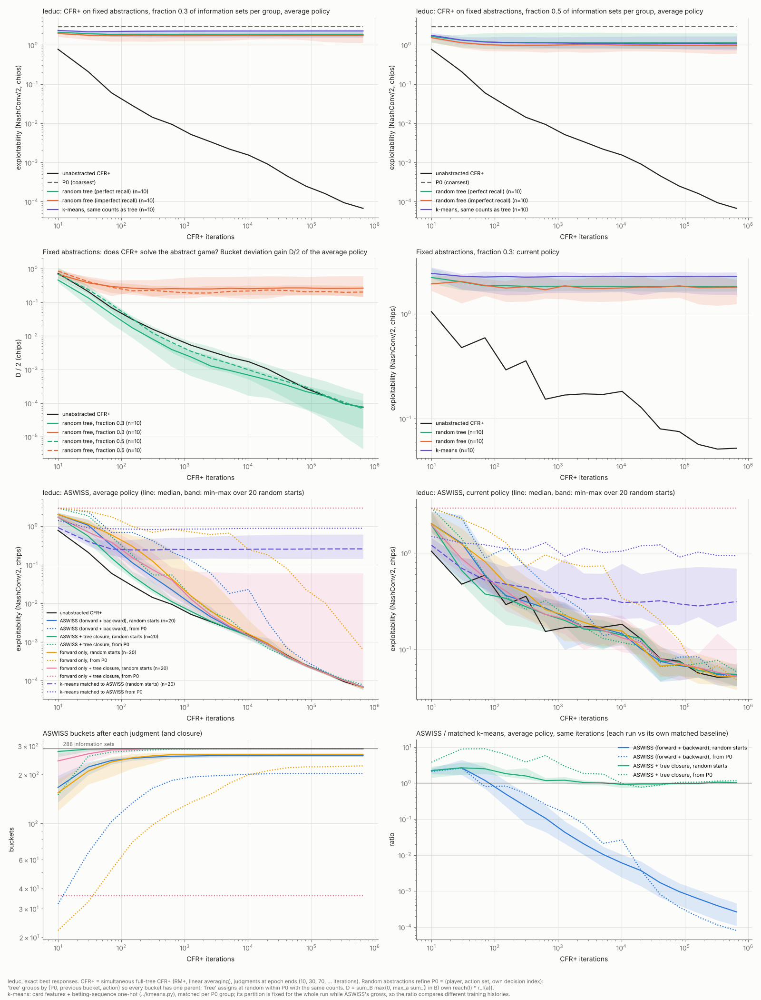
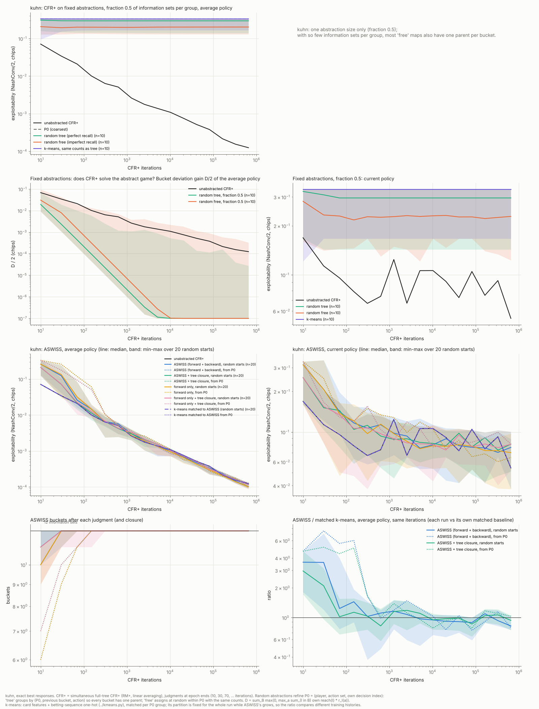

# Kuhn·Leduc: 무작위 추상화에서 ASWISS가 수렴하는가 (완료, 2026-11-02)

## 무엇을 확인했나

1. **사용자 가설:** imperfect recall이더라도 bucket 이력에 직전 bucket이 들어 있는 것이 성공의 큰 이유다. 추상 게임이 "각 bucket이 직전 bucket 하나만 부모로 갖는" 완전한 트리 구조를 지키면 제대로 수렴할 것이다.
2. **표준 작은 게임에서의 수렴:** 다른 논문들처럼 Kuhn과 Leduc에서, 무작위 추상화로 시작해도 ASWISS가 원 게임의 균형으로 가는가.

**먼저 정리 하나 (증명은 `../../ASWISS_HISTORY_PROOF_KO.md` 보조정리 H7).** "모든 bucket의 멤버가 같은 (직전 자기 bucket, 그때 둔 행동)을 가진다"는 조건은 **추상화의 완전 기억(perfect recall)과 정확히 같다**.
- 자기 결정 순번에 대한 귀납이다. 부모 bucket의 멤버들이 지나온 bucket과 행동 열 전체를 공유하면, 자식 bucket의 멤버들도 그 열에 (부모, 행동)을 붙인 같은 열을 갖는다.
- 카드 같은 관측을 합치는 것은 상관없다. 과거의 자기 bucket과 행동만 같으면 된다.
- 그래서 이 실험은 "트리(완전 기억) 추상화 대 무작위로 과거를 섞은(불완전 기억) 추상화"의 비교다.

## 설정

- **게임** (`games.py`, `export_small.py`)
  - **Kuhn:** J, Q, K. 정보집합 12개.
  - **Leduc:** J, J, Q, Q, K, K. 무늬는 쓰지 않으므로 카드는 rank만 쓴다. 1라운드 베팅 2, 2라운드 베팅 4, 라운드당 베팅 2번까지. 정보집합 288개, 노드 1,939개.
  - 두 게임 모두 mini-stud와 같은 형식으로 내보낸다. 학습기 `../aswiss.cpp`, 정확한 평가기 `../eval.py`, k-means `../kmeans.py`를 그대로 쓴다.
  - 검증: 추상화 없는 CFR+ 평균 전략의 게임 가치가 Kuhn −0.05555(이론값 −1/18), Leduc −0.08559(알려진 값 −0.0856)였다.
- **가장 거친 분할 P₀:** (player, 행동집합, 자기 결정 순번). Kuhn 4개, Leduc 18개.
  - Kuhn의 P₀는 트리다.
  - Leduc의 P₀는 18개 중 9개 bucket이 과거를 섞는다. 예를 들어 1라운드에서 콜했는지 레이즈했는지를 잊는다.
- **무작위 추상화** (`random_abstraction.py`, 시드 1–10). 둘 다 P₀를 세분하고, P₀ 묶음마다 bucket 수가 같다.
  - **트리:** 첫 결정부터 내려가며 (P₀ 묶음, 직전 bucket, 행동)이 같은 정보집합끼리 모은 뒤, 각 모음을 무작위로 round(비율 × 크기)개로 자른다. 모든 bucket이 부모를 하나만 가진다.
  - **자유:** P₀ 묶음 안에서 같은 수의 bucket에 과거와 상관없이 무작위로 넣는다.
  - 크기: Leduc은 비율 0.3(96 bucket)과 0.5(170–180 bucket), Kuhn은 0.5(8 bucket).
  - 과거가 섞인 bucket의 비율(시드 10개 중앙값):

    | 게임, 비율 | 트리 | 자유 | k-means |
    |---|---:|---:|---:|
    | Leduc, 0.3 | 0% | 79% | 30% |
    | Leduc, 0.5 | 0% | 52% | 37% |
    | Kuhn, 0.5 | 0% | 12% | 12% |

- **학습기:** 동시 갱신 전체 트리 CFR+(RM+, 선형 평균, `--mode full`), 65만 5,350반복. 표본 잡음이 없는 학습기라서 "학습기가 추상 게임을 푸는가"와 "분할 과정이 수렴하는가"를 따로 볼 수 있다.
- **ASWISS:**
  - `--split cum --label avg --unit history`. 판정은 epoch 끝(10, 30, 70, … 반복)마다 하며, 분할 시점의 평균 전략으로 정확한 라벨을 쓴다.
  - 비교군 네 개: 역방향 분할 유무(`--backward 1/0`) × 트리 닫기 유무(`--tree-closure 1/0`).
  - **트리 닫기** (`--tree-closure 1`, 이번에 `aswiss.cpp`에 추가): 시작할 때와 판정마다 각 bucket을 멤버들의 (직전 bucket, 행동)으로 다시 나눈다. 그래서 추상화가 늘 트리(완전 기억)다. 나뉜 조각은 부모의 표를 이어받는다. 이 옵션이 없으면 결과는 이전 코드와 바이트 단위로 같다(log, 최종 분할, judgments.csv).
  - 출발점: P₀, 그리고 무작위 트리와 자유 추상화(비율 0.3, 시드 10개씩).
- **기준선:**
  - **추상화 없는 CFR+**
  - **k-means:** 카드 특징과 베팅 순서 one-hot을 쓰는 `../kmeans.py`, seed 1. 두 가지로 맞췄다.
    - 고정 추상화 비교: 같은 시드의 트리 추상화와 P₀ 묶음별 bucket 수를 맞췄다.
    - ASWISS 비교: 각 ASWISS 실행의 최종 분할과 P₀ 묶음별 bucket 수를 맞췄다(`kmeans_matched.sh`). 같은 CFR+로 같은 반복 수만큼 학습했다.
  - k-means 분할은 학습 내내 고정이고 ASWISS 분할은 자란다. 그래서 같은 반복 수에서의 비율은 학습 이력이 다른 둘의 비교다.
- **평가:** 정확한 최선 응답으로 계산한 exploitability(NashConv/2, chip). 평균 정책과 현재 정책을 따로 본다. LBR 근사가 아니라 정확한 값이다.
- **추상 게임을 풀었는지 재는 양 D** (`onpath.py`)
  - D/2 = Σ_B max(0, max_a Σ_{I∈B} π_i^σ̄(I)·r_I(a)) / 2. bucket 하나의 전략만 바꿨을 때 그 주인이 얻는 최대 이득을 모든 bucket에 대해 더한 것이다.
  - 각 경로는 한 bucket을 많아야 한 번 지난다(P₀에 결정 순번이 있음). 그래서 D=0은 추상 게임에서 어느 bucket도 혼자 이득을 볼 수 없다는 뜻이다(행위자형 균형). 완전 기억 추상 게임이면 Nash 균형의 국소 조건이다.
  - 인증식의 ρ_P는 자기 도달확률로 가중하지 않는다. 그래서 평균 전략이 가지 않는 곳에서 바닥이 생긴다(아래 관찰 5). D는 그 바닥이 없다.

## 결과 1: 고정 추상화에서 CFR+ (Leduc, 65만 5,350반복, 시드 10개의 중앙값 [최소, 최대])

| 추상화 | bucket | 평균 정책 exploitability | 현재 정책 | D/2 (추상 게임을 풀었나) |
|---|---:|---:|---:|---:|
| 추상화 없음 | 288 | 6.7e-05 | 5.2e-02 | 7.5e-05 |
| P₀ | 18 | 2.93 | 2.93 | 1.9e-11 |
| 트리, 0.3 | 96 | 1.81 [1.6, 2.2] | 1.82 | **7.7e-05** [4.3e-06, 1.2e-04] |
| 자유, 0.3 | 96 | 1.74 [1.1, 2.1] | 1.78 | **0.263** [0.14, 0.61] |
| k-means, 0.3 | 96 | 2.27 [1.5, 2.5] | 2.26 | 5.2e-03 [3e-10, 2.5e-02] |
| 트리, 0.5 | 170 [170, 180] | 1.14 [0.80, 2.0] | 1.15 | **6.8e-05** [1.7e-05, 1.9e-04] |
| 자유, 0.5 | 170 [170, 180] | 0.97 [0.60, 1.2] | 1.06 | **0.201** [0.15, 0.30] |
| k-means, 0.5 | 170 [170, 180] | 1.06 [0.74, 1.7] | 1.05 | 0.101 [6e-04, 0.24] |

## 결과 2: ASWISS (Leduc, 65만 5,350반복)

추상화 없는 CFR+의 평균 정책 exploitability는 6.73e-05다. 무작위 출발은 비교군마다 20개(트리 10, 자유 10)이고, 표에는 트리·자유를 나눠 중앙값 [최소, 최대]를 적었다.

| 비교군 | 출발 | 정지 상태 | 마지막 분할 (반복) | 최종 bucket | 평균 정책 exploitability | 같은 bucket 수의 k-means | 최종 bucket 중 과거가 섞인 것 |
|---|---|---:|---:|---:|---:|---:|---:|
| 정방향 + 역방향 | P₀ | 1/1 | 40,950 | 203 | 7.1e-05 | 0.88 | 14% |
| 정방향 + 역방향 | 자유 10 | 10/10 | 1,270 [630, 327,670] | 261 [260, 270] | 6.7e-05 [5.8e-05, 6.9e-05] | 0.24 [0.14, 0.38] | 9% |
| 정방향 + 역방향 | 트리 10 | 10/10 | 2,550 [310, 20,470] | 260 [260, 270] | 6.8e-05 [6.2e-05, 7.2e-05] | 0.26 [0.16, 0.61] | 9% |
| 정방향 + 역방향 + 트리 닫기 | P₀ | 1/1 | 5,110 | 288 | 7.8e-05 | 6.7e-05 (분할 없음과 같음) | 0% |
| 정방향 + 역방향 + 트리 닫기 | 자유 10 | 10/10 | 70 [30, 310] | 288 | 7.0e-05 [6.3e-05, 7.2e-05] | 6.7e-05 | 0% |
| 정방향 + 역방향 + 트리 닫기 | 트리 10 | 10/10 | 70 [70, 2,550] | 288 | 6.9e-05 [6.6e-05, 7.1e-05] | 6.7e-05 | 0% |
| 정방향만 | P₀ | 0/1 | 655,350 (계속) | 226 | 6.3e-04 | 0.46 | 14% |
| 정방향만 | 자유 / 트리 10 | 9/10, 10/10 | 630 / 7,670 | 266 / 265 | 6.6e-05 / 6.6e-05 | 0.23 / 0.17 | 7% |
| 정방향만 + 트리 닫기 | P₀ | 0/1 | 분할 없음 | 36 | **2.93** | 2.93 | 0% |
| 정방향만 + 트리 닫기 | 자유 10 | 8/10 | 310 [70, 20,470] | 288 | 6.8e-05 [6.0e-05, 7.2e-05] | 6.7e-05 | 0% |
| 정방향만 + 트리 닫기 | 트리 10 | 9/10 | 310 [150, 1,270] | 288 [285, 288] | 6.8e-05, 시드 10만 **0.060** | 6.7e-05 | 0% |

- 정지 상태: 마지막 판정이 아무것도 나누지 않았고 G=0, H_K=0이다(인증식의 bucket 안 상쇄와 이력 안 상쇄가 모두 0).
- 정지 상태에 도달한 실행의 D/2는 6.4e-05–9.2e-05였다(최종 분할에서 잰 값). 추상화 없는 CFR+는 7.5e-05다.
- **Kuhn:** 모든 비교군과 출발점(P₀, 무작위 20개)이 12개 정보집합을 모두 나눈 뒤 멈췄다. 평균 정책 exploitability는 8.8e-05–1.3e-04로 추상화 없는 CFR+(1.24e-04)와 같았다. Kuhn의 균형은 카드마다 다른 전략을 요구하므로 압축할 여지가 없다. Kuhn은 수렴 확인용이고, 트리와 자유의 대비는 Leduc에서만 의미가 있다(Kuhn의 자유 추상화는 과거가 섞인 bucket이 0–12%뿐).





## 관찰

1. **가설의 학습기 쪽은 맞았다. 트리(완전 기억) 추상화에서는 CFR+가 추상 게임을 푼다.**
   - 고정 트리 추상화에서 D/2는 추상화 없는 CFR+와 같은 속도로 줄어 6.8e-05–7.7e-05에 이르렀다(추상화 없음 7.5e-05).
   - 같은 bucket 수의 자유 추상화에서는 중앙값 0.20–0.26에서 멈췄다. 시드 10개 모두 0.14 이상이었다.
   - 다만 불완전 기억이라고 늘 막히는 것은 아니다. Leduc의 P₀(18개 중 9개 bucket이 과거를 섞음)에서는 D가 0으로 갔다. 막힌 것은 과거를 무작위로 섞은 경우다.
2. **그러나 트리라고 원 게임 성능이 좋아지지는 않았다.** 같은 bucket 수에서 고정 트리 추상화의 exploitability는 자유보다 낮지 않았다(1.81 대 1.74, 1.14 대 0.97). 추상화 오차는 트리 여부보다 무엇을 합쳤는지에 달려 있다.
3. **ASWISS 전체의 수렴에는 트리가 아니라 역방향 분할이 결정적이었다.**
   - 역방향 분할이 있으면 P₀와 무작위 출발 20개 모두가 정지 상태에 도달했다. 트리 닫기 유무와 상관없었다. exploitability(6.7e-05–7.8e-05)도 추상화 없는 CFR+(6.73e-05)와 같았다.
   - 정방향만 쓰고 트리를 지키면 **P₀에서 한 번도 분할하지 못하고 2.93에 머물렀다.** 무작위 트리 출발 하나(시드 10)도 0.060에서 멈췄다.
   - 두 경우 모두 G=0(정방향 분할할 근거가 없음)이고 H_K>0이었다(P₀: 3.68, 시드 10: 0.109). 명제 H4의 반례가 Leduc에서 그대로 나온 것이다. 카드를 잊은 정보가 뒤 결정의 bucket 이력 안에서 상쇄되는데, 그 bucket 이력에는 같은 부모가 하나뿐이라 정방향 판정으로는 보이지 않는다.
   - 명제 H4의 게임 자체도 트리 추상화다. 그러니 트리 구조는 학습기를 수렴하게 해도 분할 과정을 수렴하게 하지는 않는다.
4. **트리 닫기는 수렴을 바꾸지 않고 bucket만 늘렸다.**
   - 닫기를 하면 Leduc에서 288개 정보집합을 모두 나눴다(압축 없음).
   - 닫기 없는 ASWISS는 203개(P₀ 출발)와 260–270개(무작위 출발)에서 멈췄다. 최종 bucket의 9–14%는 서로 다른 과거를 섞은 채, 즉 불완전 기억인 채로 균형에 도달했다.
   - 같은 bucket 수의 k-means는 0.14–0.88로, ASWISS보다 3–4 자릿수 나빴다.
5. **인증값의 바닥은 추상화와 무관하다.**
   - 추상화 없는 CFR+에서도 ρ/2 = Σ_I ψ(r_I(σ̄))/2가 0.0855에서 멈췄다. 그때 exploitability는 6.7e-05였다.
   - 2만 반복에서 그 질량의 96%가 자기 도달확률 1e-6 미만인 정보집합 11개에 있었다(`offpath.py`와 같은 계산). 이전 문서 명제 B4(b)(CFR 평균은 가지 않는 곳의 전략을 고치지 않음)의 수치 확인이다.
   - 그래서 오라클 조건 "ρ_P(σ̄) ≤ ε"는 CFR+로는 작은 ε에서 만족되지 않는다. 트리 추상화에서 CFR+가 보장하는 것은 자기 도달확률로 가중한 D 쪽이다.
6. **Leduc은 압축 여지가 작다.** 균형이 정보집합 대부분을 구분해야 해서, 가장 많이 압축한 실행도 288개 중 203개(70%)를 썼다.

## 한계

- 학습기는 정확한 전체 트리 CFR+다. 7-stud의 표본 학습기(MCCFR+)와 표본 라벨은 시험하지 않았다(`--mode es`로 같은 구성을 돌릴 수 있다).
- 무작위 추상화는 P₀를 세분하는 것만 만들었다. P₀ 경계를 넘는 무작위 추상화(행동 수가 다른 정보집합을 섞는 것)는 이 학습기가 받지 않는다.
- Kuhn은 작아서 트리와 자유의 대비가 거의 없다.
- 기울기로 교차 시점을 외삽하지 않았다.

## 재현 (이 폴더에서)

```bash
./run_small.sh OUT 655350 10 4          # 내보내기, 무작위 추상화, 고정 추상화와 ASWISS 실행, 정확한 평가 (262개 실행)
./kmeans_matched.sh OUT 655350 4         # ASWISS 실행마다 bucket 수를 맞춘 k-means (168개 실행)
python onpath_all.py OUT kuhn; python onpath_all.py OUT leduc   # 고정 추상화의 D와 on/off-path 인증값
python summarize_small.py OUT > summary.md
python plot_small.py OUT leduc results_small_leduc; python plot_small.py OUT kuhn results_small_kuhn
```

명제 B4(a)의 반례(혼합 평균 실험, `../README_KO.md`의 "혼합 평균" 절)는 `export_b4a.py OUT`로 같은 형식으로 만든다.

원자료: `../results_data/small_games_summaries.tar.gz`. 실행마다 log.csv, judgments.csv, closure.csv, exploitability.csv, onpath.csv, 최종 분할이 들어 있고, 무작위·k-means 분할 파일과 summary.md도 들어 있다. 정책 파일은 빠져 있으며 위 명령으로 다시 만들 수 있다.
