# ASWISS on 7-stud (heads-up, 5–7구)

작성 2026-10-27. 학습 seed 1 결과와, seed 2 및 상속 변형 결과(아래 절)를 담았다. 4구 12액션을 함께 학습한 비교(2026-10-28), 방법 B 라벨의 10.23M 검증(2026-10-28), bucket 이력 열쇠의 1.27M 비교와 이력 열쇠 + 방법 B의 5.11M 비교(2026-10-29), 노트북에서 돌린 100M 결과(2026-10-29), bucket 이력 열쇠의 100M 결과(2026-10-30)도 아래 절에 있다. 모두 완료된 실험이다.

> **2026-10-29 정정:** 아래 "해석" 절들의 "카드 해상도가 이미 포화"라는 결론은 10.23M까지의 결과다. 100M에서는 k-means 1024가 k-means 341보다 유의하게 낫고, ASWISS가 k-means 341을 이겼다("100M 결과" 절).

## 무엇을 비교했나

**게임**
- 엔진은 `../../../cpp_mccfr/stud_mccfr.cpp`를 수정 없이 include해서 쓴다.
- 규칙은 v3다. heads-up이고, ante 1000, stack 1000 ante다.
- 학습과 평가 모두 5구 루트에서 시작한다. 4구의 버림/공개 선택(12액션)은 두 player 모두 기존 heuristic(`discard_reveal`)으로 고정했다.
- 따라서 실제로 푸는 게임은 "4구 heuristic을 고정한 5–7구 베팅 게임"이다.

**원자(atom)**
- 원자 = K=1024 power 클러스터 × 베팅 요약 × 합법 행동 집합이다. 엔진의 `--bucket power` key와 같다.
- 원 정보집합은 학습 중 거의 한 번씩만 나와서 정보집합별 라벨이 유의해질 수 없다. 그래서 라벨 단위를 원자로 바꿨다.
- 이 바꿈의 이론적 의미는 [수렴 증명 문서](../../ASWISS_CONVERGENCE_KO.md) 정리 3에 있다. ASWISS가 0으로 보내는 것은 bucket과 원자 사이의 상쇄까지다. 원자 안의 상쇄는 남는다.
- **원자는 휴리스틱이다.** 카드 세기 k-means 군집과 손으로 정한 베팅 요약으로 만든 묶음이다. 그래서 이 7-stud 실험은 일반 알고리즘의 검증이 아니라, CFR+IRA의 휴리스틱 분할처럼 "원자로 가속한 변형"의 실험으로 본다(2026-10-28 결정). 일반 알고리즘(원 정보집합 단위)의 검증은 mini-stud 실험이 맡는다.
- 이름 정리: `atom_kK` 실행은 원자 하나를 bucket 하나로 둔 것, 즉 기존 k-means K 추상화를 같은 학습기로 학습한 것이다.

**비교군**
- 모두 같은 학습기를 쓴다: external-sampling MCCFR+(RM+), 순회 뒤 bucket 일괄 갱신, 선형 평균.
- 학습량은 10.23M roots, seed 1이다.

| 비교군 | 분할 | atlas |
|---|---|---|
| context | context당 bucket 하나. 카드 정보 없음(mini-stud의 time step에 해당) | 없음 |
| k-means 256 | 원자 = bucket. 프로젝트 표준 K | K=256 |
| k-means 341 (bucket 수 맞춤) | 원자 = bucket. ASWISS의 최종 bucket 수에 맞춰 K를 **사후에** 정함 | K=341 |
| ASWISS | context에서 시작. 두 배 epoch마다 원자 라벨(누적 샘플 regret, z=2)로 분할. 자식 표는 0에서 다시 시작 | K=1024 |
| k-means 1024 | 원자 = bucket. mini-stud의 "완전 기억"에 해당 | K=1024 |

- **atlas 생성:** 세 atlas 모두 여기서 같은 자료로 새로 만들었다(heuristic ε=0.2 self-play 10만 핸드, seed 37301).
- **이전 자료:** 저장소의 이전 atlas와 LBR 결과 파일은 이 환경에 없어서 쓰지 못했다(`data/`가 로컬에만 있음).

**평가**
- **Policy-LBR:** 엔진의 `PolicyLBR`를 쓴다. exploitability의 근사 **하한**이며 단위는 ante/hand다.
  - 모든 스냅숏에 같은 deal, 같은 LBR seed, particle 64를 쓴다.
  - 학습 곡선은 2,000 pair로 평가했다. 마지막 스냅숏은 20,000 pair로 다시 평가했다.
  - LBR 한 pair의 표준편차는 약 17.5 ante이고 최대 482 ante까지 꼬리가 길다. 그래서 2,000 pair로는 구간이 넓다.
- **샘플 BR-gap 근사치:** 고정 deal 4,000개에서 external sampling 순회로 잰다. traverser가 방문한 모든 상태의 $\max_aQ-\sum\pi Q$를 더한 값이다.
  - 상계도 하한도 아니다.
  - 단위는 ante다. 기존 `agents/evaluation/br_gap`는 ante로 한 번 더 나눈다.
- 평균 정책과 현재 정책을 따로 잰다.

## 결과 (seed 1, 마지막 스냅숏, 20,000 pair)

| 비교군 | bucket 수 | 평균 정책 LBR (95%) | 현재 정책 LBR (95%) | BR-gap 근사치 (평균/현재) |
|---|---:|---:|---:|---:|
| context | 146 | 63.66 ± 2.56 | 65.97 ± 2.59 | 70,848 / 70,808 |
| k-means 256 | 37,060 | 1.520 ± 0.136 | 1.506 ± 0.157 | 653 / 623 |
| **k-means 341 (bucket 수 맞춤)** | 49,182 | **1.206 ± 0.111** | **1.373 ± 0.127** | 721 / 699 |
| ASWISS | 49,384 | 1.335 ± 0.133 | 1.461 ± 0.138 | 1,037 / 805 |
| k-means 1024 (원자) | 142,761 | 1.200 ± 0.143 | 1.500 ± 0.151 | 813 / 701 |

ASWISS에서 각 비교군을 뺀 차이다(같은 deal로 짝지은 95% 구간).

| ASWISS − | 평균 정책 | 현재 정책 |
|---|---:|---:|
| k-means 256 | −0.186 [−0.364, −0.007] | −0.045 [−0.227, +0.138] |
| **k-means 341 (bucket 수 맞춤)** | **+0.128 [−0.033, +0.290]** | +0.088 [−0.092, +0.269] |
| k-means 1024 | +0.135 [−0.050, +0.320] | −0.039 [−0.222, +0.144] |

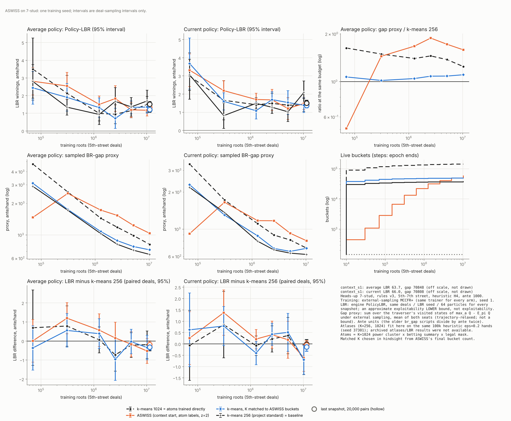

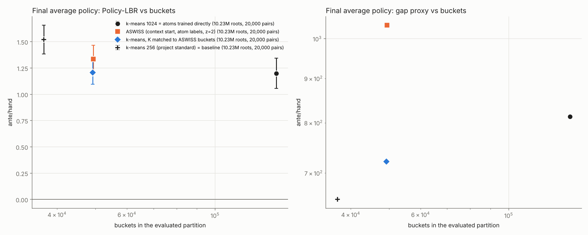

원자료: `results_data/runs_summaries.tar.gz`(seed 1, seed 2, 상속 변형 모두). 풀면 `runs/<비교군>/`에 `log.csv`, `curve.csv`, `snapshots.csv`, `eval*.jsonl`, `lbr_pairs*.csv`가 나온다. `python plot_stud.py runs <출력 접두어>`로 위 그림을 다시 그린다. 스냅숏 바이너리는 크기 때문에 넣지 않았다.

## 해석 (seed 1 기준)

1. **bucket 수를 맞추면 ASWISS가 k-means보다 낫지 않다.**
   - 점추정은 0.13 ante 나쁘다. 구간은 0을 포함한다.
   - k-means 256 대비 우위(−0.19)는 bucket이 33% 더 많은 데서 온 것으로 보는 것이 맞다.
2. **이 게임에서는 카드 분할 해상도가 이미 포화로 보인다.**
   - k-means 341(4.9만 bucket)과 k-means 1024(14.3만 bucket)의 평균 정책 LBR이 같다(1.206 대 1.200).
   - 원자(1024) 수준을 넘어서는 이득이 원리적으로 없다(정리 3). 그래서 ASWISS가 이길 여지가 거의 없는 설정이었다.
   - 남은 오차는 카드 클러스터가 아니라 다른 곳에서 온다고 볼 수 있다. 후보는 베팅 요약 key(이력을 잃는 imperfect recall), 고정 H4, 학습량이다.
3. **분할된 자식은 표를 0에서 다시 시작한다.**
   - 마지막 epoch에도 6,655개 bucket이 분할되었다. 그래서 최종 분할의 많은 bucket은 5.12M roots만 학습했다. 반면 k-means 표는 10.23M roots를 모두 학습했다.
   - mini-stud에서도 같은 손해를 가설로 적었다. 확인하기 위해 상속 변형(`--inherit 1`, 자식이 부모 표를 복사)을 실행 중이다.
4. **context(카드 정보 없음)는 LBR 64 ante다.** 카드 정보가 결정적이라는 점은 분명하다.
5. **BR-gap 근사치는 LBR과 순위가 다르다.**
   - LBR이 가장 나쁜 k-means 256이 근사치는 가장 작다. ASWISS는 근사치가 가장 크다.
   - 이 근사치는 7구의 큰 팟 갈래 합이 지배하는 것으로 보인다. 그래서 이 문서의 결론에는 쓰지 않는다.
6. **이전 프로젝트 최고치와의 비교:** 사용자 기록상 이전 최고치는 LBR 1.7–1.8이다. 이 실험의 모든 카드 기반 비교군(1.20–1.52)이 그보다 낮다.
   - 평가 deal, pair 수, atlas가 달라 직접 비교는 아니다.
   - 낮아진 몫은 ASWISS가 아니라 학습기(MCCFR+, 선형 평균, 일괄 갱신) 쪽일 가능성이 크다.

## seed 2와 상속 변형 (완료, 2026-10-27)

**조건**
- 같은 atlas와 같은 학습량(10.23M roots)이다.
- 마지막 스냅숏을 seed 1과 **같은 deal**로 20,000 pair 평가했다.
- 상속 변형(`--inherit 1`)에서는 분할된 자식이 부모의 regret 표와 평균 표를 복사해 시작한다.

| 실행 | bucket 수 | 평균 정책 LBR | 현재 정책 LBR |
|---|---:|---:|---:|
| ASWISS seed 1 / seed 2 | 49,384 / 49,872 | 1.335 / 1.378 | 1.461 / 1.490 |
| k-means 341 seed 1 / seed 2 | 49,182 / 49,229 | 1.206 / 1.390 | 1.373 / 1.550 |
| k-means 1024 seed 1 / seed 2 | 142,761 / 142,869 | 1.200 / 1.320 | 1.500 / 1.586 |
| ASWISS 상속 seed 1 | 39,663 | 1.575 | 1.636 |

같은 deal로 짝지은 차이(95%)다. "두 seed"는 seed별 차이의 평균이고, 구간은 평가 deal 잡음만 반영한다.

| 비교 | 평균 정책 | 현재 정책 |
|---|---:|---:|
| ASWISS − k-means 341, seed 2 | −0.012 [−0.204, +0.179] | −0.060 [−0.233, +0.113] |
| **ASWISS − k-means 341, 두 seed** | **+0.058 [−0.067, +0.183]** | **+0.014 [−0.111, +0.139]** |
| ASWISS − k-means 1024, 두 seed | +0.097 [−0.039, +0.232] | −0.068 [−0.202, +0.067] |
| 상속 − 재시작 (ASWISS seed 1) | **+0.240 [+0.067, +0.413]** | +0.175 [+0.002, +0.347] |

**결론** (2개 seed 기준)
1. **bucket 수가 같으면 ASWISS와 k-means는 구별되지 않는다.** k-means 341과 k-means 1024도 구별되지 않는다.
   - 같은 비교군도 seed에 따라 0.04–0.18 ante 움직인다(k-means 341: 1.206과 1.390).
   - 이 학습 seed 변동이 평가 deal 잡음보다 크다. 위 구간은 그 변동을 반영하지 않으므로 실제보다 좁다.
2. **상속은 오히려 나빴다.**
   - LBR이 0.24 나빠졌고 bucket도 약 20% 적었다.
   - 부모의 regret을 물려받으면 자식들의 regret 방향이 같은 쪽에서 출발한다. 그래서 라벨 차이가 늦게 드러나 분할이 줄어든 것으로 보인다.
   - "자식 재시작의 학습 손해" 가설은 이 실험에서 지지되지 않는다.
3. **이 설정에서는 카드 해상도가 포화되어 ASWISS의 이득을 보일 여지가 없다.**
   - 원자(1024)의 학습 결과가 bucket 4.9만 개 k-means와 같다.
   - 다음 실험은 해상도가 실제로 필요한 설정이어야 한다. 후보는 다음과 같다.
     - 더 미세한 원자(K=4096)
     - 베팅 이력을 보존하는 원자
     - 4구 12액션 추가

## 방법 B 라벨 검증 (seed 1, 10.23M roots, 완료 2026-10-28)

**무엇을 돌렸나**
- 방법 B는 분할 판정에 epoch 끝의 **평균 전략**을 고정해 쓰는 규칙이다([수렴 증명 문서](../../ASWISS_CONVERGENCE_KO.md) §9.4). 두 비교군을 추가했다.

| 비교군 | 라벨 |
|---|---|
| `aswiss_b` (방법 B) | 평균 전략으로 잰 원자 regret의 z=2 라벨만 쓴다 |
| `aswiss_wb` (기존 + B) | 기존 구간 라벨과 방법 B 라벨의 공통 세분화. 둘 중 하나라도 갈리면 나뉜다 |

- 라벨 단위는 기존 ASWISS와 같은 원자(K=1024 power 클러스터 × 베팅 요약 × 합법 행동)다. 원자는 휴리스틱이므로 이것은 "원자로 가속한 방법 B"다.
- **mini-stud와 다른 점:** 7-stud는 전체 순회가 불가능하다. 그래서 평균 전략의 regret을 정확히 계산하지 않고, epoch 끝마다 두 좌석 모두 평균 전략으로 두는 별도 external-sampling 순회로 추정한다.
  - 순회 수는 epoch 길이의 25%(`--avg-frac 0.25`)다. 이 순회는 x축의 학습 roots에 세지 않았다.
  - mini-stud의 방법 B는 정확값이었다. 여기서는 표본 추정치라 기존 라벨과 같은 표본 노이즈가 있다.
- 나머지 조건은 기존 seed-1 실험과 같다: 같은 atlas, 4구 heuristic, 학습 seed 1, 10.23M roots, 같은 epoch 일정.
- 평가도 같다: 마지막 스냅숏을 기존 비교군과 **같은 deal**, 같은 LBR seed, particle 64로 20,000 pair 평가했다. epoch 스냅숏은 2,000 pair로 평가했다.

**결과** (마지막 스냅숏, 20,000 pair)

| 비교군 | 평가한 분할의 bucket 수 | 평균 정책 LBR (95%) | 현재 정책 LBR (95%) | BR-gap 근사치 (평균/현재) |
|---|---:|---:|---:|---:|
| **방법 B** | **34,316** | 1.336 ± 0.140 | 1.481 ± 0.132 | 1,100 / 849 |
| 기존 + B | 79,720 | 1.376 ± 0.159 | 1.492 ± 0.160 | 954 / 782 |
| ASWISS (기존 라벨) | 49,384 | 1.335 ± 0.133 | 1.461 ± 0.138 | 1,037 / 805 |
| k-means 256 | 37,060 | 1.520 ± 0.136 | 1.506 ± 0.157 | 653 / 623 |
| k-means 341 | 49,182 | 1.206 ± 0.111 | 1.373 ± 0.127 | 721 / 699 |
| k-means 1024 | 142,761 | 1.200 ± 0.143 | 1.500 ± 0.151 | 813 / 701 |

- bucket 수는 평가한 스냅숏(마지막 epoch 동안 쓴 분할)의 값이다. 마지막 epoch 끝의 분할 뒤에는 방법 B 41,180개, 기존 + B 87,509개가 되지만 그 분할은 학습되지 않았다.
- k-means 256(37,060개)이 방법 B(34,316개)와 bucket 수가 가장 가깝다. 차이는 8%다.

같은 deal로 짝지은 차이(95%)다. 음수면 앞쪽이 덜 착취당한다.

| 비교 | 평균 정책 | 현재 정책 |
|---|---:|---:|
| 방법 B − ASWISS | +0.001 [−0.179, +0.180] | +0.020 [−0.151, +0.191] |
| **방법 B − k-means 256 (bucket 수 비슷)** | **−0.185 [−0.369, −0.000]** | −0.024 [−0.202, +0.153] |
| 방법 B − k-means 341 | +0.129 [−0.040, +0.298] | +0.108 [−0.059, +0.276] |
| 방법 B − k-means 1024 | +0.136 [−0.050, +0.322] | −0.019 [−0.205, +0.168] |
| 기존 + B − ASWISS | +0.041 [−0.144, +0.226] | +0.031 [−0.169, +0.230] |
| 기존 + B − k-means 256 | −0.144 [−0.342, +0.053] | −0.014 [−0.209, +0.181] |
| 기존 + B − k-means 341 | +0.170 [−0.018, +0.357] | +0.119 [−0.071, +0.309] |
| 기존 + B − k-means 1024 | +0.176 [−0.025, +0.377] | −0.008 [−0.217, +0.201] |

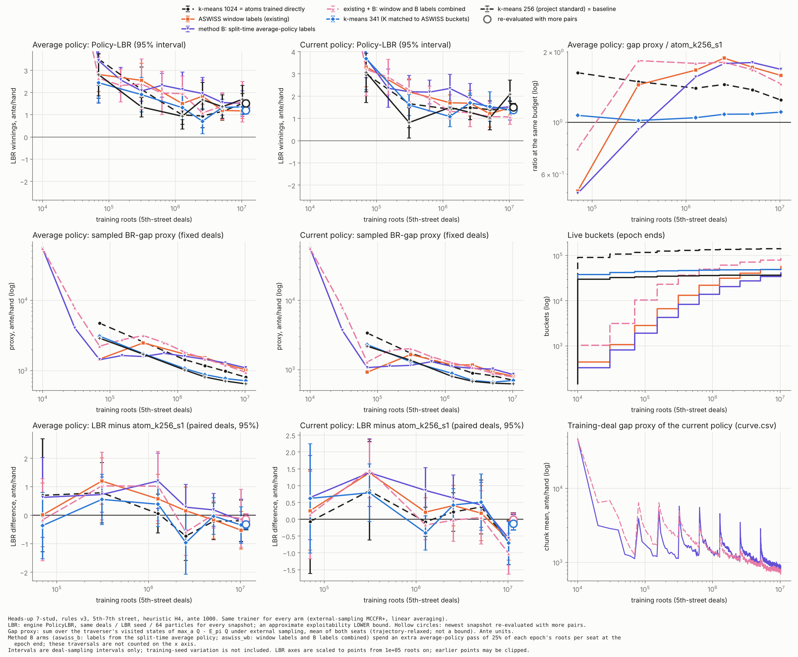

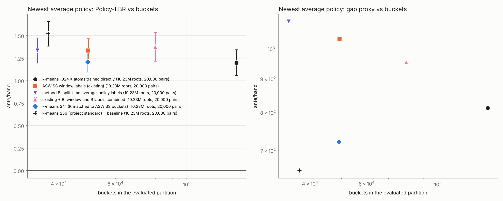

원자료: `results_data/runs_B_summaries.tar.gz`(두 새 비교군). 기존 비교군은 `results_data/runs_summaries.tar.gz`에 있다. 둘을 같은 `runs/`에 풀고 다시 그리는 명령은 다음과 같다.

```bash
python plot_stud.py runs results_stud_B_seed1 --runs \
  "atom_k1024_s1:k-means 1024 = atoms trained directly" \
  "aswiss_k1024_z2_s1:ASWISS window labels (existing)" \
  "aswiss_b_k1024_z2_s1:method B: split-time average-policy labels" \
  "aswiss_wb_k1024_z2_s1:existing + B: window and B labels combined" \
  "atom_kmatched_s1:k-means 341 (K matched to ASWISS buckets)" \
  "atom_k256_s1:k-means 256 (project standard) = baseline"
```

**해석** (seed 1 하나 기준)
1. **방법 B는 bucket을 30% 덜 쓰고 기존 ASWISS와 같은 LBR에 도달했다.**
   - 평균 정책 차이는 +0.001이다. bucket은 34,316개 대 49,384개다.
   - mini-stud 163.84M에서도 방법 B가 기존 라벨보다 bucket을 44% 덜 쓰고 exploitability가 같았다(0.0075 대 0.0080). 같은 방향의 결과가 7-stud에서도 나왔다.
   - 분할한 bucket 수도 매 epoch 기존 ASWISS보다 적다(epoch당 61–4,920개 대 103–6,655개).
   - 다만 마지막 epoch에도 4,920개가 분할되었다. mini-stud와 같이 분할이 멈추지 않았다.
2. **bucket 수가 비슷한 k-means 256보다 평균 정책 LBR이 0.185 낮다.** 다만 구간 상한이 −0.000이라 경계선이고, seed 하나다.
   - 앞 절에서 본 학습 seed 변동(같은 비교군이 seed에 따라 0.04–0.18 움직임)이 이 차이와 같은 크기다. 그래서 "방법 B가 같은 크기의 k-means보다 낫다"고 결론 내리지 않는다.
   - 현재 정책으로는 차이가 없다(−0.024).
3. **기존 + B는 bucket만 늘었다.**
   - bucket은 79,720개로 기존 ASWISS의 1.6배다. 그러나 LBR은 기존 ASWISS, 방법 B와 구별되지 않는다.
   - mini-stud에서는 기존 + B가 근소하게 가장 좋았다(163.84M에서 0.0071 대 0.0080). 7-stud에서는 그 이득이 보이지 않는다.
4. **이 설정의 포화 결론은 그대로다.**
   - 점추정은 여전히 k-means 341과 1024가 가장 낮다(1.20 근처). 방법 B와의 차이 구간은 모두 0을 포함한다.
   - 앞 절과 같이 이 설정에서는 카드 분할 해상도가 이미 포화로 보인다. 어떤 분할 규칙도 이길 여지가 거의 없다.
5. **BR-gap 근사치는 방법 B가 가장 크다**(평균 정책 1,100, k-means 256의 1.7배).
   - 학습 deal 근사치(`curve.csv`, 그림 오른쪽 아래)는 epoch 끝마다 튀어 오른다. 분할된 자식이 표를 0에서 다시 시작하는 비용이다.
   - 앞 절들과 같이 이 근사치는 LBR과 순위가 다르므로 결론에 쓰지 않는다. 일관된 신호이므로 적어 둔다.
6. **학습 시간:** 두 비교군 모두 약 2.6시간(9,250–9,410초)이었다. 기존 ASWISS는 9,330초였다. 평균 전략 순회가 25% 더 들지만, 기계 부하를 맞추지 않은 측정이라 시간 비교로 쓰지 않는다.

**AGENTS.md 점검**
- k-means 256 기준선을 모든 곡선에 겹쳤다. 같은 학습량에서의 짝지은 LBR 차이와 근사치 비율을 그렸고, 평균 정책과 현재 정책을 나눴다.
- 모든 비교군이 같은 평가 deal, LBR seed, particle 64, gap deal과 같은 학습 seed(1), 같은 학습량(10.23M roots)을 쓴다.
- 기존 비교군은 epoch 2, 4, 6, 7, 8, 9의 스냅숏만 평가했다. 새 비교군은 epoch 0–9를 모두 평가했다. 차이와 비율은 둘 다 평가한 학습량에서만 그렸다.
- 남은 차이
  - 방법 B 비교군은 epoch마다 평균 전략 순회(학습 roots의 25%)를 더 쓴다. 이 순회는 표를 갱신하지 않지만 계산량에는 들어간다.
  - ASWISS 세 비교군은 K=1024 원자를 쓰고, k-means 비교군은 각자의 atlas를 쓴다. 세 atlas 모두 같은 자료로 만들었다.
  - 학습 deal 경로는 전략이나 분할이 달라지는 순간부터 갈라진다.
- LBR은 선형 축, 근사치만 log 축이다. 교차점이나 기울기로 외삽하지 않았다.

## bucket 이력 열쇠 (seed 1, 1.27M roots, 완료 2026-10-29)

**무엇을 돌렸나**
- 학습기에 `--partition history`를 추가했다. 손으로 만든 베팅 요약(팟오즈, 스택/팟, 베팅 횟수 등) 대신 **bucket 이력**으로 베팅 정보를 기억한다.
- **열쇠(라벨 단위)** = (구조 context = street와 합법 행동 집합) + (그 player의 직전 결정에서 속한 bucket과 그때 둔 행동) + (그 뒤 상대가 둔 행동들) + (새 카드를 본 결정에서의 power 군집).
  - `--history-cards street`: power 군집은 각 street의 첫 결정에서만 열쇠에 들어간다. 같은 street의 다음 결정은 카드를 직전 bucket으로만 기억한다. mini-stud의 정의("마지막 결정 이후 새로 관측한 것")와 같다.
  - `--history-cards every`: power 군집을 모든 결정의 열쇠에 넣는다. 카드는 항상 보이고, 베팅만 bucket 이력으로 기억한다.
- **분할:** bucket은 구조 context(9개)마다 하나에서 시작해, 기존 ASWISS와 같은 구간 라벨(z=2)로 열쇠를 나눈다. 직전 bucket이 나중에 쪼개지면 그 열쇠는 분할 족보를 따라 조상 열쇠의 bucket을 이어받는다. 그래서 앞의 bucket이 쪼개질수록 열쇠도 세분된다.
- **카드 정보는 여전히 power 군집(휴리스틱)이다.** 이 실험이 바꾼 것은 베팅 쪽뿐이다. 카드 쪽까지 일반화하는 것(새 카드 기호를 라벨로 나누기)은 다음 단계다.
- **mini-stud와 다른 점:** mini-stud는 정보집합을 모두 열거할 수 있어서, 열쇠는 라벨 단위로만 쓰고 bucket은 정보집합에 붙어 있었다. 7-stud는 열거할 수 없어서 열쇠가 라벨 단위이자 분할의 원소다.
- **평가:** LBR은 상태만 받으므로, 열쇠를 5구 root부터 손을 다시 재생해 계산한다. LBR이 넘기는 상태(공격자의 hidden 카드가 지워진 상태)에서도 학습 중의 열쇠와 같다는 것을 self-test로 확인했다.
- **학습량:** 1.27M roots(epoch 6 끝)다. 요청은 1M이었지만, 기존 비교군의 스냅숏이 epoch 끝(1.27M)에만 있어서 같은 학습량으로 맞췄다. 기존 비교군은 10.23M 실행의 epoch 6 스냅숏을 썼다. 같은 seed와 학습기라 1.27M만 돌린 실행과 같다.
- 모든 비교군의 epoch 6 스냅숏을 기존과 같은 deal로 20,000 pair 평가했다. 곡선은 epoch 2, 4, 6을 2,000 pair로 평가했다.

**결과** (1.27M roots, 20,000 pair)

| 비교군 | 평가한 분할의 bucket 수 | 평균 정책 LBR (95%) | 현재 정책 LBR (95%) | BR-gap 근사치 (평균/현재) |
|---|---:|---:|---:|---:|
| **이력 열쇠, 카드는 street 첫 결정** | 14,818 | 1.581 ± 0.145 | 1.557 ± 0.139 | 864 / 657 |
| 이력 열쇠, 카드는 모든 결정 | 14,329 | 1.810 ± 0.131 | 1.863 ± 0.125 | 641 / 529 |
| ASWISS (원자 라벨) | 22,064 | 1.685 ± 0.195 | 1.711 ± 0.143 | 1,723 / 1,172 |
| ASWISS 방법 B (원자 라벨) | 14,021 | 1.661 ± 0.188 | 1.708 ± 0.145 | 1,610 / 1,111 |
| k-means 256 | 36,471 | 1.391 ± 0.146 | 1.650 ± 0.152 | 1,029 / 798 |
| k-means 341 | 48,112 | 1.288 ± 0.156 | 1.473 ± 0.134 | 1,077 / 882 |
| k-means 1024 | 137,210 | 1.196 ± 0.190 | 1.427 ± 0.144 | 1,441 / 1,108 |

같은 deal로 짝지은 차이(95%)다. 음수면 앞쪽이 덜 착취당한다.

| 비교 | 평균 정책 | 현재 정책 |
|---|---:|---:|
| 이력(street) − ASWISS 원자 | −0.104 [−0.335, +0.128] | −0.154 [−0.347, +0.039] |
| **이력(street) − 방법 B 원자 (bucket 수 비슷)** | **−0.080 [−0.304, +0.144]** | −0.151 [−0.342, +0.040] |
| 이력(street) − k-means 256 | +0.190 [−0.022, +0.403] | −0.093 [−0.293, +0.107] |
| 이력(street) − k-means 341 | +0.293 [+0.084, +0.502] | +0.084 [−0.102, +0.271] |
| 이력(street) − k-means 1024 | +0.385 [+0.149, +0.621] | +0.130 [−0.064, +0.325] |
| 이력(every) − 이력(street) | +0.228 [+0.045, +0.412] | +0.306 [+0.127, +0.484] |
| 이력(every) − ASWISS 원자 | +0.125 [−0.099, +0.349] | +0.152 [−0.018, +0.321] |
| 이력(every) − k-means 256 | +0.418 [+0.230, +0.607] | +0.213 [+0.024, +0.401] |
| 이력(every) − k-means 341 | +0.521 [+0.327, +0.715] | +0.390 [+0.213, +0.566] |
| 이력(every) − k-means 1024 | +0.613 [+0.385, +0.842] | +0.436 [+0.248, +0.624] |

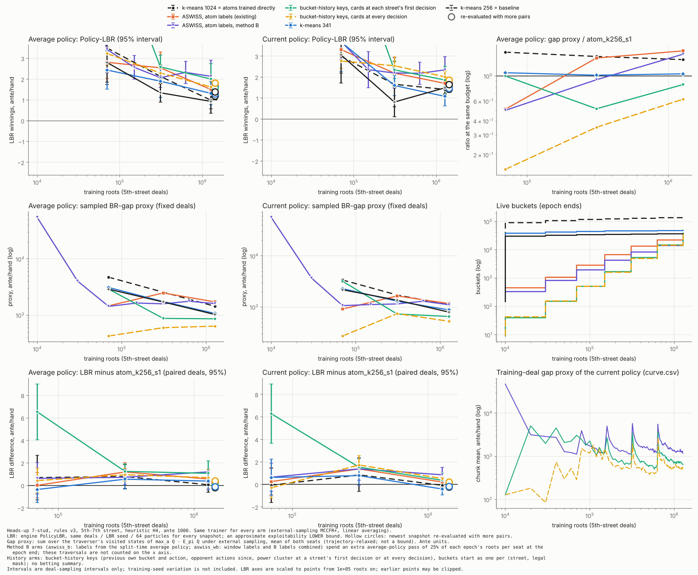

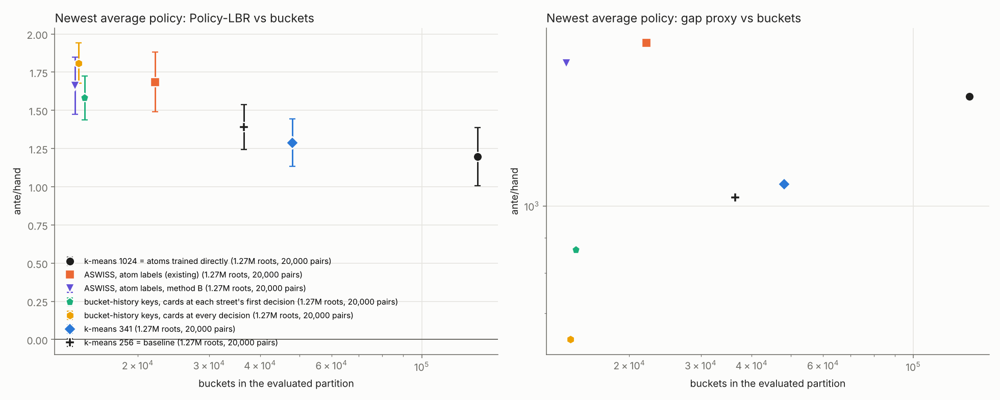

원자료: `results_data/runs_history_1m_summaries.tar.gz`. 풀면 `runs/`에 두 이력 실행과, 기존 비교군을 epoch 6에서 자른 사본이 나온다. 사본의 `eval_final.jsonl`과 `lbr_pairs_final_*`이 epoch 6 스냅숏의 20,000 pair 평가다. 다시 그리는 명령은 다음과 같다.

```bash
python plot_stud.py runs results_stud_history_1m_seed1 --runs \
  "atom_k1024_s1:k-means 1024 = atoms trained directly" "aswiss_k1024_z2_s1:ASWISS, atom labels (existing)" \
  "aswiss_b_k1024_z2_s1:ASWISS, atom labels, method B" \
  "history_street_s1:bucket-history keys, cards at each street's first decision" \
  "history_every_s1:bucket-history keys, cards at every decision" \
  "atom_kmatched_s1:k-means 341" "atom_k256_s1:k-means 256 = baseline"
```

**해석** (seed 1 하나, 1.27M 기준)
1. **이력 열쇠(street)는 같은 분할 방식의 원자 ASWISS와 같은 수준이다.**
   - bucket 수가 거의 같은 방법 B 원자(14,021개)와의 차이는 −0.08이고 구간이 0을 포함한다. 기존 원자 ASWISS(22,064개)와도 구별되지 않는다.
   - 즉 손으로 만든 베팅 요약을 bucket 이력으로 바꿔도 이 학습량에서는 손해가 없었다. 베팅 요약이라는 휴리스틱 하나를 일반적인 방법으로 대체할 수 있다는 첫 근거다.
2. **1.27M에서는 분할 계열 모두가 k-means보다 나쁘다.**
   - 이력(street)은 k-means 341, 1024보다 평균 정책이 유의하게 나쁘다(+0.29, +0.39). 현재 정책으로는 구별되지 않는다.
   - 원자 ASWISS도 이 학습량에서는 같은 정도로 k-means에 졌다(1.685 대 1.288). 같은 원자 ASWISS가 100M에서는 k-means 341을 이겼다(아래 절). 분할 계열은 일찍 나눈 bucket이 표를 0에서 다시 시작하므로, 짧은 학습량이 불리하다.
   - 그래서 1.27M의 k-means 대비 결과로 이력 열쇠를 판정하지 않는다. 더 긴 학습이 필요하다.
3. **카드를 모든 결정에 넣은 변형(every)은 오히려 나빴다**(street 대비 +0.23, 유의).
   - 열쇠가 더 잘게 나뉘어 열쇠당 표본이 줄었다(epoch 6 창의 열쇠 229만 개 대 188만 개). 라벨이 유의해지기 어렵다.
   - "같은 street 안에서는 카드를 직전 bucket으로만 기억한다"는 mini-stud식 정의가 이 학습량에서는 손해가 아니었다.
4. **라벨 단위가 훨씬 많다.** epoch 6 창에서 이력 열쇠는 188만 개(every 229만 개)이고 원자는 11.7만 개다. 단위당 표본이 16–20배 적은데도 bucket 수는 원자 ASWISS의 67%까지 늘었다.
5. **BR-gap 근사치는 이력 열쇠가 가장 작다**(평균 정책 864, every 641, 원자 ASWISS 1,723). 앞 절들과 같이 이 근사치는 LBR과 순위가 달라 결론에 쓰지 않는다.
6. **비용:** 학습 시간은 약 1,500초로 원자 ASWISS(1,276초, 다른 시점의 측정)와 비슷했다. 최대 RSS는 611 MB(every 759 MB)로 원자 ASWISS보다 크다. 열쇠 창이 크기 때문이다.

**AGENTS.md 점검**
- k-means 256 기준선을 모든 곡선에 겹쳤고, 같은 학습량에서의 짝지은 LBR 차이와 근사치 비율을 그렸다. 평균 정책과 현재 정책을 나눴다.
- 모든 비교군이 같은 평가 deal, LBR seed, particle 64, gap deal, 학습 seed(1), 학습량(1.27M roots)을 쓴다.
- 곡선의 비교 지점은 기존 비교군이 평가된 epoch 2, 4, 6뿐이다. 방법 B 비교군은 epoch 0–6 모두 평가되어 있다.
- 남은 차이
  - 이력 열쇠는 베팅 요약 대신 bucket 이력을 쓰고, 9개 구조 context에서 시작한다. 원자 ASWISS는 146개 베팅 요약 context에서 시작한다.
  - 카드 정보는 모두 같은 heuristic self-play 자료로 만든 power atlas에서 온다(K=1024; k-means 비교군은 각자의 K).
  - 학습 deal 경로는 전략이나 분할이 달라지는 순간부터 갈라진다.
- LBR은 선형 축, 근사치만 log 축이다. 교차점이나 기울기로 외삽하지 않았다.

**실행**
```bash
./aswiss_stud train --partition history --history-cards street --atlas atlas/atlas_power1024_heur_eps20_seed37301.bin \
  --z 2 --seed 1 --roots 1270000 --epoch0 10000 --out runs/history_street_s1
./aswiss_stud eval --partition history --atlas atlas/atlas_power1024_heur_eps20_seed37301.bin \
  --snapshot runs/history_street_s1/snapshot_6.bin --policy average --pairs 20000
```
- 100M 실행기에는 `hist`(street)와 `hist_every` 비교군으로 들어 있다. 예: `-Arms hist,aswiss,k341`.
- **확인한 것:** self-test(재생 열쇠 = 학습 중 열쇠, LBR 상태에서도 같음, root 재생, 스냅숏 왕복), 중단 후 재개가 끊지 않은 실행과 비트 단위로 같음, 기존 분할(aswiss, atom, window+avg)의 학습 결과가 이전 학습기와 바이트 단위로 같음.

## bucket 이력 열쇠 + 방법 B (seed 1, 5.11M roots, 완료 2026-10-29)

**무엇을 바꿨나**
- 이력 열쇠에 방법 B 라벨(`--partition history --label avg`)을 붙였다. epoch 끝마다 두 좌석 모두 평균 전략으로 두는 별도 표본 순회로 열쇠별 regret을 추정하고, 그 라벨로 나눈다. 학습 중과 같은 trail(직전 bucket과 행동)을 순회에 들고 다닌다.
- `--label window+avg`(공통 세분화)도 된다. 100M 실행기의 `hist_wb`다.
- **라벨 표본 상한(`--label-cap`):** 이력 열쇠는 개수가 포화하지 않는다(창의 열쇠가 epoch마다 약 1.8배). 그래서 epoch의 라벨 계산에 쓰는 roots에 상한을 두는 옵션을 넣었다. 실행기의 이력 비교군은 2.56M을 쓴다. 5.11M까지는 상한이 걸리지 않으므로 아래 결과에는 영향이 없다.
- `--label avg`만 쓰는 이력 실행은 구간 창을 두지 않는다. 메모리를 줄이기 위해서다(log의 L/C/H 열이 0).

**결과** (5.11M roots, epoch 8 스냅숏, 같은 20,000 pair)

| 비교군 | 평가한 분할의 bucket 수 | 평균 정책 LBR (95%) | 현재 정책 LBR (95%) | BR-gap 근사치 (평균/현재) |
|---|---:|---:|---:|---:|
| 이력 열쇠 + 구간 라벨 | 90,814 | 1.478 ± 0.155 | 1.454 ± 0.159 | 922 / 708 |
| **이력 열쇠 + 방법 B** | 31,645 | 1.805 ± 0.156 | 1.668 ± 0.127 | 779 / 601 |
| ASWISS (원자, 구간 라벨) | 40,647 | 1.365 ± 0.153 | 1.463 ± 0.131 | 1,232 / 925 |
| ASWISS (원자, 방법 B) | 27,415 | 1.518 ± 0.147 | 1.571 ± 0.120 | 1,291 / 1,019 |
| k-means 256 | 36,883 | 1.336 ± 0.135 | 1.343 ± 0.126 | 716 / 638 |
| k-means 341 | 48,902 | 1.302 ± 0.167 | 1.418 ± 0.152 | 776 / 659 |
| k-means 1024 | 141,452 | 1.223 ± 0.136 | 1.370 ± 0.116 | 987 / 816 |

같은 deal로 짝지은 차이(95%)다.

| 비교 | 평균 정책 | 현재 정책 |
|---|---:|---:|
| 이력 + 방법 B − 이력 + 구간 | +0.326 [+0.119, +0.534] | +0.214 [+0.021, +0.407] |
| 이력 + 방법 B − 원자 방법 B | +0.286 [+0.081, +0.491] | +0.097 [−0.071, +0.265] |
| 이력 + 방법 B − k-means 256 | +0.469 [+0.270, +0.667] | +0.325 [+0.152, +0.498] |
| 이력 + 방법 B − k-means 341 | +0.502 [+0.277, +0.728] | +0.251 [+0.060, +0.442] |
| 이력 + 구간 − ASWISS 원자 | +0.114 [−0.096, +0.324] | −0.009 [−0.211, +0.193] |
| 이력 + 구간 − k-means 256 | +0.143 [−0.059, +0.344] | +0.111 [−0.093, +0.314] |
| 이력 + 구간 − k-means 341 | +0.176 [−0.047, +0.400] | +0.037 [−0.181, +0.254] |
| 이력 + 구간 − k-means 1024 | +0.256 [+0.059, +0.452] | +0.084 [−0.113, +0.280] |
| (참고) 원자 방법 B − ASWISS 원자 | +0.154 [−0.048, +0.355] | +0.108 [−0.057, +0.273] |

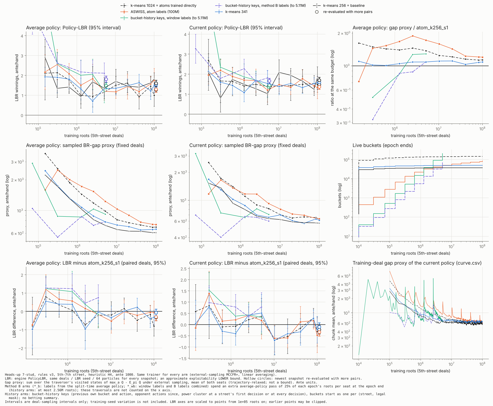

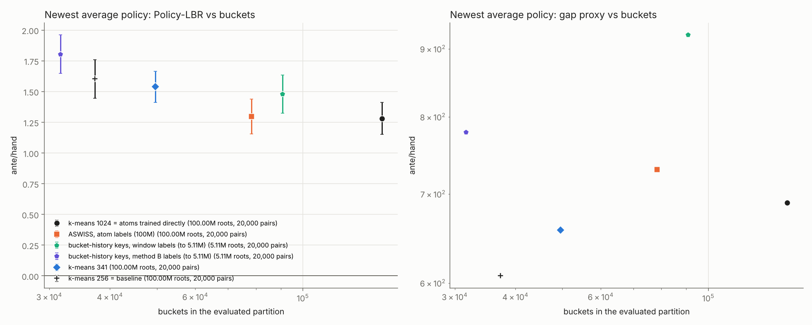

- 위 그림의 원자 ASWISS와 k-means는 노트북 100M 실행이다. 마지막 점(속이 빈 원)은 100M이고, 이력 열쇠의 마지막 점은 5.11M이다. 서로 다른 학습량이므로 마지막 점끼리 비교하지 않는다. 같은 학습량의 비교는 위 표다.
- 원자료: `results_data/runs_history_5m_summaries.tar.gz`(이력 두 실행을 epoch 8에서 자른 것과, 모든 비교군의 5.11M 20,000 pair 평가 `runs_final8/`)와 `results_data/runs_100m_s1_summaries.tar.gz`. 둘을 풀어 `runs/`에 이력 두 실행과 `runs_100m/`의 네 비교군을 함께 두고 `python plot_stud.py runs results_stud_history_overlay_seed1 --epoch-only --runs ...`로 그린다.

**해석** (seed 1 하나, 5.11M 기준)
1. **이력 열쇠 + 구간 라벨은 1.27M보다 k-means에 가까워졌다.** k-means 256, 341, 원자 ASWISS와 구별되지 않는다(1.27M에서는 k-means 341보다 유의하게 나빴다). k-means 1024보다는 아직 나쁘다(+0.26).
2. **이력 열쇠 + 방법 B는 이 학습량에서 모든 비교군보다 나쁘다.** 같은 이력 열쇠의 구간 라벨보다 +0.33, 원자 방법 B보다 +0.29다.
   - 방법 B는 분할이 적다(bucket 31,645개 대 90,814개).
   - 이력 열쇠는 나중 결정에 필요한 구분을 앞의 bucket이 먼저 나눠 줘야 한다. 그래서 분할이 적으면 한 열쇠 안의 상쇄가 남기 쉽다. mini-stud에서도 이력 열쇠 + B만 크게 나빴다(0.0896, 열쇠 안 상쇄 H 1.20).
   - 다만 원자에서도 방법 B는 5.11M에서 뒤처졌다가(+0.15) 10.23M에서 따라잡았다(+0.001). 그래서 이것만으로 판정하지 않고 100M 실행을 본다.
3. **메모리는 상한 없이 늘었다:** 이력 + 구간은 5.11M에서 최대 RSS 2.37 GB, bucket 20.3만 개(분할 후)다. 이력 + B는 0.90 GB, 7.1만 개다. 100M 실행기는 그래서 라벨 표본 상한을 쓴다.

**AGENTS.md 점검**
- k-means 256 기준선을 겹쳤다. 같은 학습량(5.11M)에서 모든 비교군을 같은 deal, LBR seed, particle 64, gap deal로 20,000 pair 평가했다. 평균 정책과 현재 정책을 나눴다.
- 그림은 서로 다른 학습량의 실행을 겹친 것이고, 마지막 점의 학습량을 범례에 적었다. 차이 칸은 두 실행 모두 평가된 학습량에서만 그린다.
- 남은 차이: 이력 비교군은 베팅 요약 대신 bucket 이력을 쓰고 9개 구조 context에서 시작한다. 방법 B 비교군은 평균 전략 순회(epoch 길이의 25%)를 더 쓴다. 학습 deal 경로는 전략이나 분할이 달라지는 순간부터 갈라진다.
- LBR은 선형 축, 근사치만 log 축이다. 교차점이나 기울기로 외삽하지 않았다.

## bucket 이력 열쇠 100M 결과 (노트북 실행, seed 1, 완료 2026-10-30)

**조건**
- 사용자가 노트북에서 `run_100m.ps1 -Arms hist_b,hist -SnapshotEvery 0`으로 돌렸다. 이전 100M 실행(원자 ASWISS, k-means 256 / 341 / 1024)과 같은 출력 폴더, 같은 학습 seed(1), 100M roots다.
  - `hist`: 이력 열쇠 + 구간 라벨이다.
  - `hist_b`: 이력 열쇠 + 방법 B 라벨이다.
  - 두 비교군 모두 카드는 street 첫 결정에서만 열쇠에 넣고, 라벨 표본 상한은 2.56M roots다.
- 학습 시간은 13.6시간(`hist`)과 14.1시간(`hist_b`)으로, 원자 비교군(13–14시간)과 비슷했다.
- 마지막 스냅숏(100M)을 기존과 같은 deal로 20,000 pair 평가했다.
- **재현 확인:** 두 실행의 5.11M 이하 평가값 8개씩이 이 환경의 실행과 완전히 같다.

| 비교군 | 평가한 분할의 bucket 수 | 평균 정책 LBR (95%) | 현재 정책 LBR (95%) | BR-gap 근사치 (평균/현재) |
|---|---:|---:|---:|---:|
| **이력 열쇠 + 구간 라벨** | 1,274,437 | **1.023 ± 0.140** | 1.096 ± 0.116 | 797 / 538 |
| **이력 열쇠 + 방법 B** | 861,446 | **1.060 ± 0.143** | **1.082 ± 0.113** | 803 / 566 |
| ASWISS (원자) | 78,397 | 1.298 ± 0.141 | 1.373 ± 0.130 | 730 / 635 |
| k-means 1024 (원자 전부) | 145,410 | 1.282 ± 0.130 | 1.481 ± 0.150 | 689 / 630 |
| k-means 341 | 49,593 | 1.539 ± 0.127 | 1.598 ± 0.135 | 658 / 613 |
| k-means 256 | 37,249 | 1.603 ± 0.156 | 1.705 ± 0.142 | 607 / 569 |

같은 deal로 짝지은 차이(95%)다.

| 비교 | 평균 정책 | 현재 정책 |
|---|---:|---:|
| 이력 + 구간 − 이력 + 방법 B | −0.037 [−0.223, +0.149] | +0.014 [−0.138, +0.166] |
| **이력 + 구간 − k-means 1024** | **−0.259 [−0.445, −0.073]** | **−0.385 [−0.567, −0.203]** |
| **이력 + 방법 B − k-means 1024** | **−0.222 [−0.409, −0.036]** | **−0.399 [−0.578, −0.220]** |
| 이력 + 구간 − ASWISS 원자 | −0.275 [−0.463, −0.087] | −0.277 [−0.453, −0.100] |
| 이력 + 방법 B − ASWISS 원자 | −0.238 [−0.429, −0.048] | −0.291 [−0.457, −0.124] |
| 이력 + 구간 − k-means 341 | −0.517 [−0.695, −0.338] | −0.502 [−0.673, −0.330] |
| 이력 + 방법 B − k-means 341 | −0.480 [−0.663, −0.297] | −0.516 [−0.683, −0.349] |
| 이력 + 구간 − k-means 256 | −0.580 [−0.782, −0.377] | −0.608 [−0.784, −0.433] |
| 이력 + 방법 B − k-means 256 | −0.543 [−0.747, −0.340] | −0.622 [−0.796, −0.448] |

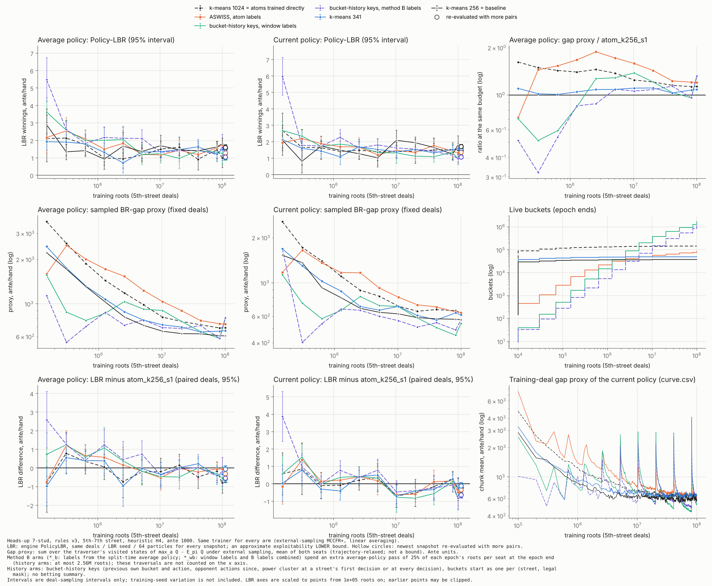

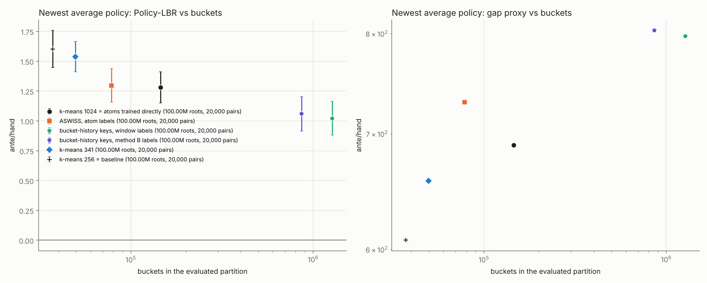

원자료: `results_data/runs_100m_s1_summaries.tar.gz`(사용자가 올린 파일, 여섯 비교군 모두). `python plot_stud.py runs_100m results_stud_100m_history_seed1 --epoch-only --baseline atom_k256_s1 --runs "atom_k1024_s1:k-means 1024 = atoms trained directly" "aswiss_k1024_z2_s1:ASWISS, atom labels" "history_street_s1:bucket-history keys, window labels" "history_b_street_s1:bucket-history keys, method B labels" "atom_k341_s1:k-means 341" "atom_k256_s1:k-means 256 = baseline"`로 다시 그린다.

**해석** (seed 1 하나)
1. **이력 열쇠 두 비교군이 모든 원자 비교군을 두 정책 모두에서 유의하게 이겼다.**
   - 원자 하나하나를 bucket으로 둔 k-means 1024보다도 −0.22 ~ −0.40 낮다. k-means 1024는 "카드 군집 × 베팅 요약" 열쇠로 낼 수 있는 가장 세밀한 추상화다. 그래서 이 차이는 원자 열쇠가 버린 정보, 즉 베팅 이력에서 온 것으로 본다.
   - "남은 오차는 원자 열쇠가 버린 베팅 이력에서 온다"는 2026-10-29의 가설과 맞는다. 베팅 요약이라는 휴리스틱을 bucket 이력으로 바꾼 것이 이득이었다.
2. **bucket 수는 맞춘 비교가 아니다.** 이력 비교군의 bucket은 86만–127만 개로 k-means 1024의 6–9배다.
   - 같은 정보를 가진 고정 추상화(카드 군집 × 전체 베팅 이력)를 같은 크기로 학습한 대조군은 아직 없다. 그래서 "더 많은 bucket"의 몫과 "bucket 이력이라는 방법"의 몫을 아직 나눌 수 없다.
   - 다만 이 bucket들은 9개 구조 context에서 시작해 라벨로만 나뉜 것이다. 미리 정한 세분 기준은 없다.
3. **방법 B("by strategy")는 따라잡았다.**
   - 5.11M에서는 구간 라벨보다 +0.33 나빴지만, 100M에서는 차이가 −0.04로 구별되지 않는다. bucket은 32% 적다(86만 대 127만 개).
   - 원자에서도 방법 B는 일찍 뒤처졌다가 따라잡았다. 덜 나누고 같은 성능에 도달한다는 점이 mini-stud, 원자 7-stud, 이력 7-stud에서 모두 같은 방향이다.
4. **분할이 아직 멈추지 않았다.** 마지막 두 epoch에도 epoch마다 24만–35만 개 bucket이 나뉘었다. bucket은 epoch마다 1.4–1.6배로 늘었다(초반에는 2.2배). 이 학습량에서 수렴했다고 볼 수 없다.
5. **비용**
   - 최종 정책 파일은 bucket 기록 146만–220만 개라 약 0.2–0.3 GB다(k-means 1024는 26 MB).
   - 학습 메모리는 학습기의 표 크기 추정으로 `hist`가 구간 창 3.7 GB + 표 1 GB, `hist_b`가 표 0.6 GB + 평균 전략 순회의 열쇠 1,670만 개 정도다. Windows에서는 최대 RSS를 재지 못해 log의 해당 열이 −1이다.
6. **평가 지표의 한계:** LBR은 exploitability의 근사 하한이고 seed가 하나다. BR-gap 근사치는 이력 비교군이 오히려 조금 크다(평균 정책 797–803 대 689–730). 앞 절들과 같이 근사치는 순위가 LBR과 달라 결론에 쓰지 않는다.

**AGENTS.md 점검**
- k-means 256 기준선을 모든 곡선에 겹쳤다. 같은 학습량에서의 짝지은 LBR 차이와 근사치 비율을 그렸고, 평균 정책과 현재 정책을 나눴다.
- 여섯 비교군 모두 같은 평가 deal, LBR seed, particle 64, gap deal, 학습 seed(1), 학습량(100M roots)을 쓴다.
- 곡선은 epoch 끝 스냅숏의 2,000 pair 평가다(95% 구간 약 ±0.75). 결론은 마지막 20,000 pair 평가에서만 냈다.
- 남은 차이
  - 이력 비교군은 베팅 요약 대신 bucket 이력을 쓰고 9개 구조 context에서 시작하며, 라벨 표본에 2.56M roots 상한이 있다.
  - `hist_b`는 epoch마다 평균 전략 순회(최대 2.56M roots)를 더 쓴다.
  - bucket 수가 6–9배 다르다.
  - 학습 deal 경로는 전략이나 분할이 달라지는 순간부터 갈라진다.
- LBR은 선형 축, 근사치만 log 축이다. 교차점이나 기울기로 외삽하지 않았다.

## 100M 결과 (노트북 실행, seed 1, 완료 2026-10-29)

**조건**
- 사용자가 Windows 노트북에서 `run_100m.ps1 -Arms aswiss,k256,k341,k1024`로 돌렸다. 4구 heuristic, 학습 seed 1, 100M roots다. 비교군당 약 13–14시간 걸렸다.
- 마지막 스냅숏(100M)을 기존과 같은 deal로 20,000 pair 평가했다. 곡선은 스냅숏마다 2,000 pair다.
- **재현 확인:** 이 실행의 10.23M 이하 모든 평가값(LBR, BR-gap 근사치)이 이 환경(Linux)의 10.23M 실행과 소수 넷째 자리까지 같다. 같은 실행을 이어 간 것으로 볼 수 있다.

| 비교군 | 평가한 분할의 bucket 수 | 평균 정책 LBR (95%) | 현재 정책 LBR (95%) | BR-gap 근사치 (평균/현재) | 10.23M 평균 정책 LBR |
|---|---:|---:|---:|---:|---:|
| **ASWISS (원자 라벨)** | 78,397 | **1.298 ± 0.141** | **1.373 ± 0.130** | 730 / 635 | 1.335 |
| k-means 256 | 37,249 | 1.603 ± 0.156 | 1.705 ± 0.142 | 607 / 570 | 1.520 |
| k-means 341 | 49,593 | 1.539 ± 0.127 | 1.598 ± 0.135 | 658 / 613 | 1.206 |
| k-means 1024 | 145,410 | 1.282 ± 0.130 | 1.481 ± 0.150 | 689 / 630 | 1.200 |

같은 deal로 짝지은 차이(95%)다.

| 비교 | 평균 정책 | 현재 정책 |
|---|---:|---:|
| **ASWISS − k-means 341** | **−0.241 [−0.415, −0.068]** | **−0.225 [−0.397, −0.054]** |
| ASWISS − k-means 256 | −0.305 [−0.501, −0.109] | −0.331 [−0.514, −0.149] |
| ASWISS − k-means 1024 | +0.016 [−0.153, +0.186] | −0.108 [−0.282, +0.065] |
| k-means 1024 − k-means 341 | −0.257 [−0.423, −0.092] | −0.117 [−0.293, +0.060] |

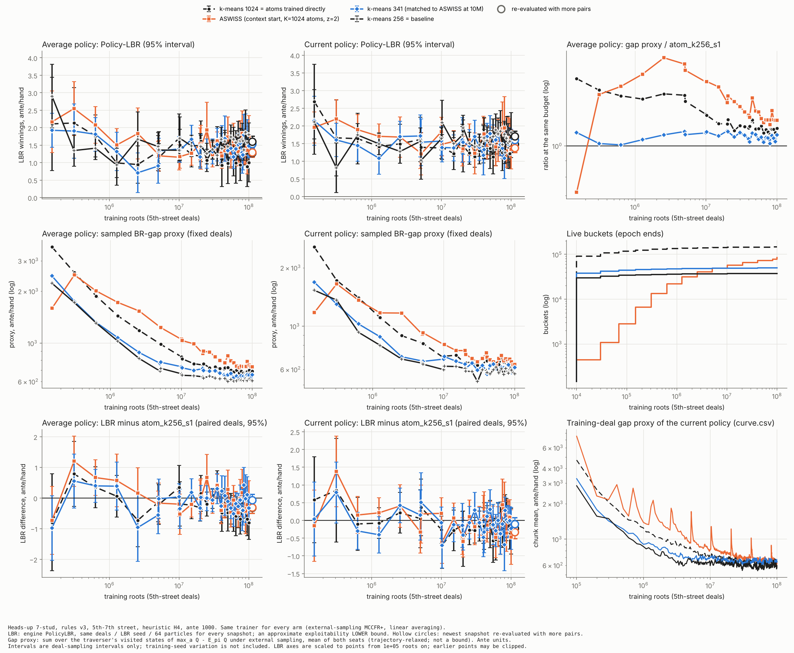

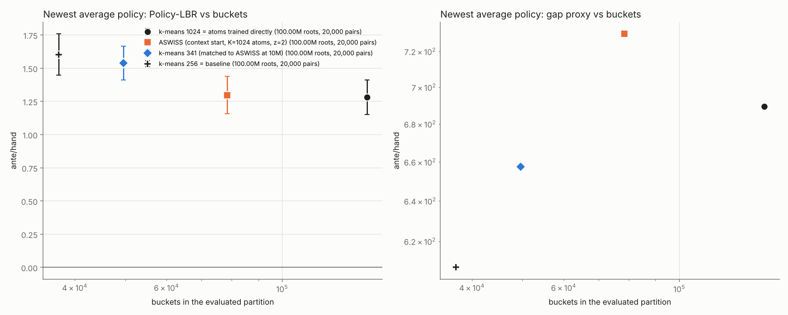

원자료: `results_data/runs_100m_s1_summaries.tar.gz`(사용자가 올린 파일). 풀면 `runs_100m/`이 나온다. `python plot_stud.py runs_100m results_stud_100m_seed1 --baseline atom_k256_s1 --runs "atom_k1024_s1:k-means 1024 = atoms trained directly" "aswiss_k1024_z2_s1:ASWISS (context start, K=1024 atoms, z=2)" "atom_k341_s1:k-means 341 (matched to ASWISS at 10M)" "atom_k256_s1:k-means 256 = baseline"`로 다시 그린다.

**해석** (seed 1 하나)
1. **100M에서 ASWISS는 k-means 1024와 같은 LBR을 bucket 54%로 냈다.** 그리고 k-means 341과 256을 두 정책 모두에서 유의하게 이겼다.
   - 다만 ASWISS의 bucket(78,397개)은 k-means 341(49,593개)의 1.6배라, bucket 수를 맞춘 비교는 아니다.
   - bucket 수 대비 LBR 그림에서 ASWISS는 k-means 341과 1024를 잇는 선보다 아래에 있다.
2. **10.23M의 "카드 해상도 포화" 결론은 100M에서 성립하지 않는다.** k-means 1024가 k-means 341보다 유의하게 낫다(평균 정책 −0.257). 10.23M에서 둘이 같았던 것은 학습량이 부족했던 탓으로 보인다.
3. **LBR은 학습량에 따라 단조롭게 줄지 않았다.**
   - k-means 341은 10.23M 1.206에서 100M 1.539로, k-means 256은 1.520에서 1.603으로 올랐다. ASWISS(1.335 → 1.298)와 k-means 1024(1.200 → 1.282)는 거의 그대로다.
   - 2,000 pair 곡선은 5M 이후 모든 비교군이 0.9–1.9 사이를 오르내린다. 점 하나의 95% 구간이 약 ±0.75라 이 흔들림은 대부분 평가 잡음이다.
   - imperfect-recall 추상화에서는 평균 정책이 균형으로 수렴한다는 보장이 없다. 그래서 학습량을 늘려도 LBR이 줄지 않는 것 자체는 이상하지 않다.
4. **seed가 하나다.** 10.23M에서 같은 비교군의 seed 간 차이가 0.04–0.18이었다. 위 차이(−0.24)는 그보다 크지만, seed 반복 없이는 확정하지 않는다.

## 메모리

**최종 정책 파일:** 스냅숏 = 현재 표 + 평균 표, 행동 8개 × double. ASWISS는 분할 지도도 포함한다.

| context | k-means 256 | k-means 341 | ASWISS | k-means 1024 |
|---:|---:|---:|---:|---:|
| 24 KB | 5.0 MB | 6.6 MB | 6.9 MB | 19.1 MB |

**프로세스 메모리** (실제 상주 메모리)
- 평가 프로세스(k-means 1024)는 138 MB다. 대부분은 카드 → 클러스터 배정 캐시(최대 100만 항목)다.
- context 학습은 14 MB다.
- 학습 전체(10.23M roots)의 최대 상주 메모리다(seed 2, 메모리 기록판).

| 실행 | 최대 메모리 | bucket 기록 | bucket 표 | 원자 구간 통계 | 분할 지도 |
|---|---:|---:|---:|---:|---:|
| ASWISS | 156 MB | 95,842 (살아 있는 것 58,097) | 26.2 MB | 24.1 MB | 2.2 MB |
| ASWISS 상속 (seed 1) | 158 MB | 78,911 | 13.1 MB | 23.4 MB | 2.0 MB |
| k-means 341 | 113 MB | 49,229 | 13.1 MB | – | 1.1 MB |
| k-means 1024 | 157 MB | 142,869 | 52.4 MB | – | 3.2 MB |

- bucket 표 MB는 vector capacity 기준이다. 나머지는 대부분 배정 캐시(최대 100만 항목)다.

**이론 문서의 한계와 일치하는 점**
- 학습 메모리는 k-means 1024와 같은 차수다. 라벨을 붙이려면 원자 통계가 필요하기 때문이다.
- 최종 정책은 k-means 1024의 약 1/2.8이다. 다만 bucket 수를 맞춘 k-means와는 크기도 성능도 비슷하다.

## AGENTS.md 점검 항목

- **k-means 기준선:** 같은 학습기로 새로 학습한 k-means 256을 모든 곡선에 겹쳐 그렸다. bucket 수를 맞춘 k-means 341도 함께 그렸다.
  - 이전에 기록된 hard256 결과(`curve_hard_10m.json`)는 이 환경에 없다. 조건도 달라서(이전 학습기, 다른 평가 seed) 겹쳐 그리지 않았다.
- **평가 조건:** 모든 비교군이 같은 평가 deal, LBR seed, particle 수, gap deal을 쓴다. 학습 seed도 같다(1).
- **남은 차이:**
  - 학습 deal 경로는 전략이 달라지는 순간부터 갈라진다.
  - k-means K=341은 ASWISS 결과를 보고 사후에 정했다.
  - ASWISS의 분할은 자기 실행의 샘플 regret으로 정해진다.
  - k-means는 카드 feature만 쓴다. 배팅 요약 key는 모든 비교군에 공통이다.
- **축과 지표:** LBR은 음수가 될 수 있어 선형 축에 그렸다. BR-gap 근사치만 log 축이다. 어느 것도 exploitability와 같은 것으로 다루지 않았다.
- **외삽:** 교차점이나 기울기로 외삽하지 않았다.

## 4구 12액션 학습 (`--h4 learn`, 완료)

4구에서 4장 중 버릴 카드 1장과 공개할 카드 1장을 고르는 결정(12액션)을 5–7구 베팅과 함께 학습한다.

- **정보 상태:** (좌석, 자기 4장). 문양 재배치에 대해 정규화한 엔진 key(`make_h4_view`)를 쓴다.
  - 카드 추상화가 없는 원 정보집합이다. 좌석당 약 1.6만 개다.
  - 12액션은 엔진의 정규 순서 (`h4_positions`, `h4_choice`)를 따른다.
- **학습 방법:** external sampling을 쓴다.
  - 상대의 버림/공개는 현재 전략에서 표본화하고, 상대의 평균 전략은 선형 가중으로 쌓는다.
  - traverser는 12가지를 모두 펼친다. 각 갈래 뒤에 같은 카드로 베팅 순회를 한다.
  - 4구 regret은 베팅 regret과 함께 순회가 끝난 뒤 RM+로 갱신한다.
  - 그래서 root 하나의 비용이 약 12–20배다. 이 환경에서 초당 약 50 roots였다.
- **4구 분할:** `--partition` 규칙을 따른다.

  | partition | 4구 표 |
  |---|---|
  | context | 좌석당 bucket 하나 |
  | atom | 4장 key마다 bucket 하나. 정확한 표이며 k-means 비교군에 해당 |
  | aswiss | 좌석당 하나에서 시작해 같은 라벨 규칙으로 분할 |

  4구에서는 원자가 곧 원 정보집합이다. 그래서 mini-stud와 같은 조건(정리 1)이 그대로 적용되는 결정이다.
- **평가:** `H4PolicyLBR`을 쓴다.
  - 이것은 `make_h4_lbr.py`가 엔진의 `PolicyLBR`에서 기계적으로 만든다. `cpp_mccfr/h4_ablation`과 같은 치환이다.
  - 상대 카드 추정(particle)의 사전확률로 학습된 4구 정책의 likelihood(24 × 확률)를 쓴다.
  - target은 자기 4구 선택을 학습된 정책에서 표본화한다.
  - LBR 공격자는 기존 heuristic 4구를 그대로 쓴다. 공격자의 12액션에 대한 BR이 아니다.
  - BR-gap 근사치는 양쪽 4구 선택을 평가 정책에서 표본화한 뒤 5–7구 베팅의 gap만 잰다.
- **검증:**
  - 학습된 4구 루트에 heuristic 선택을 넣으면 엔진의 5구 루트와 같다.
  - 4구 표가 스냅숏 저장/복원에서 보존된다.
  - 학습 전(균등) likelihood는 2(= 24/12)다.
  - 4구 모드도 SIGINT와 `kill -9` 뒤 재개한 스냅숏이 비트 단위로 같다.
  - heuristic 모드는 이전 실행과 같다(스냅숏 버전 바이트만 다름).
- **비교:** ASWISS(4구도 분할), k-means 256 / 341 / 1024(4구는 정확한 표)를 2.55M roots까지 돌렸다. 학습 seed 1, 스냅숏은 25만 roots마다 남겼다.
  - 이 환경에서 4개 병렬로 5.8시간(k-means 256)–7.7시간(ASWISS) 걸렸다.
  - 더 길게 돌리려면 `run_100m.*`에 `-H4 learn`(`H4=learn`)을 준다.

### 결과 (seed 1, 2.55M roots, 마지막 스냅숏, 20,000 pair)

| 비교군 | bucket 수 (베팅 + 4구) | 평균 정책 LBR (95%) | 현재 정책 LBR (95%) | BR-gap 근사치 (평균/현재) | 최종 정책 파일 | 최대 RSS |
|---|---:|---:|---:|---:|---:|---:|
| k-means 256 | 37,151 + 32,864 = 70,015 | 1.072 ± 0.137 | 1.153 ± 0.140 | 563 / 540 | 11.6 MB | 134 MB |
| k-means 341 | 49,451 + 32,864 = 82,315 | 1.030 ± 0.143 | 1.030 ± 0.146 | 565 / 555 | 13.2 MB | 134 MB |
| ASWISS | 46,890 + 958 = 47,848 | 1.005 ± 0.157 | 1.020 ± 0.141 | 1,067 / 798 | 7.0 MB | 169 MB |
| k-means 1024 | 144,914 + 32,864 = 177,778 | 1.079 ± 0.165 | 1.160 ± 0.159 | 707 / 639 | 26.0 MB | 170 MB |

- ASWISS의 bucket 수는 평가한 스냅숏(마지막 epoch 동안 쓴 분할)의 값이다. 마지막 epoch 끝의 분할 뒤에는 58,680 + 1,868개가 되지만, 그 분할은 학습되지 않았다.
- 4구 표: k-means 비교군은 4장 key마다 bucket 하나(좌석 합 32,864개)다. ASWISS는 좌석당 하나에서 시작해 958개까지 나뉘었다.

같은 deal로 짝지은 차이(95%)다. 음수면 앞쪽이 덜 착취당한다.

| 비교 | 평균 정책 | 현재 정책 |
|---|---:|---:|
| ASWISS − k-means 256 | −0.067 [−0.268, +0.135] | −0.133 [−0.328, +0.062] |
| ASWISS − k-means 341 | −0.025 [−0.235, +0.185] | −0.010 [−0.206, +0.185] |
| ASWISS − k-means 1024 | −0.074 [−0.299, +0.150] | −0.140 [−0.348, +0.068] |
| k-means 341 − k-means 256 | −0.042 [−0.232, +0.148] | −0.123 [−0.320, +0.075] |
| k-means 1024 − k-means 256 | +0.008 [−0.197, +0.212] | +0.007 [−0.185, +0.199] |

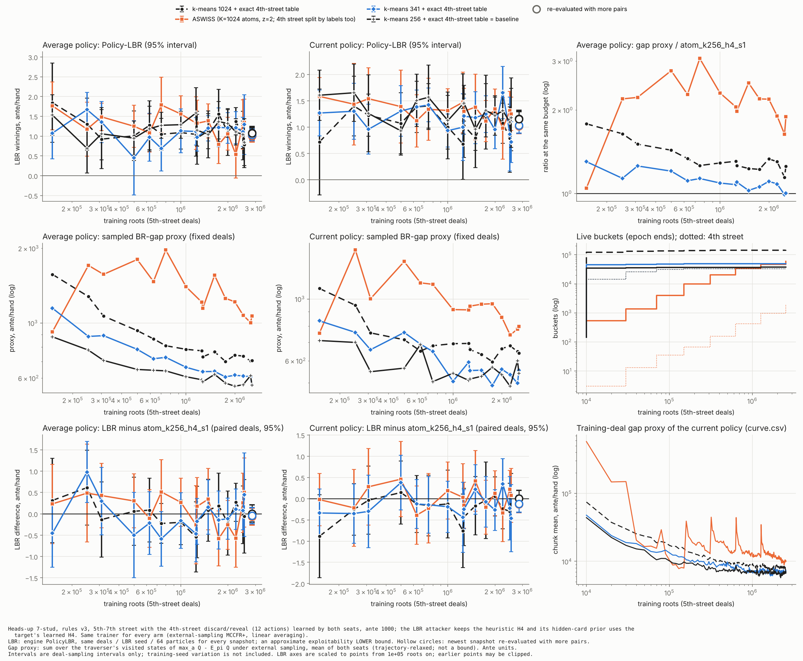

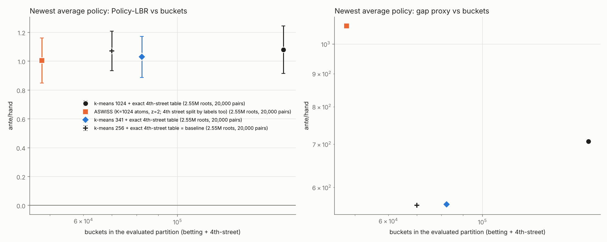

원자료: `results_data/runs_h4_summaries.tar.gz`. 풀면 `runs_h4/<비교군>/`에 같은 파일들이 나온다. 다시 그리는 명령은 다음과 같다.

```bash
python plot_stud.py runs_h4 results_stud_h4_seed1 --baseline atom_k256_h4_s1 --runs \
  "atom_k1024_h4_s1:k-means 1024 + exact 4th-street table" \
  "aswiss_k1024_z2_h4_s1:ASWISS (K=1024 atoms, z=2; 4th street split by labels too)" \
  "atom_k341_h4_s1:k-means 341 + exact 4th-street table" \
  "atom_k256_h4_s1:k-means 256 + exact 4th-street table = baseline"
```

**해석** (seed 1 하나 기준)
1. **LBR로는 네 비교군이 구별되지 않는다.**
   - 짝지은 차이 10개가 모두 0을 포함한다.
   - ASWISS의 점추정이 두 정책 모두 가장 낮지만 차이는 0.14 이하다. 앞 절에서 본 학습 seed 변동(0.04–0.18)보다 작다.
2. **ASWISS가 가장 작은 표로 같은 LBR에 도달했다.**
   - 전체 bucket 수는 k-means 256의 68%, k-means 1024의 27%다. 최종 정책 파일은 7.0 MB로 가장 작다.
   - 차이의 대부분은 4구 표다(958개 대 32,864개, 약 34배).
   - 다만 LBR은 4구 결정을 직접 공격하지 않는다. 공격자는 자기 4구 선택에서 BR을 하지 않는다. 4구 정책은 그것이 만든 손패 분포와 공격자의 카드 추정을 통해서만 평가에 반영된다. 그래서 "4구는 958개 bucket이면 충분하다"는 이 실험만으로는 확정되지 않는다.
3. **학습 메모리는 줄지 않았다.** 최대 RSS는 ASWISS 169 MB로 k-means 1024(170 MB)와 비슷하다. K=1024 원자의 판정 창을 들고 있기 때문이다. 절감은 최종 정책 크기에만 있다(앞 절과 같은 결론).
4. **BR-gap 근사치는 LBR과 다르게 ASWISS가 가장 나쁘다.**
   - 평균 정책 기준 k-means 256의 1.9배(현재 정책 1.5배)이고, 모든 측정 학습량에서 가장 크다.
   - 학습 deal의 근사치(`curve.csv`, 그림 오른쪽 아래)는 epoch 끝마다 튀어 오른다. 분할된 자식이 표를 0에서 다시 시작하는 비용이 그대로 보인다.
   - 앞 절과 같이 이 근사치는 순위가 LBR과 다르므로 결론에 쓰지 않는다. 다만 일관된 신호이므로 숨기지 않고 적는다.
5. **4구 heuristic 고정 실험(10.23M roots, LBR 1.20–1.52)과 직접 비교하지 않는다.** 게임(4구 학습 여부), 평가기(`H4PolicyLBR`), 학습량이 모두 다르다.

**AGENTS.md 점검**
- k-means 256 기준선을 모든 곡선에 겹쳤고, 같은 학습량에서의 짝지은 차이와 근사치 비율을 그렸다. 평균 정책과 현재 정책을 나눴다.
- 모든 비교군이 같은 평가 deal, LBR seed, particle 64, gap deal과 같은 학습 seed(1)를 쓴다. 학습량도 2.55M roots로 같다.
- 남은 차이: ASWISS는 K=1024 원자를 쓰고 4구도 라벨로 나눈다. k-means 비교군은 각자의 atlas와 정확한 4구 표를 쓴다. 학습 deal 경로는 전략이 달라지는 순간부터 갈라진다.
- LBR은 선형 축, 근사치만 log 축이다. 교차점이나 기울기로 외삽하지 않았다.

## 100M 실행 (중단 후 재개 가능)

`run_100m.ps1`(Windows)와 `run_100m.sh`(Linux/WSL)는 비교군을 하나씩 별도 프로세스(코어 1개)로 돌린다.
- **필요한 것:** `g++`(Windows는 MinGW-w64, C++17), Python 3 + numpy + matplotlib(평가와 그림). 저장소를 최신 main으로 받은 뒤 저장소 루트에서 실행한다.
- **처음 실행:** 실행 파일이 없으면 스크립트가 직접 빌드한다. 실행 시 MinGW DLL이 필요 없도록 완전 정적(`-static`)으로 링크한다.
  - `g++`는 다음 순서로 찾는다: `-Gxx <g++.exe 경로>` 인자, PATH, `C:\ProgramData\mingw64\mingw64\bin`, `C:\msys64\ucrt64\bin`, `C:\msys64\mingw64\bin`, `C:\mingw64\bin`.
  - 어디에도 없으면 오류 메시지와 함께 멈춘다. 그때는 `-Gxx`로 경로를 주거나 MinGW-w64를 설치한다.
- **git symlink:** 저장소에는 폴더 이전 때 남긴 git symlink가 160개 있다(`agent/*.py`, `agents/cpp_mccfr/` 등).
  - Windows의 git은 symlink 지원을 켜지 않으면 이것을 "대상 경로 한 줄짜리 텍스트 파일"로 받는다.
  - 이 실험의 빌드는 엔진이 실제 헤더(`environments/seven_stud/stud_rules.hpp`)를 직접 include하도록 고쳐서 symlink 없이도 된다(2026-10-28).
  - 프로젝트의 다른 부분까지 쓰려면 Windows 개발자 모드를 켜고, 저장소에서 아래를 한 번 실행해 symlink를 다시 받는다.
    ```powershell
    git config core.symlinks true
    git ls-files -s | Where-Object { $_ -like '120000*' } | ForEach-Object { $_.Split("`t")[1] } |
        ForEach-Object { Remove-Item -LiteralPath $_ -Force; git checkout -- $_ }
    ```
- **확인한 것 (2026-10-28):** `run_100m.sh`로 시작 → STOP으로 중단 → 같은 명령으로 재개 → 평가 → 그림까지 실제로 돌렸다. Windows용 실행 파일은 MinGW-w64 교차 컴파일로 같은 옵션의 빌드가 경고 없이 되는 것까지 확인했다. `run_100m.ps1` 자체는 이 환경에 PowerShell이 없어 실행해 보지 못했다.
- 기본 비교군은 ASWISS와 k-means 256 / 341 / 512 / 1024다.
- **방법 B 비교군 (2026-10-28 추가):** `aswiss_b`(방법 B 라벨만)와 `aswiss_wb`(기존 라벨 + 방법 B 분할의 공통 세분화)다.
  - 7-stud는 원 정보집합이 거의 반복되지 않으므로 라벨 단위는 기존 ASWISS와 같은 원자다. 그래서 이것은 "원자로 가속한 방법 B"다.
  - 평균 전략의 regret은 전체 순회가 불가능하므로, epoch 끝마다 두 좌석 모두 평균 전략으로 두는 별도 표본 순회로 추정한다. 순회 수는 epoch 길이의 25%(`--avg-frac`)다. 라벨 검정은 기존과 같은 z=2다. 학습 시간은 약 25% 늘어난다.
  - 4구 heuristic 모드에서만 쓸 수 있다(`-H4 learn`과 함께 쓰면 학습기가 멈춘다).
  - 실행 예: `-Arms aswiss_b,aswiss_wb,aswiss,k341` (Linux: `ARMS="aswiss_b aswiss_wb aswiss k341"`).
  - 확인한 것: 기본 라벨 모드는 이전 학습기와 스냅숏이 바이트 단위로 같다. `window+avg` 모드도 중단 후 재개가 끊지 않은 실행과 바이트 단위로 같다. bash 스크립트로 두 비교군을 실제로 돌렸다.
- **bucket 이력 비교군 (2026-10-29 추가):** `hist`(구간 라벨), `hist_b`(방법 B 라벨), `hist_every`(카드를 모든 결정에)다. 열쇠의 정의는 "bucket 이력 열쇠" 절에 있다.
  - **라벨 표본 상한 2.56M roots(`--label-cap 2560000`):** 이력 열쇠는 원자와 달리 개수가 포화하지 않는다(epoch마다 약 1.8배). 그래서 epoch의 라벨 계산에 쓰는 roots를 2.56M으로 묶었다.
    - 구간 라벨은 epoch의 마지막 2.56M roots만 센다. 방법 B의 평균 전략 순회는 최대 2.56M roots다.
    - 5.11M까지는 상한이 걸리지 않으므로 상한 없는 실행과 같다. 그 뒤로는 분할 검정의 문턱이 더 작아지지 않는다(이론의 "창이 계속 커진다"는 조건에서 벗어난다).
  - `hist_b`는 구간 창을 아예 두지 않는다(진단용 L/C/H 열이 0). 메모리를 반으로 줄이기 위해서다.
  - **이 환경에서 잰 메모리 (5.11M까지):** `hist` 최대 RSS 0.61 GB(1.27M) → 1.30 GB(2.55M) → 2.37 GB(5.11M), bucket 3.8만 → 9.1만 → 20.3만 개. `hist_b`는 0.51 GB(2.55M) → 0.90 GB(5.11M), bucket 3.2만 → 7.1만 개.
  - **100M 추정:** 상한 덕분에 창은 수백만 열쇠 수준에서 멈추지만, bucket은 계속 는다. `hist`는 비교군당 4–6 GB, `hist_b`는 2–3 GB 정도로 본다(외삽이라 불확실하다). 16 GB 노트북이면 두 개를 함께 돌릴 수 있다. `status`의 마지막 열(최대 RSS, MB)로 지켜보고, 넘칠 것 같으면 `stop` 했다가 하나씩 이어 돌린다.
  - **디스크:** 이력 스냅숏은 모든 bucket 기록을 담아 epoch마다 약 2배 커진다(5.11M에서 32 MB). 5M마다의 주기 스냅숏을 두면 수십 GB가 될 수 있으므로 `-SnapshotEvery 0`(epoch 끝만, 14개)을 권한다. 그림도 epoch 끝 스냅숏만 그린다.
  - **시간:** 이 환경에서 root당 약 1.1 ms였다(원자 ASWISS와 비슷). 노트북은 앞선 100M 실행 기준 약 1.8배 빠르므로 100M에 약 17–20시간으로 본다.
  - **실행 예 (이전 100M 실행과 같은 출력 폴더에 더해 겹쳐 그리기):**
    ```powershell
    git pull origin main
    $s = "agents\adaptive_buckets\aswiss\stud7\run_100m.ps1"
    powershell -ExecutionPolicy Bypass -File $s -Arms hist_b,hist -SnapshotEvery 0     # 학습 (중단 후 같은 명령으로 재개)
    powershell -ExecutionPolicy Bypass -File $s -Action status -Arms hist_b,hist       # 진행, 마지막 열이 최대 RSS(MB)
    # 끝난 뒤
    powershell -ExecutionPolicy Bypass -File $s -Action eval  -Arms hist_b,hist
    powershell -ExecutionPolicy Bypass -File $s -Action final -Arms hist_b,hist
    $a = "hist_b,hist,aswiss,k256,k341,k1024"
    powershell -ExecutionPolicy Bypass -File $s -Action plot -Arms $a                  # 이전 100M 결과와 한 그림에
    powershell -ExecutionPolicy Bypass -File $s -Action pack -Arms $a                  # 표 + 요약 묶기 (이전 결과 포함)
    ```
    `hist_wb`(구간 + 방법 B)를 더하려면 `-Arms hist_b,hist,hist_wb`로 세 개를 돌린다. 메모리가 `hist`보다 조금 더 든다.
- **다시 빌드:** 실행 파일이 소스보다 오래됐으면(예: `git pull` 뒤) `run`이 자동으로 다시 빌드한다. 학습 중인 프로세스가 실행 파일을 잡고 있으면 빌드가 실패한다. 그때는 `stop`으로 멈추고 `status`에서 모두 멈춘 것을 확인한 뒤 다시 `run` 한다(모든 비교군이 checkpoint에서 그대로 이어진다).
- k-means 341은 10M에서 맞춘 K다. 100M에서 ASWISS의 bucket 수가 어디까지 늘지 모르므로 512로 범위를 넓혀 두었다.
- atlas 네 개는 `atlas/`에 들어 있다. 모두 heuristic ε=0.2 self-play 10만 핸드, seed 37301로 만들었다.

```powershell
# 저장소 루트에서 실행
$s = "agents\adaptive_buckets\aswiss\stud7\run_100m.ps1"
powershell -ExecutionPolicy Bypass -File $s                  # 시작 (멈춘 뒤 같은 명령을 다시 실행하면 이어서 진행)
powershell -ExecutionPolicy Bypass -File $s -Action status   # 진행 상황
powershell -ExecutionPolicy Bypass -File $s -Action stop     # checkpoint 저장 후 종료
powershell -ExecutionPolicy Bypass -File $s -Action eval     # 새 스냅숏 평가 (LBR 2,000 pair, 이미 한 것은 건너뜀)
powershell -ExecutionPolicy Bypass -File $s -Action final    # 가장 최근 스냅숏, LBR 20,000 pair
powershell -ExecutionPolicy Bypass -File $s -Action plot     # 그림
powershell -ExecutionPolicy Bypass -File $s -Action pack     # 결과 요약 파일을 results_data로 묶기 (공유용)
# 옵션: -Roots 100000000 -Seed 1 -Arms aswiss,k256,k341,k512,k1024 -Workers 4 -Out <폴더> -Python python
#       -H4 learn (4구 12액션 학습) -SnapshotEvery 5000000 -CheckpointEvery 1000000 -CurveEvery 100000
```

```bash
bash agents/adaptive_buckets/aswiss/stud7/run_100m.sh run      # status | stop | eval | final | plot | pack
# 환경 변수: ROOTS SEED ARMS OUT WORKERS PYTHON H4 SNAPSHOT_EVERY CHECKPOINT_EVERY CURVE_EVERY
```

**학습이 끝난 뒤 확인하는 순서** (2026-10-29 추가)
- **모든 단계에 학습 때와 같은 `-Arms`를 준다.** 아래는 `-Arms aswiss_b,aswiss_wb,aswiss,k341`로 돌렸을 때의 예다.
  ```powershell
  git pull origin main
  $s = "agents\adaptive_buckets\aswiss\stud7\run_100m.ps1"; $a = "aswiss_b,aswiss_wb,aswiss,k341"
  powershell -ExecutionPolicy Bypass -File $s -Action status -Arms $a   # 모두 running=False, 마지막 줄 roots가 100,000,000인지
  powershell -ExecutionPolicy Bypass -File $s -Action eval   -Arms $a   # 스냅숏마다 LBR 2,000 pair (학습 곡선)
  powershell -ExecutionPolicy Bypass -File $s -Action final  -Arms $a   # 마지막 스냅숏 LBR 20,000 pair (최종 비교)
  powershell -ExecutionPolicy Bypass -File $s -Action plot   -Arms $a   # 그림
  powershell -ExecutionPolicy Bypass -File $s -Action pack   -Arms $a   # 표 출력 + 결과 요약 묶기
  ```
- **소요 시간:** 이 환경 기준으로 `eval`은 4개 비교군에 약 2시간, `final`은 약 40분이다. 노트북 성능에 따라 다르다. 중간에 끊겨도 다시 실행하면 이미 평가한 스냅숏은 건너뛴다.
- **결과 보는 곳:** 기본 출력 폴더는 `agents\adaptive_buckets\aswiss\stud7\data\runs_100m`이다.
  - 그림은 `results_s1_curves.png`(학습 곡선, 기준선 대비 짝지은 차이)와 `results_s1_frontier.png`(bucket 수 대비 LBR)다.
  - 같은 출력 폴더에 있는 비교군은 `-Arms`에 함께 적으면 한 그림에 겹쳐 그려진다(예: 이전 100M 실행에 새 비교군을 더하기).
  - 2026-10-29부터 선이 가늘고(`plot_stud.py --lw`, 기본 1.1), `plot`은 epoch 끝 스냅숏만 그린다(`--epoch-only`). 5M마다의 스냅숏까지 모두 보려면 `python plot_stud.py <출력 폴더> <접두어> --runs ...`를 `--epoch-only` 없이 직접 실행한다.
  - 기준선은 실행한 비교군 중 첫 k-means다(k256이 있으면 k256, 없으면 k341). 학습하지 않은 비교군은 평가와 그림에서 건너뛰고, 그 사실을 화면과 그림 주석에 적는다.
  - `pack`은 비교군별 학습량, 평가한 분할의 bucket 수, 최종 LBR(평균/현재 정책, 95%)을 표로 출력한다.
- **공유:** `pack`이 만드는 `results_data\runs_100m_s1_summaries.tar.gz`(수 MB)에는 스냅숏과 checkpoint가 빠져 있다. 이 파일만 커밋해 push하면 다른 곳에서 같은 그림과 짝지은 비교를 다시 계산할 수 있다.
  ```powershell
  git add agents\adaptive_buckets\aswiss\stud7\results_data\runs_100m_s1_summaries.tar.gz
  git commit -m "Add 7-stud 100M run summaries"; git push origin main
  ```
  `data\` 폴더는 `.gitignore` 대상이라 스냅숏(약 1.5 GB)이 실수로 올라가지 않는다.
- **확인한 것:** bash 판(`run_100m.sh`)으로 `eval`, `final`, `plot`, `pack`을 10.23M 결과를 복사한 폴더에서 실제로 돌렸다. 학습하지 않은 비교군을 넣어도 멈추지 않았고, 묶은 파일을 풀어 다시 그릴 수 있었다. PowerShell 판은 이 환경에 PowerShell이 없어 실행해 보지 못했다.

**중단과 재개**
- **checkpoint 저장 시점:** 다음 네 경우에 학습 상태 전체를 `checkpoint.bin`에 원자적으로 저장한다.
  - 1M roots마다
  - epoch 끝마다
  - Ctrl+C나 종료 신호를 받았을 때
  - 출력 폴더에 `STOP` 파일이 생겼을 때 (`-Action stop`이 만든다)
- **저장 내용:** bucket 표, 분할 지도, 원자 구간 통계, 두 RNG 상태, 출력 파일 길이다.
- **재개:** 같은 명령을 다시 실행하면 checkpoint 이후 출력 줄을 잘라 내고 그 시점부터 이어 간다.
- **재현성 확인:** SIGINT, `kill -9`, STOP으로 끊고 이어 간 실행의 스냅숏이 끊지 않은 실행과 비트 단위로 같았다. 끊지 않은 실행은 10M 원래 실행의 스냅숏과도 같았다.
- **강제 종료:** 작업 관리자 강제 종료나 정전이면 마지막 checkpoint 이후(최대 1M roots)만 다시 계산한다.
- **이미 끝난 비교군:** 다시 실행해도 바로 끝난다.
- **실행 중인 비교군:** `.pid`로 확인해 건너뛴다.
- **학습량 늘리기:** `--roots`를 늘려 재개할 수 있다. 다만 마지막 epoch가 잘린 지점에서 이미 분할했다면, 처음부터 더 길게 돌린 실행과 epoch 경계가 다르다.

**저장되는 그래프용 자료** (비교군 폴더마다)

| 파일 | 내용 |
|---|---|
| `log.csv` | epoch마다: bucket 수(street별), 분할 수, 원자 수, 샘플 L/C/H, 시간, 메모리(최대 RSS, 표 크기) |
| `curve.csv` | 10만 roots마다: 학습 deal에서 잰 현재 정책의 샘플 BR-gap 근사치(평균, 표준오차), bucket 수, 최대 RSS. 학습 순회의 부산물이라 추가 계산이 없다 |
| `snapshots.csv`, `snapshot_*.bin` | epoch 끝과 500만 roots마다의 정책 스냅숏(현재 표 + 평균 표 + 분할) |
| `eval.jsonl`, `lbr_pairs_*.csv` | `eval`/`final` 결과. 스냅숏 × 평균/현재 정책의 LBR(평균, 표준오차)과 BR-gap 근사치, 그리고 pair별 원자료(짝지은 차이 계산용) |
| `results_s1_*.png` (12액션은 `results_h4_s1_*.png`) | `plot`이 그리는 그림: LBR과 근사치 학습 곡선, k-means 256 대비 차이와 비율, bucket 수, `curve.csv` 곡선, bucket 수 대비 LBR |

**규모 추정** (이 환경 기준: 4개 병렬, 10M에 2–2.5시간)
- **시간:** 100M에 비교군당 약 22–25시간이다. 평가는 2,000 pair에 약 2분, 20,000 pair에 약 20분이다.
  - `-H4 learn`(12액션)은 root 하나가 약 12–20배 비싸다. 2.55M에 5.8–7.7시간 걸렸으므로 100M이면 비교군당 약 10–13일이다. 12액션은 `-Roots 20000000`(약 2–2.5일)처럼 줄이거나 `-Arms`로 비교군을 줄이는 것을 권한다.
  - 비교군 수가 코어 수보다 많으면 서로 느려진다. 코어가 4개면 `-Arms aswiss,k256,k341,k1024`처럼 4개로 줄인다.
- **디스크:** 스냅숏이 비교군당 약 27개라 전체 약 1.5 GB다(k-means 1024는 개당 약 20 MB). checkpoint는 비교군당 수십 MB이고 덮어쓴다.
- **메모리:** 비교군당 약 110–160 MB(10M 측정값)다. 100M에서는 bucket 기록이 늘어나는 만큼 조금 커진다.

## 실행

```bash
g++ -O3 -std=c++17 aswiss_stud.cpp -o aswiss_stud
./aswiss_stud self-test --atlas ATLAS_K1024
./aswiss_stud train --partition aswiss --atlas ATLAS_K1024 --roots 10230000 --z 2 --seed 1 --out runs/aswiss_k1024_z2_s1
./aswiss_stud train --partition atom --atlas ATLAS_K --roots 10230000 --seed 1 --out runs/atom_kK_s1
./aswiss_stud train --partition context --roots 10230000 --seed 1 --out runs/context_s1
python evaluate.py ./aswiss_stud runs --runs aswiss_k1024_z2_s1:aswiss:ATLAS_K1024 atom_k256_s1:atom:ATLAS_K256 ...
python evaluate.py ./aswiss_stud runs --runs ... --epochs 9 --pairs 20000 --tag final
python plot_stud.py runs results_stud_seed1
```

atlas는 엔진으로 만든다. 예:

```bash
stud_mccfr --bucket power --fit-hands 100000 --clusters K --power-samples 128 --fit-sample-cap 50000 \
  --fit-policy-epsilon 0.2 --save-atlas ATLAS --start-street 5 --algorithm mccfr --ante 1000 \
  --hands 2 --iterations 0 --seed 37301
```

**실행 시간:** 4개 병렬 기준으로 원자 기반 학습은 비교군당 약 2–2.5시간, context는 약 5.5시간이었다. 평가는 2,000 pair에 약 2분, 20,000 pair에 약 20분이었다.
