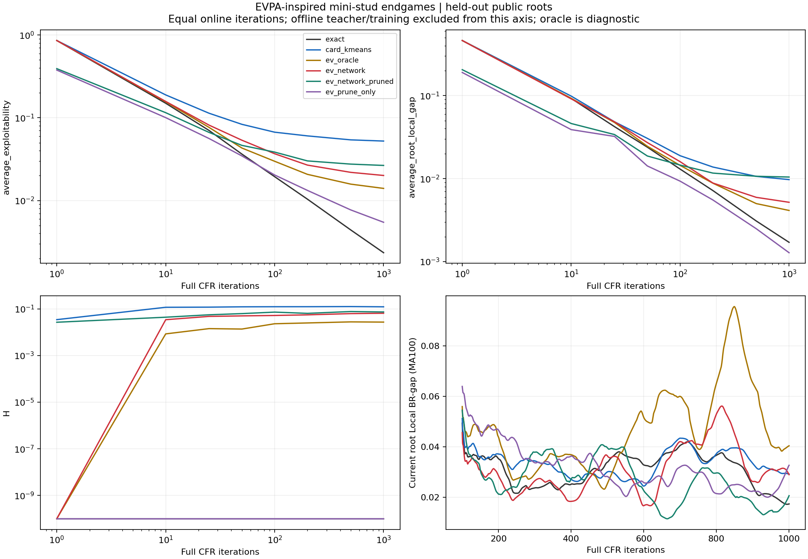
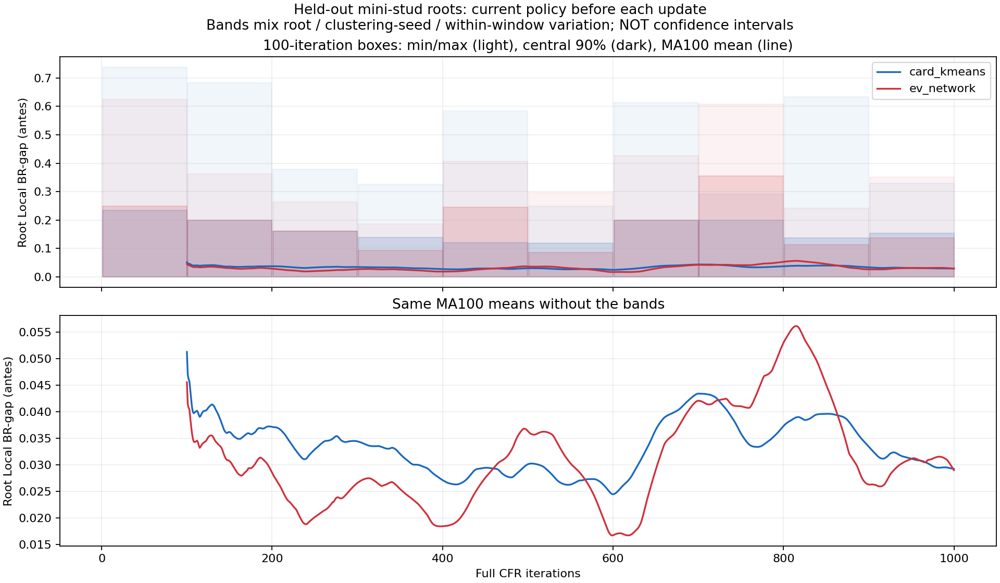

# EVPA-inspired mini-stud pilot results

This is a component pilot, not the full EVPA paper reproduction or a 52-card seven-stud result.

- Public-root split: 36 train / 12 validation / 12 test; seed 17.
- Teacher: 3000 full signed CFR iterations per root. Online: 1000 iterations per case; K=4 per player.
- Models: 10 independently initialized 64x64 MLPs; 1500 optimizer steps each.
- Prefix policy is forced CHECK with H4 discard/reveal. Test roots are equally weighted, not whole-game on-policy reach-weighted.
- Each learned/pruned evaluation uses a frozen network; test teacher values are diagnostic/oracle-only.

## Final measurements

All losses are in antes; lower is better. Average and current policies are separate.

| Arm | Average exploitability | Current exploitability | Average root gap | Rows | Kept actions |
|---|---:|---:|---:|---:|---:|
| exact | 0.002342 | 0.036745 | 0.001709 | 56.8 | 100.0% |
| card_kmeans | 0.052357 | 0.083108 | 0.009729 | 38.3 | 100.0% |
| ev_oracle | 0.014021 | 0.056170 | 0.004138 | 37.0 | 100.0% |
| ev_network | 0.020095 | 0.041360 | 0.005189 | 38.3 | 100.0% |
| ev_network_pruned | 0.026572 | 0.056292 | 0.010454 | 38.3 | 76.3% |
| ev_prune_only | 0.005463 | 0.055543 | 0.001281 | 56.8 | 75.1% |

## Paired differences

Difference = arm minus matched card k-means. Intervals resample test roots after averaging clustering seeds.
They do not include training-split or neural-training variation and are exploratory, not full-game guarantees.

| Arm | Difference | 95% paired bootstrap interval | Better roots |
|---|---:|---|---:|
| exact | -0.050014 | [-0.110457, -0.007915] | 5/12 |
| card_kmeans | +0.000000 | [+0.000000, +0.000000] | 0/12 |
| ev_oracle | -0.038336 | [-0.086725, -0.005797] | 5/12 |
| ev_network | -0.032262 | [-0.078770, -0.004549] | 5/12 |
| ev_network_pruned | -0.025785 | [-0.073598, +0.002877] | 7/12 |
| ev_prune_only | -0.046894 | [-0.107884, -0.004036] | 8/12 |

## Prediction and pruning audit

- train: EV RMSE=0.071426 pot units, MAE=0.036940; fraction inside ensemble min/max=85.8% (not a confidence interval).
- validation: EV RMSE=0.141881 pot units, MAE=0.078859; fraction inside ensemble min/max=81.0% (not a confidence interval).
- test: EV RMSE=0.162941 pot units, MAE=0.095402; fraction inside ensemble min/max=78.5% (not a confidence interval).
- ev_network_pruned: reference-best action excluded at 0.6% of original infosets (tolerance 0.01 root pots; finite teacher reference).
- ev_prune_only: reference-best action excluded at 1.2% of original infosets (tolerance 0.01 root pots; finite teacher reference).
- Held-out teacher exploitability: mean=0.000874, max=0.001506 antes. Labels are not exact Nash values.

## Costs and limitations

- Teacher/root/label phase: 102.85 s; network fitting/checkpoint phase: 17.04 s; full pilot elapsed: 234.23 s.
- EV inference checkpoint: 0.453 MiB; offline label archive: 0.276 MiB.
- Learning curves match ONLINE iterations only. Teacher and network costs must be amortized or charged separately for an efficiency comparison.
- Pruning masks restrict policies, but the pilot still computes the full matrix tree. No pruning speedup is claimed.
- Full original actions remain available to the exact BR evaluator. Bucket-legal masks are conservative unions, unlike a verbatim EVPA implementation.
- Extra original-type raw-regret arrays are diagnostic storage, not compressed policy storage. Maps, masks, joint matrices and networks also consume memory.
- Root gap is a one-decision deviation at the first actor, not exploitability or an LBR match. L/C/H are diagnostics, not exploitability lower bounds.

## Artifacts

`online_gap.csv` contains every iteration's pre-update root gap. `metrics.csv` contains exact checkpoint metrics.
`ev_models.pt` and `policy_root*.npz` are inference exports, not resumable optimizer/experiment checkpoints.
See [configuration and executable command](../../README.md).

The 100-iteration boxes show min/max and central 90% across held-out roots, clustering seeds and iterations within each box; lines are MA100 means, not confidence intervals.
